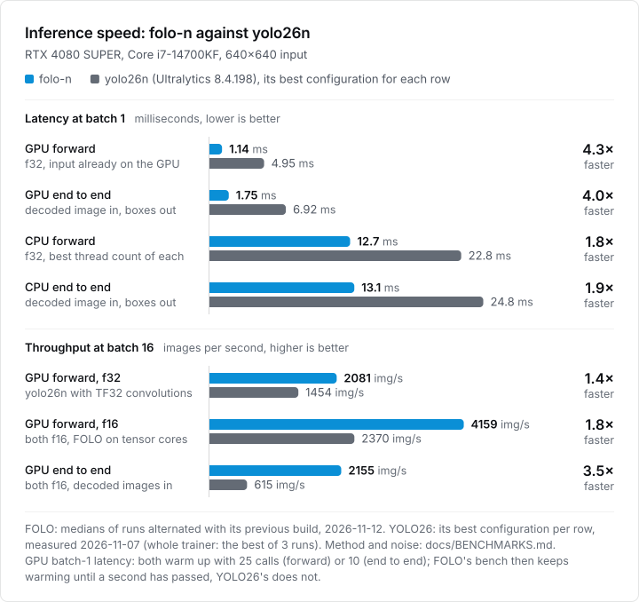
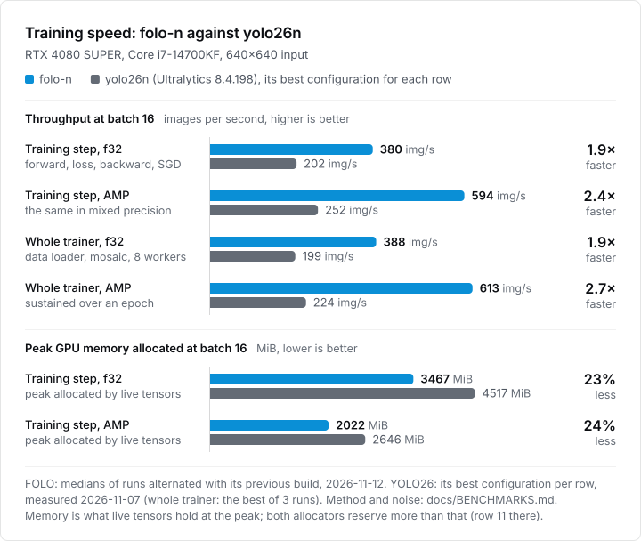
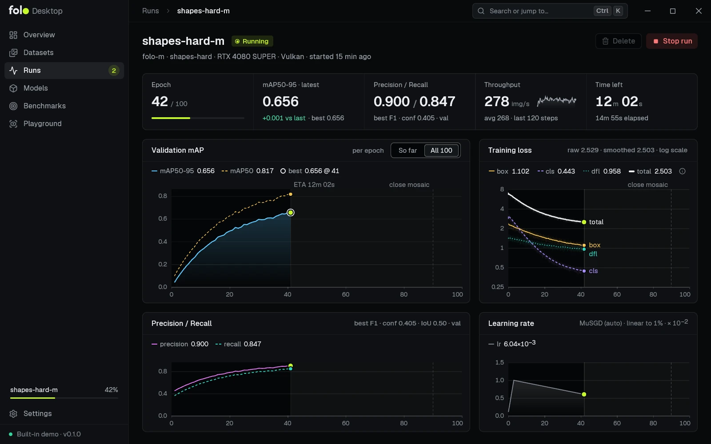
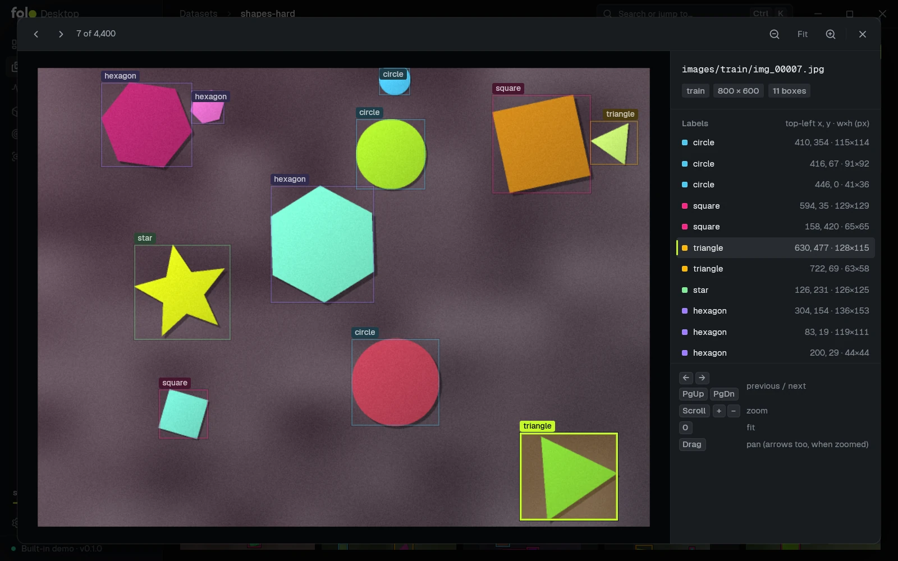

<p align="center">
  <picture>
    <source media="(prefers-color-scheme: dark)" srcset="design/logo-wordmark.svg">
    
  </picture>
</p>

# FOLO

**FOLO Only Looks Once.** A from-scratch, real-time vision framework in Rust: train, evaluate, benchmark, and run
YOLO-style object detectors from one native binary — with custom tensors, autograd, CPU/GPU kernels, a web Studio,
a native Desktop app, and first-class agent tooling.

- **One binary, no Python or CUDA stack.** `folo train`, `val`, `predict`, `export`, `serve`, and `mcp` all run on
  FOLO's own Rust engine and WGSL GPU kernels (`wgpu`). Any Vulkan, DX12, or Metal GPU that meets wgpu's compute
  limits works out of the box (`folo doctor` shows which adapter FOLO picks).
- **End-to-end computer vision.** Go from raw unlabeled photos to a deployed detector in one place: label images with
  coding agents, train locally or on rented cloud GPUs, validate with pycocotools-exact mAP, stress-test models with
  vision benchmarks, and export to `.folo` or ONNX.
- **Built for agents.** Every command accepts `--json` with stable exit codes and structured error hints,
  `folo describe --json` exposes the entire CLI and MCP schema surface, and `folo mcp` gives Claude Code, Codex,
  Antigravity, Devin, or any MCP client 40 tools.
- **Runs in the browser.** The same Rust detector compiles to WebAssembly and runs directly in the page on WebGPU or
  wasm CPU (about 14 ms for `folo-n` at 640×640 in Chrome).

> **Status: early (v0.1).** The detector trains and runs on CPU and GPU, and COCO-pretrained weights are published
> (`folo weights pull folo-s-coco`). FOLO is faster than the incumbent on every benchmark row below and is not yet as
> accurate on COCO; interfaces may still change. See [Project status](#project-status).

**[Install it and train a first model](#quickstart)** · **[See the benchmarks](#why-folo-the-numbers)** ·
**[Explore Studio](#folo-studio)** · **[Drive FOLO from an agent](#use-folo-from-an-agent)**

## What FOLO is

Most object-detection stacks glue together Python, PyTorch, CUDA toolkits, separate labeling apps, training dashboards,
and a different runtime for inference or browser demos. FOLO builds the whole stack from scratch in Rust and ships it
as one coherent tool:

1. **Prepare & label data.** Point FOLO at an existing YOLO or COCO folder (including Roboflow exports), generate
   synthetic training data (`folo dataset synth`), inspect label issues, or hand unlabeled images to a coding agent to
   propose boxes for human review ([docs/LABELING.md](docs/LABELING.md)).
2. **Train anywhere.** Train any of the five YOLO11-class detector sizes (`folo-n`, `folo-s`, `folo-m`, `folo-l`,
   `folo-x`) from scratch or fine-tune from COCO weights — on your local GPU/CPU or on a rented cloud GPU
   ([docs/CLOUD.md](docs/CLOUD.md)) — with deterministic data loading, bit-exact resume, EMA, mixed precision (`--amp`),
   and an optional NMS-free head (`--head o2o`).
3. **Evaluate & stress-test.** Score models with pycocotools-exact mAP (`folo val`), or freeze a set of your own
   labeled images into a five-axis vision benchmark with synthetic stress conditions like haze, blur, low light, and
   distance ([docs/BENCH.md](docs/BENCH.md)).
4. **Drive visually or programmatically.** Follow live runs and test models interactively in **FOLO Studio** (browser)
   or **FOLO Desktop** (native), automate pipelines with `folo ... --json`, or connect an AI agent through `folo mcp`.
5. **Deploy anywhere.** Run native GPU/CPU inference (`folo predict`), export to `.folo` (safetensors-compatible) or
   ONNX (`folo export`), or ship detection straight inside a web page with WebGPU (`folo-wasm`).

Every piece of the ML stack — tensors, autograd, CPU SIMD-friendly kernels, WGSL GPU shaders, layers, optimizers,
losses, assigners, NMS, metrics, and augmentation — lives in this repository with no external ML framework dependency
([docs/MODEL.md](docs/MODEL.md), [docs/ARCHITECTURE.md](docs/ARCHITECTURE.md)).

## Why FOLO: the numbers

Below is `folo-n` measured against Ultralytics **yolo26n** (8.4.198, torch 2.11 + CUDA 12.8) on the same machine: an
RTX 4080 SUPER and an i7-14700KF, both at 640×640. FOLO computes in strict f32 (no TF32, no tensor cores) unless a row
explicitly says f16 or AMP, and performs about 19% more FLOPs per image (6.54 vs 5.5 GFLOPs). Each `yolo26n` bar uses
its best configuration for that row. Every number comes from [docs/BENCHMARKS.md](docs/BENCHMARKS.md), which covers
the method, raw results, and expected variance.

<p align="center">
  <picture>
    <source media="(prefers-color-scheme: dark)" srcset="docs/img/charts/speed-inference-dark.svg">
    
  </picture>
</p>

<p align="center">
  <picture>
    <source media="(prefers-color-scheme: dark)" srcset="docs/img/charts/speed-training-dark.svg">
    
  </picture>
</p>

<details>
<summary>The same numbers as a table</summary>

| metric | folo-n | yolo26n (best configuration) | |
|---|---:|---:|---|
| GPU forward, batch 1, f32 (median latency) | **1.09 ms** | 4.95 ms (6.04 ms at its defaults) | FOLO 4.5× faster |
| GPU end to end, batch 1 (decoded image in, boxes out) | **1.60 ms** | 6.92 ms | FOLO 4.3× faster |
| CPU forward, batch 1, f32 | **12.7 ms** (28 threads) | 22.8 ms (8 threads) | FOLO 1.8× faster |
| CPU end to end, batch 1 | **13.6 ms** (28 threads) | 24.8 ms | FOLO 1.8× faster |
| GPU forward, batch 16, f32 (throughput) | **2081 img/s** | 1454 img/s (TF32) | FOLO 1.4× faster |
| GPU forward, batch 16, f16 (tensor cores) | **4159 img/s** | 2370 img/s (fp16) | FOLO 1.8× faster |
| GPU end to end, batch 16, f16 (tensor cores) | **2428 img/s** | 615 img/s (fp16) | FOLO 3.9× faster |
| Training step, batch 16 (forward, loss, backward, SGD) | **380 img/s** (f32) / **594 img/s** (AMP) | 202 img/s (fp32 with TF32) / 252 img/s (AMP) | FOLO 1.9× / 2.4× faster |
| Whole trainer, sustained (data loader, mosaic, 8 workers) | **388 img/s** (f32) / **613 img/s** (AMP) | 199 / 224 img/s | FOLO 1.9× / 2.7× faster |
| Training step peak GPU memory allocated, batch 16 | **3467 MiB** (f32) / **2022 MiB** (AMP) | 4517 / 2646 MiB | FOLO allocates 23% / 24% less |

</details>

FOLO's numbers were measured on `main`, alternated run by run with the build before it: on 2026-11-13 for the GPU
batch-1 and end-to-end rows (the end-to-end rows with the published COCO weights, which find objects, on the first 16
val2017 images), and on 2026-11-12 for the rest; `yolo26n`'s were measured on 2026-11-07 at its best configuration for
each row. The GPU batch-1 latency warm-ups differ: both make the same calls first (25, or 10 end to end), and FOLO's
bench then keeps warming until a second has passed. `folo-s` beats `yolo26s` on every row measured for it as well
([the chart by model size](docs/BENCHMARKS.md#summary)); its whole-trainer row was not measured.

### Accuracy

Speed only counts at comparable accuracy, and on full COCO FOLO is not there yet. Trained on COCO alone from random
weights, `folo-n` reaches AP 0.370 on val2017 after 128 epochs, 96 of them distilled from `folo-s` (`folo-n-coco-v5`:
`folo-n-coco-v4`, 0.356 after 64 epochs, continued for 64 more with the teacher) and `folo-s` reaches 0.416 after 56;
the opt-in box fusion (`--fusion dfl --iou 0.65 --max-det 1000`) adds 0.002–0.004 AP to each. Ultralytics publishes
0.409 for `yolo26n` and 0.480 for `yolo26s`, from models pretrained on Objects365 and then trained on COCO for far
longer (245 epochs for `yolo26n`). That is not like for like, and a full COCO comparison at an equal budget has not
been run yet. Two things have been measured at an equal budget:

- **Per epoch, the two trainers learn equally well.** On a 20,000-image COCO subset at 320 px, 20 epochs from scratch,
  FOLO's trainer with `folo-n` and Ultralytics' with YOLO11n reach the same AP with the same optimizer (SGD 0.086 vs
  0.085, MuSGD 0.113–0.116 vs 0.113). What causes the remaining gap on full COCO has not been measured.
- **Fine-tuned on small datasets, `folo-n` and `yolo26n` are level on three of four.** Each starts from its own COCO
  weights (`folo-n` from `folo-n-coco-v2`) and trains 100 epochs at its defaults; one scorer (pycocotools) grades both.

<p align="center">
  <picture>
    <source media="(prefers-color-scheme: dark)" srcset="docs/img/charts/accuracy-dark.svg">
    
  </picture>
</p>

The training runs, per-epoch curves, and published weights are in [examples/coco](examples/coco/README.md); the
fine-tuning harness is in [bench/finetune](bench/finetune/README.md).

## Quickstart

### Install

Releases ship `folo` for x86_64 Windows and Linux (glibc 2.35 or newer) with Studio embedded, so `folo serve` works
out of the box, plus FOLO Desktop for Windows and the browser module (`folo-wasm.tar.gz`). You need a GPU with
Vulkan, DX12, or Metal to train at speed; without one, `--device auto` falls back to the CPU, which is much slower.

```sh
curl -fsSL https://github.com/himent12/folo/releases/latest/download/install.sh | sh      # Linux: folo into ~/.local/bin
```

```powershell
irm https://github.com/himent12/folo/releases/latest/download/install.ps1 | iex            # Windows: folo, added to PATH
```

The scripts download the archive for your platform, verify its SHA-256, and install `folo`. To install FOLO Desktop
as well on Windows, save `install.ps1` and run `powershell -ExecutionPolicy Bypass -File install.ps1 -Desktop`. Both
scripts also live in the repo (`scripts/install.sh`, `scripts\install.ps1`) and accept a version, folder, and mirror
([docs/RELEASE.md](docs/RELEASE.md)). To install manually, download `folo-<target>.zip` / `.tar.gz` and its `.sha256`
from [Releases](https://github.com/himent12/folo/releases) and put the binary on your `PATH`. There is no prebuilt
macOS binary yet: on a Mac, build from source below.

### First model

Generate a tiny synthetic dataset, train a `folo-n` detector, and run predictions in four commands:

```sh
folo doctor                                                              # check which GPU FOLO picks
folo dataset synth datasets/shapes --images 1000 --imgsz 320             # generate a labelled YOLO dataset (~1 s)
folo train --data datasets/shapes --model folo-n --imgsz 320 --epochs 30 # ~1.5 min on a modern GPU
folo predict --model runs/shapes-n/weights/best.folo datasets/shapes/images/val --save runs/shapes-n/pred
```

`train` prints one row per epoch and writes `runs/shapes-n/` containing `weights/best.folo`, `weights/last.folo`, and
`metrics.jsonl`. On an RTX 4080 SUPER this run finishes at mAP50 0.955 / mAP50-95 0.823 in 83 s. `predict --save`
writes copies of the validation images with predicted boxes drawn on them.

To inspect the model in Studio, copy the weights into your FOLO models directory and open `http://127.0.0.1:7878`:

```sh
mkdir -p ~/.folo/models && cp runs/shapes-n/weights/best.folo ~/.folo/models/shapes-n.folo
folo serve                                                               # or `folo serve --mock` for demo data
```

`folo serve` stores datasets, runs, and models in its data dir (`--data-dir`, default `$FOLO_HOME` or `~/.folo`) and
discovers every `.folo` file under `<data dir>/models/`, so the copy above makes your trained model immediately
available in the Playground.

**[docs/QUICKSTART.md](docs/QUICKSTART.md)** walks through the rest: training on your own YOLO or COCO folder,
fine-tuning from COCO weights, evaluation, ONNX export, and running models in the browser.

### Build from source

You need Rust (stable). `cargo folo` is an alias for `cargo run --release -p folo-cli --`, so every command above
works as `cargo folo ...` from a checkout (the first build takes a few minutes). Studio's web frontend is a separate
build:

```sh
git clone https://github.com/himent12/folo && cd folo
cargo folo doctor
(cd web && npm ci && npm run build)       # build Studio once; cargo folo serve then serves web/dist
cargo folo serve --mock
```

To install `folo` onto your `PATH`: `cargo install --path crates/folo-cli` (add `--features embed-web` after building
`web/` to embed Studio inside the binary, just like the release builds). [docs/RELEASE.md](docs/RELEASE.md) documents
the full release build including the in-browser wasm module.

## FOLO Studio


`folo serve` hosts Studio at `http://127.0.0.1:7878` (built on FOLO's own TypeScript UI framework and design system).
Alongside an overview and settings, Studio gives you five focused workspaces:
- **Datasets**: register a YOLO or COCO folder or generate a synthetic one, browse images with their ground-truth
  boxes, and inspect class balance, box-size histograms, and label issues. No labels yet? **Label images** sends
  unlabeled images to Claude Code, Codex or Antigravity on your machine, shows every proposed box for review and correction, and
  exports a clean dataset ([docs/LABELING.md](docs/LABELING.md)).
- **Runs**: launch a training run, follow live metrics over SSE alongside validation samples, per-class mAP, and logs,
  stop or resume bit-exactly, and compare runs side by side. **Run on** trains on a GPU rented from RunPod for the
  duration of the run, or on another FOLO server of yours, showing the upfront price and live spend
  ([docs/CLOUD.md](docs/CLOUD.md)).
- **Models**: inspect evaluation results, per-class precision/recall curves, and export weights.
- **Benchmarks**: freeze a set of labeled images into a vision benchmark with a plan of stress conditions (haze, low
  light, blur, distance, ...), and score any vision model on it — a FOLO model, Claude Code, Codex or Antigravity inspecting the
  images, or predictions produced elsewhere. Every entry is graded across five axes (accuracy, robustness,
  self-labeling, calibration, localization), and a self-improvement loop tests whether a model's own labels can train
  its successor ([docs/BENCH.md](docs/BENCH.md)).
- **Playground**: run a model on any image, either on the server or **directly in the browser** (WebGPU or wasm CPU).
  Confidence and IoU thresholds re-filter boxes instantaneously. In-browser backends require the wasm module
  (`sh scripts/build-wasm.sh`) built before Studio.


`folo serve --mock` serves deterministic demo data, which is what these screenshots show. For frontend development,
run `npm run dev` in `web/` to start Vite on `:5173` with `/api` proxied to `folo serve`. See
[web/README.md](web/README.md).

## FOLO Desktop



The same design system and main screens as Studio (Overview, Datasets, Runs, Models, Benchmarks, Playground and
Settings), built natively in Rust on `folo-ui` (FOLO's own UI framework); agent labeling, run compare, benchmark
compare and importing external predictions stay in Studio. The UI
renders on the CPU so your GPU stays completely free for training and inference. It includes a command palette, full
keyboard navigation, and dark/light/custom themes, and talks to a local `folo serve` over the same HTTP API. If no
server answers on `$FOLO_SERVER` (default `http://127.0.0.1:7878`), Desktop starts a local `folo serve` automatically
(data dir `$FOLO_HOME` or `~/.folo`). Pass `--server` to point at a remote server, or `--mock` (or Settings ›
Connection) to explore with built-in demo data.

```powershell
cd apps/desktop
cargo run --release                                   # attaches to a running folo serve, or starts one locally
cargo run --release -- --server http://127.0.0.1:7878 # connects to a specific server
```



Desktop lives in its own cargo workspace (the app and `folo-ui`), so engine builds and core CI do not compile it. See
[apps/desktop/README.md](apps/desktop/README.md).

## Use FOLO from an agent

**MCP.** `folo mcp` is a [Model Context Protocol](https://modelcontextprotocol.io) server over stdio (MCP 2026-07-28
and 2025-11-25). It exposes 40 tools covering the full vision lifecycle: build, register, and check datasets; label
images with a coding agent and review boxes; train locally or on a cloud GPU; follow, stop, reorder, and resume runs;
evaluate, predict, export, compare runs; stress-test models on vision benchmarks; and manage cloud connections and
instances. It also serves `folo://`
resources (dataset images, live run status and metrics, validation sample grids, and docs) plus three prompts, running
against the real engine in `--data-dir` (default `$FOLO_HOME` or `~/.folo`).

```sh
claude mcp add folo -- folo mcp                 # Claude Code
codex mcp add folo -- folo mcp                  # Codex
```

Or add it to `.mcp.json` (`claude_desktop_config.json` for Claude Desktop):

```json
{ "mcpServers": { "folo": { "command": "folo", "args": ["mcp"] } } }
```

From a source checkout without an installed `folo`, use `"command": "cargo", "args": ["run", "-q", "--release", "-p",
"folo-cli", "--", "mcp"]`. Useful flags:
- `--device auto|cpu|gpu:<n>`: choose where embedded inference and `val` run (always `f32`; `--tensor-cores` asks
  for the GPU feature that `train` with `"amp": true` needs). For `f16` inference or `val` over MCP, start
  `folo serve --precision f16` (add `--tensor-cores` on a GPU that has them) and run
  `folo mcp --server http://127.0.0.1:7878`.
- `--mock`: simulated data and runs, ideal for testing tool flows.
- `--read-only`: expose only non-mutating tools.
- `--confine`: restrict file reads to `--data-dir`.
- `--server http://127.0.0.1:7878`: share live state and runs with `folo serve` and Studio (`--token` if protected).

**CLI with `--json`.** Every `folo` command accepts `--json`: stdout becomes pure JSON Lines while human-readable
progress goes to stderr. Failures emit `{"error":{"code","message","hint"}}` with stable exit codes (`0` ok, `1`
runtime error, `2` usage, `3` not found, `4` not implemented or not supported on this machine). `folo describe --json`
dumps every command, flag, default, and MCP tool schema.

```sh
folo train --data datasets/shapes --model folo-n --epochs 30 --json            # {"event":"epoch",...}, then {"event":"done",...}
folo val --model runs/shapes-n/weights/best.folo --data datasets/shapes --json # {"map50":...,"map50_95":...,"per_class":[...]}
```

Read on in [docs/AGENT_COOKBOOK.md](docs/AGENT_COOKBOOK.md) (side-by-side MCP and CLI recipes),
[docs/MCP.md](docs/MCP.md) (the full MCP contract), and [llms.txt](llms.txt) (an agent-oriented index of the repo).

## Architecture at a glance

FOLO separates the ML engine from the services and apps cleanly. Each crate depends only on crates on the rows below
it (dev-dependencies aside):

```
 FOLO Studio (web/)   FOLO Desktop (apps/desktop/)     the apps: HTTP + SSE to folo-server (docs/API.md)
 ──────────────────────────────────────────────────────────────────────────────────────────────────────────────
 folo-cli      the `folo` binary: train, val, predict, export, serve, mcp, dataset, weights, cloud, ...
 folo-mcp      `folo mcp`: MCP over stdio, on the server's Store (in process, or proxying `folo serve`)
 folo-server   axum HTTP + SSE: datasets, runs and their queue, models, labeling, cloud runs; serves Studio
 folo-bench    vision benchmarks       folo-cloud    RunPod, remote servers   folo-wasm    the browser build
 folo-client   blocking HTTP client of the API
 folo-vision   detector (folo-n/s/m/l/x), loss, assigner, NMS, mAP, trainer, predictor, ONNX export
 folo-nn       layers, optimizers      folo-data     datasets, augmentation   folo-gpu     wgpu, WGSL kernels
 folo-core     tensors, autograd, CPU kernels, the Backend trait              folo-api     the wire types
```

`folo-test-support` (temporary test directories and process guards) is strictly a dev-dependency. FOLO Desktop also
links `folo-vision` and the engine crates directly to run models in process in its Playground. See
[crates/README.md](crates/README.md) for every crate and its exact dependency rules.

Everything ML is written here: tensors, kernels, autograd, layers, optimizers, detector, loss, assigner, NMS, metrics,
augmentation, and WGSL GPU shaders. Commodity crates handle commodity jobs (`wgpu`, `rayon`, image decoding, `serde`,
`axum`, `clap`). [docs/ARCHITECTURE.md](docs/ARCHITECTURE.md) maps the full system and every data flow.

### Where things are

| folder | what is there |
|---|---|
| [crates/](crates/README.md) | The root cargo workspace: engine and services, with a README per crate |
| [web/](web/README.md) | FOLO Studio (TypeScript + Vite) and `web/framework/`, its own UI framework |
| [apps/desktop/](apps/desktop/README.md) | FOLO Desktop and `folo-ui` (`ui/`), its own native UI framework and cargo workspace |
| [design/](design/README.md) | Shared design tokens, fonts, themes, and logos used by both apps |
| [docs/](docs/README.md) | User guides, internal specs, and `docs/notes/` engineering notebooks |
| [examples/](examples/README.md) | Worked runs: shapes convergence test, COCO pretraining, external benchmark entry |
| [bench/](bench/README.md) | Python harnesses outside cargo: Ultralytics baselines, fine-tuning accuracy, parity |
| [tools/](tools/README.md) | CI/dev helpers and the benchmark chart generator (`tools/charts/`) |
| [scripts/](scripts/README.md) | WebAssembly build scripts and release installers |
| [site/](site/README.md) | Static documentation website generated directly from this repo's Markdown |
| [.github/](.github/) | CI workflows ([docs/CI.md](docs/CI.md)) and issue/PR templates |

Looking for which files a change touches? Start with the **"Where do I change ...?"** table in
[docs/ARCHITECTURE.md](docs/ARCHITECTURE.md).

## Project status

What works today (v0.1):
- `folo-n/s/m/l/x`, trained from scratch on CPU or GPU with bit-exact resume, EMA, mosaic, and standard augmentations.
  The trainer's convergence test — a synthetic shapes dataset it must learn to a fixed mAP
  ([examples/shapes](examples/shapes/README.md)) — passes at mAP50-95 0.934 against a bar of 0.75
  ([docs/BENCHMARKS.md](docs/BENCHMARKS.md#learning-2026-11-12)).
- COCO-pretrained weights, each trained from scratch and scored with a pycocotools-exact evaluator
  ([examples/coco](examples/coco/README.md)). Download them with `folo weights pull <name>`:

  | name | model | val2017 AP / AP50 | training |
  |---|---|---|---|
  | `folo-s-coco` | folo-s | 0.416 / 0.580 | 56 epochs |
  | `folo-n-coco-v5` | folo-n | 0.370 / 0.525 | v4 continued for 64 epochs with the `folo-s-coco` teacher, 128 in all |
  | `folo-n-coco-v4` | folo-n | 0.356 / 0.509 | 64 epochs, the second half distilled from `folo-s-coco` |
  | `folo-n-coco-v3` | folo-n | 0.340 / 0.487 | v2 annealed for 16 more epochs, 78 in all |
  | `folo-n-coco-v2` | folo-n | 0.317 / 0.458 | epoch 62 of a 300-epoch run that is paused |
  | `folo-n-coco` | folo-n | 0.314 / 0.455 | 50 epochs |

  The higher COCO AP is not always the better fine-tuning start: v5 is the documented one, but fine-tuned on
  brain-tumor from `folo-n-coco-v2`, `best.folo` scores 0.030 AP higher on val (mean of three seeds) than from v5
  ([docs/QUICKSTART.md](docs/QUICKSTART.md#fine-tune-from-pretrained-weights)).

- YOLO and COCO datasets: reading, stats, validation checks, and format conversion, plus pycocotools-exact mAP.
- `val`, `predict`, and export to `.folo` (f32 or f16, safetensors-compatible) and ONNX (opset 17, f32 or f16,
  optional in-graph decode and dynamic shapes; parity-tested in onnxruntime).
- f16 on the GPU: `--half` inference (on tensor cores with `--tensor-cores`), mixed-precision training (`--amp`),
  and the NMS-free one-to-one head (`--head o2o`).
- `folo serve` (Studio + HTTP/SSE API), `folo mcp`, in-browser WebGPU/wasm inference, agent-assisted labeling,
  cloud GPU training, vision benchmarks, and the 0.1.0 release assets ([CHANGELOG.md](CHANGELOG.md)).

Not yet:
- COCO accuracy level with the incumbent, or a COCO comparison at an equal budget ([Accuracy](#accuracy));
- a speed benchmark as a CLI command (the speed numbers above come from `cargo bench`,
  [docs/BENCHMARKS.md](docs/BENCHMARKS.md); `folo bench` is the vision benchmarks of Studio's Benchmarks screen);
- a prebuilt macOS release binary.

See [docs/ROADMAP.md](docs/ROADMAP.md) for the live checklist.

## Docs

| doc | what it covers |
|---|---|
| [QUICKSTART](docs/QUICKSTART.md) | Walkthrough: your own data, fine-tuning, export, in-browser inference |
| [CLI](docs/CLI.md) | Every `folo` command, `--json`, exit codes, dataset tools |
| [LABELING](docs/LABELING.md) | Unlabeled images to a dataset with Claude Code, Codex or Antigravity: workflow, cost, accuracy |
| [BENCH](docs/BENCH.md) | Vision benchmarks from your own images: conditions, the score and its definitions, any model as a contestant, self-improvement loops |
| [CLOUD](docs/CLOUD.md) | Training on a rented GPU (RunPod) or another FOLO server: lifecycle, safety, providers |
| [AGENT_COOKBOOK](docs/AGENT_COOKBOOK.md) | Recipes for agents, as MCP tool calls and as `--json` commands |
| [MCP](docs/MCP.md) | The `folo mcp` contract: tools, resources, prompts, errors |
| [API](docs/API.md) | The HTTP + SSE API behind Studio and Desktop |
| [SERVER](docs/SERVER.md) | Inside folo-server: the router, the Store and the services behind the API |
| [BENCHMARKS](docs/BENCHMARKS.md) | FOLO against Ultralytics on one machine: method, numbers, accuracy |
| [ARCHITECTURE](docs/ARCHITECTURE.md) | A map of the repository: the crates, how they fit together, where to change what |
| [MODEL](docs/MODEL.md) | The detector, loss and training recipe (normative spec) |
| [VISION](docs/VISION.md) | A tour of folo-vision's code: the model, loss, assigner, trainer and predictor |
| [DATA](docs/DATA.md) | Dataset formats, augmentation, the data loader |
| [WASM](docs/WASM.md) | FOLO in the browser: the build, JS API, performance |
| [CORE](docs/CORE.md) | folo-core in depth: tensors, CPU kernels, autograd |
| [GPU](docs/GPU.md) | The wgpu backend, the buffer pool, the WGSL kernels |
| [NN](docs/NN.md) | Layers, optimizers, LR schedules, `.folo` IO |
| [FORMAT](docs/FORMAT.md) | The `.folo` weights and checkpoint format |
| [METRICS](docs/METRICS.md) | How mAP, precision and recall are computed |
| [ROADMAP](docs/ROADMAP.md) | What is done, in progress and next |
| [CHANGELOG](CHANGELOG.md) · [RELEASE](docs/RELEASE.md) · [CI](docs/CI.md) | What each release changed, how releases are cut, what CI checks |

[docs/README.md](docs/README.md) groups every doc by what you want to do, with a reading order for new contributors.

Examples: [shapes](examples/shapes/README.md) (the convergence test, on CPU and GPU) and
[coco](examples/coco/README.md) (folo-n and folo-s pretrained from scratch on COCO 2017).

To browse all docs locally as a searchable website: `cd site && npm ci && npm run dev` ([site/README.md](site/README.md)).

## Contributing

Issues, hardware measurements, and pull requests are welcome: [CONTRIBUTING.md](CONTRIBUTING.md) covers building,
checks, and conventions, and [SECURITY.md](SECURITY.md) explains how to report vulnerabilities.

FOLO is built almost entirely through a multi-agent workflow where specialized subagents handle orchestration,
implementation, app play-testing and review, and documentation, with every change landing as a reviewed pull request.
[AGENTS.md](AGENTS.md) defines the ground rules and subagent roles, [docs/notes/PROCESS.md](docs/notes/PROCESS.md)
documents the exact T3 Code orchestration loop, and [docs/notes](docs/notes/README.md) keeps the engineering
notebooks, measurements, and negative results.

## License

Licensed under either of [MIT](LICENSE-MIT) or [Apache-2.0](LICENSE-APACHE) at your option.
