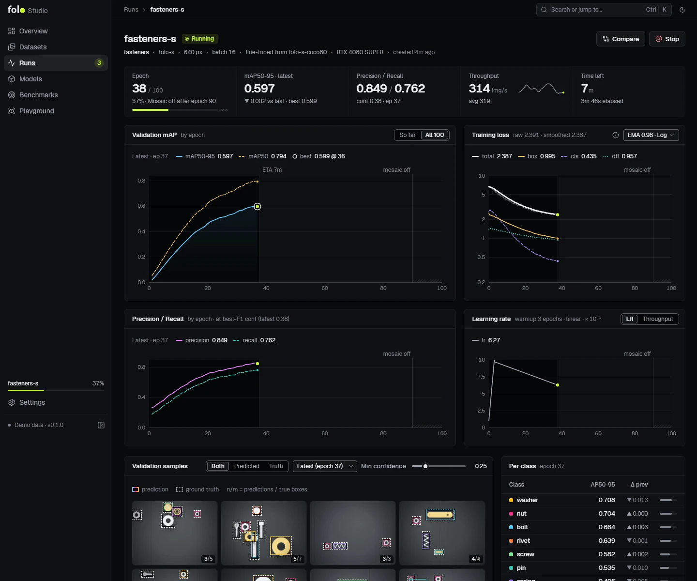

<p align="center">
  <picture>
    <source media="(prefers-color-scheme: dark)" srcset="design/logo-wordmark.svg">
    
  </picture>
</p>

# FOLO

**FOLO Only Looks Once.** A from-scratch, real-time vision framework in Rust: train, evaluate, benchmark, and run
YOLO-style object detectors from one native binary — with custom tensors, autograd, CPU/GPU kernels, Studio, Desktop,
and first-class agent tooling.

- **One binary, zero Python or CUDA.** Custom Rust engine and `wgpu`/WGSL shaders run on any Vulkan, DX12, or Metal GPU
  that meets wgpu's compute requirements (`folo doctor` shows the picked adapter).
- **End-to-end computer vision.** Label raw images with coding agents, train locally or on rented cloud GPUs, validate
  with pycocotools-exact mAP, stress-test with vision benchmarks, and export to `.folo` or ONNX.
- **Built for agents.** CLI commands support `--json` with stable exit codes, `folo describe --json` exposes the full
  schema, and `folo mcp` gives Claude Code, Codex, Antigravity, or any MCP client 43 tools.
- **Runs in the browser.** The same Rust detector compiles to WebAssembly on WebGPU or wasm CPU (~14 ms on WebGPU for
  `folo-n` at 640×640 in Chrome).

> **Status: early (v0.1).** Trains and runs on CPU and GPU with published COCO weights (`folo weights pull folo-s-coco`).
> Faster than the incumbent on every benchmark row below; not yet as accurate on COCO, and interfaces may still change.
> See [Project status](#project-status).

**[Quickstart](#quickstart)** · **[Benchmarks](#why-folo-the-numbers)** · **[Studio](#folo-studio)** ·
**[Desktop](#folo-desktop)** · **[Agents & MCP](#use-folo-from-an-agent)** · **[Docs](#docs)**

## Why FOLO: the numbers

`folo-n` measured against Ultralytics **yolo26n** (8.4.198, torch 2.11 + CUDA 12.8) on the same machine (RTX 4080 SUPER,
i7-14700KF) at 640×640. FOLO computes in strict f32 unless a row says f16/AMP and performs ~19% more FLOPs (6.54 vs
5.5 GFLOPs); each `yolo26n` bar uses its fastest config for that row. Full method, `folo-s` results, and raw data:
[docs/BENCHMARKS.md](docs/BENCHMARKS.md).

<p align="center">
  <picture>
    <source media="(prefers-color-scheme: dark)" srcset="docs/img/charts/speed-inference-dark.svg">
    
  </picture>
</p>

<p align="center">
  <picture>
    <source media="(prefers-color-scheme: dark)" srcset="docs/img/charts/speed-training-dark.svg">
    
  </picture>
</p>

`folo-s` beats `yolo26s` on every measured row as well; GPU batch-1 latency uses a longer warm-up on FOLO
([summary](docs/BENCHMARKS.md#summary), [method](docs/BENCHMARKS.md#method)).

<details>
<summary>Full benchmark table and measurement notes</summary>

| metric | folo-n | yolo26n (best configuration) | |
|---|---:|---:|---|
| GPU forward, batch 1, f32 (median latency) | **1.09 ms** | 4.95 ms (6.04 ms at its defaults) | FOLO 4.5× faster |
| GPU end to end, batch 1 (decoded image in, boxes out) | **1.60 ms** | 6.92 ms | FOLO 4.3× faster |
| CPU forward, batch 1, f32 | **12.7 ms** (28 threads) | 22.8 ms (8 threads) | FOLO 1.8× faster |
| CPU end to end, batch 1 | **13.6 ms** (28 threads) | 24.8 ms | FOLO 1.8× faster |
| GPU forward, batch 16, f32 (throughput) | **2081 img/s** | 1454 img/s (TF32) | FOLO 1.4× faster |
| GPU forward, batch 16, f16 (tensor cores) | **4159 img/s** | 2370 img/s (fp16) | FOLO 1.8× faster |
| GPU end to end, batch 16, f16 (tensor cores) | **2428 img/s** | 615 img/s (fp16) | FOLO 3.9× faster |
| Training step, batch 16 (forward, loss, backward, SGD) | **380 img/s** (f32) / **594 img/s** (AMP) | 202 img/s (fp32 with TF32) / 252 img/s (AMP) | FOLO 1.9× / 2.4× faster |
| Whole trainer, sustained (data loader, mosaic, 8 workers) | **388 img/s** (f32) / **613 img/s** (AMP) | 199 / 224 img/s | FOLO 1.9× / 2.7× faster |
| Training step peak GPU memory allocated, batch 16 | **3467 MiB** (f32) / **2022 MiB** (AMP) | 4517 / 2646 MiB | FOLO allocates 23% / 24% less |

FOLO's numbers were measured on `main`, alternated run by run with the prior build (2026-11-13 for GPU batch-1 and
end-to-end rows, the latter on published COCO weights; 2026-11-12 for the rest); `yolo26n` was measured on 2026-11-07.
For GPU batch-1 latency, both sides warm up with 25 forward / 10 end-to-end calls, after which FOLO's bench continues
warming until 1 s has elapsed.

</details>

### Accuracy

Trained from random weights on COCO alone, `folo-n` reaches **0.370** val2017 AP (128 epochs, 96 distilled from
`folo-s`) and `folo-s` reaches **0.416** (56 epochs); opt-in box fusion adds +0.002–0.004 AP. Ultralytics publishes
0.409 (`yolo26n`) and 0.480 (`yolo26s`) from Objects365-pretrained models trained far longer — an equal-budget full-COCO
run has not been run yet. At equal budgets so far:

- **Same learning curve per epoch.** On a 20k-image COCO subset (320 px, 20 epochs from scratch), FOLO (`folo-n`) and
  Ultralytics (`YOLO11n`) reach the same AP with the same optimizer (SGD 0.086 vs 0.085; MuSGD 0.113–0.116 vs 0.113).
- **Level on 3 of 4 small-dataset fine-tunes.** Fine-tuned 100 epochs from each model's own COCO weights (`folo-n` from
  `folo-n-coco-v2`) and scored by one pycocotools evaluator.

<p align="center">
  <picture>
    <source media="(prefers-color-scheme: dark)" srcset="docs/img/charts/accuracy-dark.svg">
    
  </picture>
</p>

Runs, curves, and published weights: [examples/coco](examples/coco/README.md) · Fine-tuning harness:
[bench/finetune](bench/finetune/README.md).

## Quickstart

### Install

Prebuilt `x86_64` binaries for Linux (glibc 2.35+) and Windows include Studio out of the box; a Vulkan, DX12, or Metal
GPU is recommended for training (`--device auto` falls back to CPU).

```sh
# Linux (installs to ~/.local/bin)
curl -fsSL https://github.com/himent12/folo/releases/latest/download/install.sh | sh
```

```powershell
# Windows (adds to PATH; save and run with -Desktop to also install FOLO Desktop)
irm https://github.com/himent12/folo/releases/latest/download/install.ps1 | iex
```

Manual archives and checksums are on [Releases](https://github.com/himent12/folo/releases)
([docs/RELEASE.md](docs/RELEASE.md)). No prebuilt macOS binary yet — build from source below.

### First model

Generate a synthetic dataset, train `folo-n`, and run predictions:

```sh
folo doctor                                                              # check which GPU FOLO picks
folo dataset synth datasets/shapes --images 1000 --imgsz 320             # synthetic YOLO dataset (~1 s)
folo train --data datasets/shapes --model folo-n --imgsz 320 --epochs 30 # ~1.5 min on a modern GPU
folo predict --model runs/shapes-n/weights/best.folo datasets/shapes/images/val --save runs/shapes-n/pred
```

On an RTX 4080 SUPER this reaches mAP50 0.955 / mAP50-95 0.823 in 83 s. Copy the weights into `<data dir>/models/`
(default `$FOLO_DATA_DIR`, `$FOLO_HOME`, or `~/.folo`) and open Studio at `http://127.0.0.1:7878` — e.g. with the
default config (POSIX shell):

```sh
mkdir -p ~/.folo/models && cp runs/shapes-n/weights/best.folo ~/.folo/models/shapes-n.folo
folo serve                                                               # or `folo serve --mock` for demo data
```

On PowerShell: `New-Item -Force -ItemType Directory ~\.folo\models | Out-Null; Copy-Item runs\shapes-n\weights\best.folo ~\.folo\models\shapes-n.folo; folo serve`.

See **[docs/QUICKSTART.md](docs/QUICKSTART.md)** for custom YOLO/COCO folders, fine-tuning from COCO weights, ONNX
export, and in-browser inference.

### Build from source

Requires Rust stable (`cargo folo` is a workspace alias for `cargo run --release -p folo-cli --`):

```sh
git clone https://github.com/himent12/folo
cd folo
cargo folo doctor
npm --prefix web ci                   # build Studio once for `cargo folo serve` (skip for CLI/API only)
npm --prefix web run build
cargo folo serve --mock
```

Install onto `PATH` with `cargo install --path crates/folo-cli` (add `--features embed-web` after building `web/` to
embed Studio).

## FOLO Studio



`folo serve` hosts Studio at `http://127.0.0.1:7878` (built on FOLO's own TypeScript UI framework and design system),
with five workspaces alongside Overview and Settings:
- **Datasets** — register YOLO/COCO or synthetic folders, inspect class balance and label issues, or label raw images
  with Claude Code, Codex, or Antigravity ([docs/LABELING.md](docs/LABELING.md)).
- **Runs** — launch, compare, stop, or resume runs (bit-exact on the same device) with live SSE metrics and validation
  grids, locally or on RunPod / remote FOLO servers ([docs/CLOUD.md](docs/CLOUD.md)).
- **Models** — inspect per-class precision/recall curves and export `.folo` or ONNX weights.
- **Benchmarks** — freeze labeled images into five-axis vision benchmarks with stress conditions (haze, blur, low light,
  distance) and score any model or agent ([docs/BENCH.md](docs/BENCH.md)).
- **Playground** — run inference on the server or directly in the browser via WebGPU/wasm ([docs/WASM.md](docs/WASM.md))
  with instant threshold sliders.


`folo serve --mock` loads the deterministic demo data shown above. Frontend dev guide: [web/README.md](web/README.md).

## FOLO Desktop


A native Rust app on `folo-ui` sharing Studio's design system and core workspaces (Overview, Datasets, Runs, Models,
Benchmarks, Playground, and Settings; agent labeling, compare views, and external prediction import stay in Studio).
It renders on the CPU so your GPU stays free for training and inference, includes a command palette, keyboard
navigation, and custom themes, and auto-starts a local `folo serve` when none is running (or pass `--server` to connect
to one, or `--mock` for demo data).

```sh
cd apps/desktop
cargo run --release                   # attaches to or starts folo serve (add -- --mock for demo data)
```

Desktop lives in its own cargo workspace so engine builds stay fast ([apps/desktop/README.md](apps/desktop/README.md)).

## Use FOLO from an agent

**MCP.** `folo mcp` is a [Model Context Protocol](https://modelcontextprotocol.io) server over stdio (MCP 2026-07-28 and
2025-11-25) with 43 tools covering datasets, agent labeling, local and cloud training, evaluation, prediction, export,
and vision benchmarks — plus `folo://` resources and three prompts against `--data-dir` (default `~/.folo`).

```sh
claude mcp add folo -- folo mcp                       # Claude Code
codex mcp add folo -- folo mcp                        # Codex
agy mcp add folo -- folo mcp                          # Antigravity
```

Or add `{ "mcpServers": { "folo": { "command": "folo", "args": ["mcp"] } } }` to `.mcp.json`. Key flags: `--server URL`
(share live state with Studio), `--device`, `--tensor-cores` (for AMP), `--mock`, `--read-only`, and `--confine` — see
[docs/MCP.md](docs/MCP.md) for full schemas and running from a source checkout.

**CLI with `--json`.** Every command except `folo mcp` (which reserves stdout for MCP and reports errors on stderr)
accepts `--json`: stdout emits pure JSON Lines, stderr carries progress, errors return
`{"error":{"code","message","hint"}}` with stable exit codes (`0` ok, `1` runtime, `2` usage, `3` not found,
`4` unsupported; `--help` and `--version` stay plain text), and `folo describe --json` dumps the entire CLI and MCP
schema.

```sh
folo train --data datasets/shapes --model folo-n --epochs 30 --json            # {"event":"epoch",...}, {"event":"done",...}
folo val --model runs/shapes-n/weights/best.folo --data datasets/shapes --json # {"map50":...,"map50_95":...,"per_class":[...]}
```

Read on in [docs/AGENT_COOKBOOK.md](docs/AGENT_COOKBOOK.md), [docs/MCP.md](docs/MCP.md), and [llms.txt](llms.txt).

## Architecture at a glance

Everything ML — tensors, autograd, CPU/WGSL kernels, layers, optimizers, detector, losses, assigner, NMS, metrics, and
augmentation — is written from scratch here; commodity crates handle commodity jobs (`wgpu`, `rayon`, `serde`, `axum`,
`clap`). Each crate depends only on rows below it:

```
 FOLO Studio (web/)   FOLO Desktop (apps/desktop/)     the apps: HTTP + SSE to folo-server (docs/API.md)
 ──────────────────────────────────────────────────────────────────────────────────────────────────────────────
 folo-cli      the `folo` binary: train, val, predict, export, serve, mcp, dataset, weights, cloud, ...
 folo-mcp      `folo mcp`: MCP over stdio, on the server's Store (in process, or proxying `folo serve`)
 folo-server   axum HTTP + SSE: datasets, runs and their queue, models, labeling, cloud runs; serves Studio
 folo-bench    vision benchmarks       folo-cloud    RunPod, remote servers   folo-wasm    the browser build
 folo-client   blocking HTTP client of the API
 folo-vision   detector (folo-n/s/m/l/x), loss, assigner, NMS, mAP, trainer, predictor, ONNX export
 folo-nn       layers, optimizers      folo-data     datasets, augmentation   folo-gpu     wgpu, WGSL kernels
 folo-core     tensors, autograd, CPU kernels, the Backend trait              folo-api     the wire types
```

See [docs/ARCHITECTURE.md](docs/ARCHITECTURE.md) (including the **"Where do I change ...?"** table) and
[crates/README.md](crates/README.md).

<details>
<summary>Repository layout (every folder's README)</summary>

| folder | what is there |
|---|---|
| [crates/](crates/README.md) | The root cargo workspace: engine and services, with a README per crate |
| [web/](web/README.md) | FOLO Studio (TypeScript + Vite) and `web/framework/`, its own UI framework |
| [apps/desktop/](apps/desktop/README.md) | FOLO Desktop and `folo-ui` (`ui/`), its own native UI framework and cargo workspace |
| [design/](design/README.md) | Shared design tokens, fonts, themes, and logos used by both apps |
| [docs/](docs/README.md) | User guides, internal specs, and `docs/notes/` engineering notebooks |
| [examples/](examples/README.md) | Worked runs: shapes convergence test, COCO pretraining, external benchmark entry |
| [bench/](bench/README.md) | Python harnesses outside cargo: Ultralytics baselines, fine-tuning accuracy, parity |
| [tools/](tools/README.md) | CI/dev helpers and the benchmark chart generator (`tools/charts/`) |
| [scripts/](scripts/README.md) | WebAssembly build scripts and release installers |
| [site/](site/README.md) | Static documentation website generated directly from this repo's Markdown |
| [.github/](.github/) | CI workflows ([docs/CI.md](docs/CI.md)) and issue/PR templates |

</details>

## Project status

**Works today (v0.1):**
- `folo-n/s/m/l/x` training on CPU or GPU (bit-exact resume on the same device, EMA, mosaic, `--amp` mixed precision,
  and `--head o2o` NMS-free head) plus GPU f16 inference (`--half`, `--tensor-cores`). The synthetic shapes convergence
  gate ([examples/shapes](examples/shapes/README.md)) passes at mAP50-95 0.934 vs a 0.75 bar
  ([docs/BENCHMARKS.md](docs/BENCHMARKS.md#learning-2026-11-12)).
- Published COCO-pretrained weights via `folo weights pull` — including `folo-s-coco` (val2017 AP 0.416) and
  `folo-n-coco-v5` (AP 0.370). See [examples/coco](examples/coco/README.md) for all checkpoints and
  [docs/QUICKSTART.md](docs/QUICKSTART.md#fine-tune-from-pretrained-weights) for fine-tuning guidance.
- YOLO and COCO dataset tools, pycocotools-exact `val`, `predict`, and export to `.folo` (f32/f16,
  safetensors-compatible) and ONNX (opset 17, parity-tested in onnxruntime).
- `folo serve` (Studio + HTTP/SSE API), FOLO Desktop, `folo mcp`, in-browser WebGPU/wasm, agent-assisted labeling, cloud
  GPU training, vision benchmarks, and v0.1.0 release assets ([CHANGELOG.md](CHANGELOG.md)).

**Not yet:**
- COCO accuracy level with the incumbent, or an equal-budget full-COCO comparison ([Accuracy](#accuracy));
- a CLI speed-benchmark command (speed numbers come from `cargo bench`, [docs/BENCHMARKS.md](docs/BENCHMARKS.md);
  `folo bench` runs vision benchmarks);
- prebuilt macOS release binaries.

Live checklist: [docs/ROADMAP.md](docs/ROADMAP.md).

## Docs

Browse by task in [docs/README.md](docs/README.md), try the worked examples ([shapes](examples/shapes/README.md),
[coco](examples/coco/README.md)), or run the searchable docs site locally with `cd site && npm ci && npm run dev`
([site/README.md](site/README.md)).

<details>
<summary>All documentation</summary>

| doc | what it covers |
|---|---|
| [QUICKSTART](docs/QUICKSTART.md) | Walkthrough: your own data, fine-tuning, export, in-browser inference |
| [CLI](docs/CLI.md) | Every `folo` command, `--json`, exit codes, dataset tools |
| [LABELING](docs/LABELING.md) | Unlabeled images to a dataset with Claude Code, Codex or Antigravity: workflow, cost, accuracy |
| [BENCH](docs/BENCH.md) | Vision benchmarks from your own images: conditions, scoring, any model as a contestant, self-improvement loops |
| [CLOUD](docs/CLOUD.md) | Training on a rented GPU (RunPod) or another FOLO server: lifecycle, safety, providers |
| [AGENT_COOKBOOK](docs/AGENT_COOKBOOK.md) | Recipes for agents, as MCP tool calls and as `--json` commands |
| [MCP](docs/MCP.md) | The `folo mcp` contract: tools, resources, prompts, errors |
| [API](docs/API.md) | The HTTP + SSE API behind Studio and Desktop |
| [SERVER](docs/SERVER.md) | Inside folo-server: the router, the Store and the services behind the API |
| [BENCHMARKS](docs/BENCHMARKS.md) | FOLO against Ultralytics on one machine: method, numbers, accuracy |
| [ARCHITECTURE](docs/ARCHITECTURE.md) | Map of the repository: crates, data flows, where to change what |
| [MODEL](docs/MODEL.md) | The detector, loss and training recipe (normative spec) |
| [VISION](docs/VISION.md) | Tour of folo-vision: model, loss, assigner, trainer and predictor |
| [DATA](docs/DATA.md) | Dataset formats, augmentation, the data loader |
| [WASM](docs/WASM.md) | FOLO in the browser: build, JS API, performance |
| [CORE](docs/CORE.md) | folo-core in depth: tensors, CPU kernels, autograd |
| [GPU](docs/GPU.md) | The wgpu backend, buffer pool, WGSL kernels |
| [NN](docs/NN.md) | Layers, optimizers, LR schedules, `.folo` IO |
| [FORMAT](docs/FORMAT.md) | The `.folo` weights and checkpoint format |
| [METRICS](docs/METRICS.md) | How mAP, precision and recall are computed |
| [ROADMAP](docs/ROADMAP.md) | What is done, in progress and next |
| [RELEASE](docs/RELEASE.md) | How releases are cut, install scripts, and embedded Studio |
| [CI](docs/CI.md) | What each CI workflow runs and checks |
| [CHANGELOG](CHANGELOG.md) | What each release changed |

</details>

## Contributing

Issues, hardware measurements, and pull requests are welcome — see [CONTRIBUTING.md](CONTRIBUTING.md) and
[SECURITY.md](SECURITY.md). FOLO is built with a multi-agent workflow where every change lands as a reviewed PR;
[AGENTS.md](AGENTS.md), [docs/notes/PROCESS.md](docs/notes/PROCESS.md), and [docs/notes](docs/notes/README.md) cover the
rules, orchestration loop, and engineering notebooks.

## License

Licensed under either of [MIT](LICENSE-MIT) or [Apache-2.0](LICENSE-APACHE) at your option.
