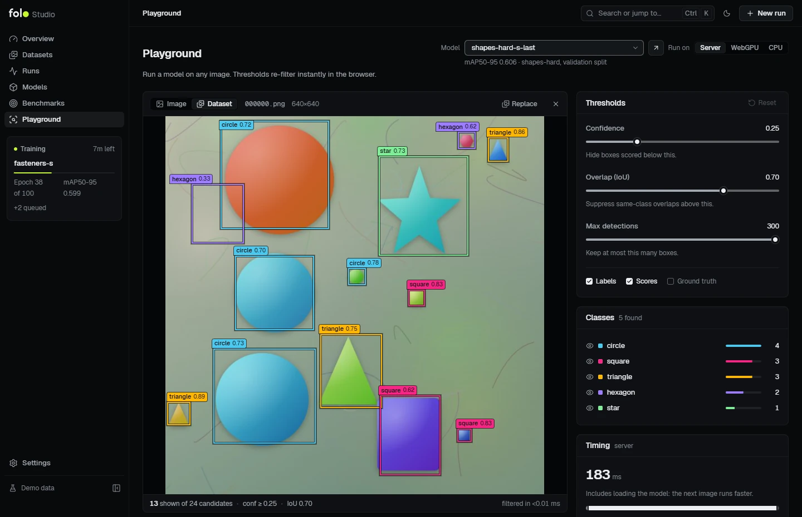

<p align="center">
  <picture>
    <source media="(prefers-color-scheme: dark)" srcset="design/logo-wordmark.svg">
    
  </picture>
</p>

# FOLO

**FOLO Only Looks Once.** A from-scratch, very fast vision framework in Rust: a YOLO-style real-time object detector
with its own tensors, autograd, CPU kernels and GPU kernels (wgpu: Vulkan, DX12, Metal, and WebGPU in the browser),
plus training, evaluation and export. You drive it from one `folo` binary, an HTTP API, an MCP server for agents,
**FOLO Studio** (a web app) or **FOLO Desktop** (a native app).

- **One binary, no Python.** `folo train`, `val`, `predict`, `export`, `serve` and `mcp` run on the same Rust engine.
  No PyTorch or CUDA toolkit is needed: the GPU kernels are our own WGSL, so a Vulkan, DX12 or Metal GPU that meets
  wgpu's compute limits works (`folo doctor` tells you which one FOLO picks).
- **Built for agents.** `--json` on every command, stable exit codes and error codes, `folo describe --json` for the
  whole CLI surface, and `folo mcp` for Claude Code, Codex or any MCP client.
- **Runs in the browser.** The same detector compiles to wasm and runs on WebGPU in the page (about 14 ms for folo-n
  at 640 in Chrome).

> **Status: early (v0.1).** The detector trains and infers on CPU and GPU, and it passes its convergence gate.
> COCO-pretrained weights are published as GitHub releases: `folo-s-coco`, val2017 AP 0.416 after 56 epochs from
> scratch, and for folo-n `folo-n-coco` (AP 0.314 after 50 epochs) and the interim `folo-n-coco-v2` (AP 0.317 at
> epoch 62 of a paused 300-epoch run). The repository is
> private for now, so `folo weights pull` still needs access to it (through `gh`); once it is public, it needs nothing.
> See [Project status](#project-status).

## Why FOLO: the numbers

folo-n against Ultralytics **yolo26n** (8.4.198, torch 2.11 + CUDA 12.8) on the same machine: an RTX 4080 SUPER and an
i7-14700KF, both at 640×640. FOLO computes in strict f32 (no TF32, no tensor cores) unless a row says f16 or AMP, and does about 19% more FLOPs per
image (6.54 vs 5.5 GFLOPs). Every number here comes from [docs/BENCHMARKS.md](docs/BENCHMARKS.md), which also covers
the method, the raw JSON and how much noise to expect.

| metric | folo-n | yolo26n (best config) | |
|---|---:|---:|---|
| GPU forward, batch 1, f32 (median latency) | **2.09 ms** | 4.95 ms (6.04 ms default) | FOLO 2.4× faster |
| GPU forward, batch 16, f32 (throughput) | **1648 img/s** | 1454 img/s (TF32) | FOLO 13% faster |
| GPU forward, batch 16, f16 (tensor cores) | **3078 img/s** | 2370 img/s (fp16) | FOLO 30% faster |
| Training step, batch 16 (fwd + loss + bwd + SGD) | **327 img/s** (f32) / **537 img/s** (AMP) | 202 img/s (fp32 with TF32) / 252 img/s (AMP) | FOLO 1.6× / 2.1× faster |
| Trainer, sustained (data loader, mosaic, 8 workers) | **347 img/s** (f32) / **500 img/s** (AMP) | 199 / 224 img/s | FOLO 1.7× / 2.2× faster |
| Training step peak GPU memory, batch 16, f32 | **3467 MiB** | 4517 MiB (2646 MiB AMP) | FOLO uses 23% less in f32 |
| GPU end to end, batch 1 (decoded image in, boxes out) | **2.63 ms** (f32) | 6.92 ms | FOLO 2.6× faster |
| GPU end to end, batch 16 | **1898 img/s** (f16, tensor cores) / 1239 (f32) | 615 img/s (fp16) / 536 (fp32) | FOLO 3.1× faster |
| CPU forward, batch 1, f32 | **18.3 ms** (28 threads) | 22.8 ms (8 threads) | FOLO 1.25× faster |
| CPU end to end, batch 1 | **18.6 ms** (28 threads) | 24.8 ms | FOLO 1.33× faster |

Accuracy is a separate question: on COCO val2017, folo-n reaches AP 0.317 after 62 epochs from scratch (a 300-epoch
run, paused there; 0.314 for the finished 50-epoch run), against
0.409 published for yolo26n, which was pretrained on Objects365 and then trained 245 epochs on COCO; folo-s reaches
AP 0.416 after 56 epochs from scratch, against 0.480 for yolo26s
([examples/coco](examples/coco/README.md), docs/BENCHMARKS.md, Accuracy). Trained the same way on the same images (a
20,000-image COCO proxy at 320 px, 20 epochs, from scratch), FOLO's trainer and Ultralytics' land level with each
other per epoch (SGD 0.086 vs 0.085 AP, MuSGD 0.113–0.116 vs 0.113, both optimizers chosen explicitly), so the gap is
data and schedule, not the trainer; full COCO at an equal budget has not been run. The folo-s run is the first full
COCO run of `auto`'s MuSGD recipe for long runs (rule 3: momentum 0.9, warmup_bias_lr 0; the proxy runs used 0.937
and 0.1, which `auto` rule 4 now uses for every run); it shows the recipe works, not how much it gains over SGD there.

These are the hill-climb build's numbers (2026-11-09, quiet machine, alternated with the earlier build). FOLO is not
ahead everywhere: folo-s ties yolo26s on batch-16 forward throughput, and CPU batch-1 latency did not move in the
hill-climb.

With the whole trainer (data loader, augmentation, validation), folo-n trains the shapes gate set (2,000 images
at 320 px, 30 epochs) to mAP50 0.980 in **169 s on the GPU**, 25.6× faster than
on the CPU ([examples/shapes](examples/shapes/README.md)).

## Quickstart

### Install

Releases ship `folo` for x86_64 Windows and Linux (glibc 2.35 or newer) with Studio built in, so `folo serve` works
anywhere, plus FOLO Desktop for Windows, the browser module (`folo-wasm.tar.gz`) and the install scripts. You need a
GPU with Vulkan, DX12 or Metal for training at speed; without one, `--device auto` falls back to the CPU, which is
much slower. The repository is private, so downloads need a logged-in [`gh`](https://cli.github.com) (or a token in
`GH_TOKEN` / `GITHUB_TOKEN`):

```sh
gh release download --repo himent12/folo --pattern install.sh      # Linux: the latest release's install script
sh install.sh                                                       # folo into ~/.local/bin
```

```powershell
gh release download --repo himent12/folo --pattern install.ps1     # Windows
powershell -ExecutionPolicy Bypass -File install.ps1                # into %LOCALAPPDATA%\Programs\folo\bin, added to PATH
powershell -ExecutionPolicy Bypass -File install.ps1 -Desktop       # also FOLO Desktop
```

The scripts download the archive for your platform, check its SHA-256 and install `folo` (and `folo-desktop`).
The same scripts are in a checkout as `scripts/install.sh` and `scripts\install.ps1`. Options: `--version` /
`-Version` (a tag such as `v0.1.0`; default the latest release), `--dir` / `-InstallDir`, `--repo` / `-Repo` and
`--base-url` / `-BaseUrl`, or the environment variables `FOLO_VERSION`, `FOLO_INSTALL_DIR`, `FOLO_REPO` and
`FOLO_BASE_URL`. To install by hand, download `folo-<target>.zip` / `.tar.gz` and its `.sha256` from the release
and put the binary on your `PATH`. There is no macOS build yet: on a Mac, build from source.

### First model

```sh
folo doctor                                                         # the GPU FOLO picks
folo dataset synth datasets/shapes --images 1000 --imgsz 320        # a labelled YOLO dataset, ~1 s
folo train --data datasets/shapes --model folo-n --imgsz 320 --epochs 30   # ~2 min on the GPU
folo predict --model runs/shapes-n/weights/best.folo datasets/shapes/images/val --save runs/shapes-n/pred
folo serve --mock                                                   # Studio on http://127.0.0.1:7878, demo data
```

`train` prints one row per epoch and writes `runs/shapes-n/`: `weights/best.folo`, `weights/last.folo` and
`metrics.jsonl`. On the dev machine this run ended at mAP50 0.955 / mAP50-95 0.823 after 83 s. `predict --save`
writes copies of the images with the boxes drawn on them.

To see real runs in Studio, drop `--mock`. `folo serve` keeps datasets, runs and models in its data dir
(`--data-dir`, default `~/.folo`), and lists every `.folo` file under `<data dir>/models/` as a model. To try your
model in the Playground, copy it there: `mkdir -p ~/.folo/models && cp runs/shapes-n/weights/best.folo
~/.folo/models/shapes-n.folo`.

**[docs/QUICKSTART.md](docs/QUICKSTART.md)** goes further: training on your own YOLO or COCO folder, fine-tuning,
evaluation, export, and running a model in the browser.

### Build from source

You need Rust (stable). `cargo folo` is an alias for `cargo run --release -p folo-cli --`, so every command above
works as `cargo folo ...` from a checkout; the first call builds the CLI (a few minutes). Studio is a separate build:

```sh
git clone https://github.com/himent12/folo && cd folo
cargo folo doctor
(cd web && npm ci && npm run build)       # build Studio's web app, once; cargo folo serve then serves web/dist
cargo folo serve --mock
```

To put a binary on your `PATH`: `cargo install --path crates/folo-cli` (add `--features embed-web` after building
`web/` to embed Studio, as the releases do). [docs/RELEASE.md](docs/RELEASE.md) has the full release build, with the
in-browser module.

## FOLO Studio


`folo serve` hosts Studio at `http://127.0.0.1:7878` (our own UI framework and design system). It has these screens:
- **Datasets**: register a YOLO or COCO folder or generate a synthetic one, browse the images with their boxes, and
  see class and box-size statistics and label issues. No labels yet? **Label images** hands a set of unlabeled
  images to Claude Code or Codex on your machine, shows you every box for review and correction, and makes the
  dataset ([docs/LABELING.md](docs/LABELING.md)).
- **Runs**: start a training run, follow it live (metrics over SSE, validation samples, per-class mAP, logs), stop
  or resume it, and compare runs. **Run on** trains it on a GPU rented from RunPod for the length of the run, or on
  another FOLO server of yours, with the price before it starts and the cost while it runs
- **Benchmarks**: freeze a set of your labeled images into a benchmark with a plan of hard conditions (haze, low
  light, blur, distance, ...), and run any vision model on it: a FOLO model, Claude Code or Codex looking at the
  images, or predictions from a model that runs anywhere else. Every entry gets a score from five axes (accuracy,
  robustness, self-labeling, calibration, localization) and the charts behind it, and a self-improvement loop
  tests whether a model's own labels can train its successor ([docs/BENCH.md](docs/BENCH.md)).
  ([docs/CLOUD.md](docs/CLOUD.md)).
- **Models**: evaluation results, per-class metrics, and export.
- **Playground**: run a model on any image, on the server or **in the browser** (WebGPU or the wasm CPU). The
  in-browser backends need the wasm module (`sh scripts/build-wasm.sh`) built before Studio. Thresholds re-filter
  instantly.



`folo serve --mock` serves deterministic demo data, which is what these screenshots show. For UI work, run
`npm run dev` in `web/`, which starts the Vite dev server on :5173 with `/api` proxied to `folo serve`. See
[web/README.md](web/README.md).

## FOLO Desktop


The same screens, built natively in Rust on folo-ui, its own UI framework (rendered on the CPU, so the GPU stays free
for training and inference). It also has a command palette, keyboard navigation, and dark and light themes. It talks to a local `folo serve` over the same
HTTP API. If no server answers on `$FOLO_SERVER` (default `http://127.0.0.1:7878`), it starts a local `folo serve`
for you, empty until you add datasets and runs (its data dir is `$FOLO_HOME` or `~/.folo`). `--server` points it at
another server, and `--mock` (or Settings › Connection) shows the built-in demo data.

```powershell
cd apps/desktop
cargo run --release                                   # a running folo serve, else a local one it starts
cargo run --release -- --server http://127.0.0.1:7878 # a specific server
```


Desktop is its own cargo workspace (the app and folo-ui), so the engine's builds and CI do not build it. See
[apps/desktop/README.md](apps/desktop/README.md).

## Use FOLO from an agent

**MCP.** `folo mcp` is a [Model Context Protocol](https://modelcontextprotocol.io) server over stdio (MCP 2026-07-28
and 2025-11-25). It has 22 tools: build, register and check datasets, train (here or on a cloud GPU), follow, stop, reorder and
resume runs, evaluate, predict, export, compare runs, and look after cloud connections and instances. It also has `folo://` resources (dataset images, live run status and metrics,
validation sample grids, the docs) and two prompts. It runs the real engine on `--data-dir`.

```sh
claude mcp add folo -- folo mcp --data-dir D:/folo-data                 # Claude Code
codex mcp add folo -- folo mcp --data-dir D:/folo-data                  # Codex
```

Or in `.mcp.json` (`claude_desktop_config.json` for Claude Desktop):

```json
{ "mcpServers": { "folo": { "command": "folo", "args": ["mcp", "--data-dir", "D:/folo-data"] } } }
```

From a checkout without an installed `folo`, use `"command": "cargo", "args": ["run", "-q", "--release", "-p",
"folo-cli", "--", "mcp", "--data-dir", "D:/folo-data"]`. These flags change how it runs:
- `--device auto|cpu|gpu:<n>`: where inference and `val` run.
- `--mock`: simulated data and runs, to try the tools.
- `--read-only`: only tools that don't change state.
- `--confine`: only read files inside `--data-dir`.
- `--server http://127.0.0.1:7878`: share runs with a running `folo serve` and Studio.

**CLI with `--json`.** Every command takes `--json`: stdout is then JSON Lines only, and human text goes to stderr.
Failures end with `{"error":{"code","message","hint"}}` and a stable exit code (0 ok, 1 runtime error, 2 usage,
3 not found, 4 not implemented). `folo describe --json` prints every command, argument and default, plus every MCP
tool's schemas.

```sh
folo train --data datasets/shapes --model folo-n --epochs 30 --json   # {"event":"epoch",...} per epoch, then {"event":"done",...}
folo val --model runs/shapes-n/weights/best.folo --data datasets/shapes --json   # {"map50":...,"map50_95":...,"per_class":[...]}
```

Read on in [docs/AGENT_COOKBOOK.md](docs/AGENT_COOKBOOK.md) (recipes for both forms), [docs/MCP.md](docs/MCP.md)
(the MCP contract) and [llms.txt](llms.txt) (an index for agents).

## Architecture at a glance

```
 folo (CLI) ─────┬──────────────► folo-server (axum, HTTP + SSE) ◄── FOLO Studio (web/), FOLO Desktop (apps/desktop/)
 folo mcp ───────┘                     │  docs/API.md, types in folo-api
                                       ▼
                folo-vision: detector (folo-n/s/m/l/x), loss, assigner, NMS, mAP, trainer, predictor
                  │                      │                        │
             folo-nn: layers,       folo-data: YOLO / COCO,   folo-wasm: the predictor in the
             optimizers, .folo      augmentation, loader      browser (WebGPU or wasm CPU)
                  │
             folo-core: tensors, autograd, CPU kernels ◄── folo-gpu: wgpu device, WGSL kernels
```

Everything ML is written here: the kernels, autograd, layers, optimizers, detector, loss, assigner, NMS, metrics,
augmentation and GPU kernels. Commodity crates do the commodity jobs: wgpu, rayon, image decoding, serde, axum and
clap. [docs/ARCHITECTURE.md](docs/ARCHITECTURE.md) has the full picture.

## Project status

What works today (v0.1):
- folo-n/s/m/l/x, trained from scratch on CPU or GPU, with resume, EMA, mosaic and the usual augmentations. On the
  shapes gate it reaches mAP50 0.980 / mAP50-95 0.896 ([examples/shapes](examples/shapes/README.md)).
- COCO-pretrained weights: `folo-n-coco`, folo-n trained from scratch on COCO for 50 epochs, val2017 AP 0.314 /
  AP50 0.455 (pycocotools-exact, [examples/coco](examples/coco/README.md)), in the published release `weights-v1`.
  `folo-n-coco-v2` (release `weights-v2`) is the interim result of a 300-epoch run paused at epoch 62: AP 0.317 /
  AP50 0.458. `folo-s-coco` (release `weights-v3`) is folo-s trained from scratch on COCO for 56 epochs on a rented
  GPU: AP 0.416 / AP50 0.580, 0.05–0.06 AP behind the published YOLO11s / YOLO26s. `folo weights pull <name>`
  downloads them over plain HTTPS; while the repository is private, that is refused and it falls back to a
  logged-in `gh`.
- YOLO and COCO datasets: reading, stats, checks and conversion. mAP that matches pycocotools.
- `val`, `predict` and export to `.folo` (f32 or f16, a safetensors-compatible format) and ONNX (opset 17, f32 or
  f16, optional in-graph decode and dynamic shapes; parity-tested in onnxruntime).
- f16 on the GPU: `--half` inference (on tensor cores with `--tensor-cores`) and mixed-precision training (`--amp`),
  plus the NMS-free one-to-one head (`--head o2o`).
- `folo serve` (Studio and the HTTP API), `folo mcp`, in-browser inference, and the 0.1.0 release: Windows and
  Linux binaries with Studio embedded, FOLO Desktop for Windows, the browser module and install scripts
  ([CHANGELOG.md](CHANGELOG.md)).

Not yet:
- a public repository (the weights releases are published, but downloading them needs access to the repository until
  it is public), or a COCO comparison with the incumbent at equal budget;
- `folo bench`;
- a macOS build (it needs GitHub-hosted runners, which are unavailable for now).

The live checklist is [docs/ROADMAP.md](docs/ROADMAP.md).

## Docs

| doc | what it covers |
|---|---|
| [QUICKSTART](docs/QUICKSTART.md) | Walkthrough: your own data, fine-tuning, export, in-browser inference |
| [CLI](docs/CLI.md) | Every `folo` command, `--json`, exit codes, dataset tools |
| [LABELING](docs/LABELING.md) | Unlabeled images to a dataset with Claude Code or Codex: workflow, cost, accuracy |
| [BENCH](docs/BENCH.md) | Vision benchmarks from your own images: conditions, the score and its definitions, any model as a contestant, self-improvement loops |
| [CLOUD](docs/CLOUD.md) | Training on a rented GPU (RunPod) or another FOLO server: lifecycle, safety, providers |
| [AGENT_COOKBOOK](docs/AGENT_COOKBOOK.md) | Recipes for agents, as MCP tool calls and as `--json` commands |
| [MCP](docs/MCP.md) | The `folo mcp` contract: tools, resources, prompts, errors |
| [API](docs/API.md) | The HTTP + SSE API behind Studio and Desktop |
| [BENCHMARKS](docs/BENCHMARKS.md) | FOLO vs Ultralytics on the dev machine: method, numbers, targets |
| [ARCHITECTURE](docs/ARCHITECTURE.md) | The crates and how they fit together |
| [MODEL](docs/MODEL.md) | The detector, loss and training recipe (normative spec) |
| [DATA](docs/DATA.md) | Dataset formats, augmentation, the data loader |
| [WASM](docs/WASM.md) | FOLO in the browser: the build, JS API, performance |
| [GPU](docs/GPU.md) | The wgpu backend, the buffer pool, the WGSL kernels |
| [NN](docs/NN.md) | Layers, optimizers, LR schedules, `.folo` IO |
| [FORMAT](docs/FORMAT.md) | The `.folo` weights and checkpoint format |
| [METRICS](docs/METRICS.md) | How mAP, precision and recall are computed |
| [ROADMAP](docs/ROADMAP.md) | What is done, in progress and next |
| [CHANGELOG](CHANGELOG.md) · [RELEASE](docs/RELEASE.md) · [CI](docs/CI.md) · [PROCESS](docs/PROCESS.md) · [AGENTS](AGENTS.md) | What each release changed, releases, CI runners, how changes land, rules for contributors |

Examples: [shapes](examples/shapes/README.md) (the convergence gate, on CPU and GPU) and
[coco](examples/coco/README.md) (folo-n pretrained from scratch on COCO 2017).

To read these as a website with search: `cd site && npm ci && npm run dev` ([site/README.md](site/README.md)).

## License

Licensed under either of MIT or Apache-2.0 at your option.
