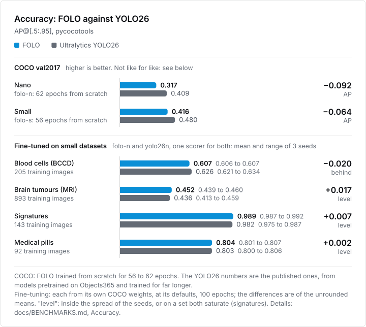

<p align="center">
  <picture>
    <source media="(prefers-color-scheme: dark)" srcset="design/logo-wordmark.svg">
    
  </picture>
</p>

# FOLO

**FOLO Only Looks Once.** A from-scratch, very fast vision framework in Rust: a YOLO-style real-time object detector
with its own tensors, autograd, CPU kernels and GPU kernels (wgpu: Vulkan, DX12, Metal, and WebGPU in the browser),
plus training, evaluation and export. You drive it from one `folo` binary, an HTTP API, an MCP server for agents,
**FOLO Studio** (a web app) or **FOLO Desktop** (a native app).

- **One binary, no Python.** `folo train`, `val`, `predict`, `export`, `serve` and `mcp` run on the same Rust engine.
  No PyTorch or CUDA toolkit is needed: the GPU kernels are our own WGSL, so a Vulkan, DX12 or Metal GPU that meets
  wgpu's compute limits works (`folo doctor` tells you which one FOLO picks).
- **Built for agents.** `--json` on every command, stable exit codes and error codes, `folo describe --json` for the
  whole CLI surface, and `folo mcp` for Claude Code, Codex or any MCP client.
- **Runs in the browser.** The same detector compiles to wasm and runs on WebGPU in the page (about 14 ms for folo-n
  at 640 in Chrome).

> **Status: early (v0.1).** The detector trains and runs on CPU and GPU, and COCO-pretrained weights are published
> (`folo weights pull folo-s-coco`). It is faster than the incumbent on every row below and not yet as accurate on
> COCO; interfaces may still change. See [Project status](#project-status).

**[Install it and train a first model](#quickstart)**, or read on for the numbers.

## Why FOLO: the numbers

folo-n against Ultralytics **yolo26n** (8.4.198, torch 2.11 + CUDA 12.8) on the same machine: an RTX 4080 SUPER and an
i7-14700KF, both at 640×640. FOLO computes in strict f32 (no TF32, no tensor cores) unless a row says f16 or AMP, and
does about 19% more FLOPs per image (6.54 against 5.5 GFLOPs). Each yolo26n bar is its best configuration for that
row. Every number comes from [docs/BENCHMARKS.md](docs/BENCHMARKS.md), which has the method, the raw results and how
much noise to expect.

<p align="center">
  <picture>
    <source media="(prefers-color-scheme: dark)" srcset="docs/img/charts/speed-inference-dark.svg">
    
  </picture>
</p>

<p align="center">
  <picture>
    <source media="(prefers-color-scheme: dark)" srcset="docs/img/charts/speed-training-dark.svg">
    
  </picture>
</p>

<details>
<summary>The same numbers as a table</summary>

| metric | folo-n | yolo26n (best configuration) | |
|---|---:|---:|---|
| GPU forward, batch 1, f32 (median latency) | **1.09 ms** | 4.95 ms (6.04 ms at its defaults) | FOLO 4.5× faster |
| GPU end to end, batch 1 (decoded image in, boxes out) | **1.60 ms** | 6.92 ms | FOLO 4.3× faster |
| CPU forward, batch 1, f32 | **12.7 ms** (28 threads) | 22.8 ms (8 threads) | FOLO 1.8× faster |
| CPU end to end, batch 1 | **13.6 ms** (28 threads) | 24.8 ms | FOLO 1.8× faster |
| GPU forward, batch 16, f32 (throughput) | **2081 img/s** | 1454 img/s (TF32) | FOLO 1.4× faster |
| GPU forward, batch 16, f16 (tensor cores) | **4159 img/s** | 2370 img/s (fp16) | FOLO 1.8× faster |
| GPU end to end, batch 16, f16 (tensor cores) | **2428 img/s** | 615 img/s (fp16) | FOLO 3.9× faster |
| Training step, batch 16 (forward, loss, backward, SGD) | **380 img/s** (f32) / **594 img/s** (AMP) | 202 img/s (fp32 with TF32) / 252 img/s (AMP) | FOLO 1.9× / 2.4× faster |
| Whole trainer, sustained (data loader, mosaic, 8 workers) | **388 img/s** (f32) / **613 img/s** (AMP) | 199 / 224 img/s | FOLO 1.9× / 2.7× faster |
| Training step peak GPU memory allocated, batch 16 | **3467 MiB** (f32) / **2022 MiB** (AMP) | 4517 / 2646 MiB | FOLO allocates 23% / 24% less |

</details>

FOLO's numbers were measured on `main`, alternated run by run with the build before it: on 2026-11-13 the GPU
batch-1 rows and the end-to-end rows (the end-to-end ones with the published COCO weights, which find objects, on
the first 16 val2017 images), on 2026-11-12 the rest; yolo26n's on 2026-11-07, its best configuration for each row. The GPU batch-1 latency warm-ups
differ: both make the same calls first (25, or 10 end to end), and FOLO's bench then keeps warming until a second has
passed. folo-s beats yolo26s on every row
measured for it as well ([the chart by model size](docs/BENCHMARKS.md#summary)); its whole-trainer row was not
measured.

### Accuracy

Speed only counts at comparable accuracy, and on COCO FOLO is not there yet. Trained from scratch on COCO alone,
folo-n reaches AP 0.340 on val2017 after 78 epochs (`folo-n-coco-v3`; the earlier `folo-n-coco-v2` read 0.317 after
62) and folo-s 0.416 after 56; the opt-in box fusion (`--fusion dfl --iou 0.65 --max-det 1000`) adds 0.002–0.004
AP to each. Ultralytics publishes 0.409 for yolo26n and 0.480 for yolo26s, from models pretrained on Objects365 and then trained on COCO for far longer (245 epochs for
yolo26n). That is not like for like, and a full COCO comparison at an equal budget has not been run. Two things have
been measured at an equal budget:

- **Per epoch, the two trainers learn equally well.** On a 20,000-image COCO subset at 320 px, 20 epochs from scratch,
  FOLO's trainer with folo-n and Ultralytics' with YOLO11n reach the same AP with the same optimizer (SGD 0.086
  against 0.085, MuSGD 0.113–0.116 against 0.113). What causes the gap on full COCO has not been measured.
- **Fine-tuned on small datasets, folo-n and yolo26n are level on three of four.** Each starts from its own COCO
  weights (folo-n from `folo-n-coco-v2`) and trains 100 epochs at its defaults; one scorer (pycocotools) grades both.

<p align="center">
  <picture>
    <source media="(prefers-color-scheme: dark)" srcset="docs/img/charts/accuracy-dark.svg">
    
  </picture>
</p>

The runs, the per-epoch curves and the published weights are in [examples/coco](examples/coco/README.md); the
fine-tuning harness is [bench/finetune](bench/finetune/README.md).

## Quickstart

### Install

Releases ship `folo` for x86_64 Windows and Linux (glibc 2.35 or newer) with Studio built in, so `folo serve` works
anywhere, plus FOLO Desktop for Windows and the browser module (`folo-wasm.tar.gz`). You need a GPU with Vulkan, DX12
or Metal to train at speed; without one, `--device auto` falls back to the CPU, which is much slower.

```sh
curl -fsSL https://github.com/himent12/folo/releases/latest/download/install.sh | sh      # Linux: folo into ~/.local/bin
```

```powershell
irm https://github.com/himent12/folo/releases/latest/download/install.ps1 | iex            # Windows: folo, added to PATH
```

The scripts download the archive for your platform, check its SHA-256 and install `folo`. For FOLO Desktop as well,
save `install.ps1` and run `powershell -ExecutionPolicy Bypass -File install.ps1 -Desktop`. Both scripts are in a
checkout too (`scripts/install.sh`, `scripts\install.ps1`) and take a version, a folder and a mirror
([docs/RELEASE.md](docs/RELEASE.md)). To install by hand, download `folo-<target>.zip` / `.tar.gz` and its `.sha256`
from the [release](https://github.com/himent12/folo/releases) and put the binary on your `PATH`. There is no macOS
build yet: on a Mac, build from source.

### First model

```sh
folo doctor                                                         # the GPU FOLO picks
folo dataset synth datasets/shapes --images 1000 --imgsz 320        # a labelled YOLO dataset, ~1 s
folo train --data datasets/shapes --model folo-n --imgsz 320 --epochs 30   # ~1.5 min on the GPU
folo predict --model runs/shapes-n/weights/best.folo datasets/shapes/images/val --save runs/shapes-n/pred
```

`train` prints one row per epoch and writes `runs/shapes-n/`: `weights/best.folo`, `weights/last.folo` and
`metrics.jsonl`. On an RTX 4080 SUPER this run ended at mAP50 0.955 / mAP50-95 0.823 after 83 s. `predict --save`
writes copies of the images with the boxes drawn on them.

To look at it in Studio, start the server and open `http://127.0.0.1:7878`:

```sh
mkdir -p ~/.folo/models && cp runs/shapes-n/weights/best.folo ~/.folo/models/shapes-n.folo
folo serve                                                          # or `folo serve --mock` for demo data
```

`folo serve` keeps datasets, runs and models in its data dir (`--data-dir`, default `$FOLO_HOME` or `~/.folo`) and
lists every `.folo` file under `<data dir>/models/` as a model, so the copy above puts your model in the Playground.

**[docs/QUICKSTART.md](docs/QUICKSTART.md)** goes further: training on your own YOLO or COCO folder, fine-tuning from
the COCO weights, evaluation, export, and running a model in the browser.

### Build from source

You need Rust (stable). `cargo folo` is an alias for `cargo run --release -p folo-cli --`, so every command above
works as `cargo folo ...` from a checkout; the first call builds the CLI (a few minutes). Studio is a separate build:

```sh
git clone https://github.com/himent12/folo && cd folo
cargo folo doctor
(cd web && npm ci && npm run build)       # build Studio's web app, once; cargo folo serve then serves web/dist
cargo folo serve --mock
```

To put a binary on your `PATH`: `cargo install --path crates/folo-cli` (add `--features embed-web` after building
`web/` to embed Studio, as the releases do). [docs/RELEASE.md](docs/RELEASE.md) has the full release build, with the
in-browser module.

## FOLO Studio


`folo serve` hosts Studio at `http://127.0.0.1:7878` (our own UI framework and design system). Next to an overview
and the settings, it has these screens:
- **Datasets**: register a YOLO or COCO folder or generate a synthetic one, browse the images with their boxes, and
  see class and box-size statistics and label issues. No labels yet? **Label images** hands a set of unlabeled
  images to Claude Code or Codex on your machine, shows you every box for review and correction, and makes the
  dataset ([docs/LABELING.md](docs/LABELING.md)).
- **Runs**: start a training run, follow it live (metrics over SSE, validation samples, per-class mAP, logs), stop
  or resume it, and compare runs. **Run on** trains it on a GPU rented from RunPod for the length of the run, or on
  another FOLO server of yours, with the price before it starts and the cost while it runs
  ([docs/CLOUD.md](docs/CLOUD.md)).
- **Models**: evaluation results, per-class metrics, and export.
- **Benchmarks**: freeze a set of your labeled images into a benchmark with a plan of hard conditions (haze, low
  light, blur, distance, ...), and run any vision model on it: a FOLO model, Claude Code or Codex looking at the
  images, or predictions from a model that runs anywhere else. Every entry gets a score from five axes (accuracy,
  robustness, self-labeling, calibration, localization) and the charts behind it, and a self-improvement loop
  tests whether a model's own labels can train its successor ([docs/BENCH.md](docs/BENCH.md)).
- **Playground**: run a model on any image, on the server or **in the browser** (WebGPU or the wasm CPU). The
  in-browser backends need the wasm module (`sh scripts/build-wasm.sh`) built before Studio. Thresholds re-filter
  instantly.


`folo serve --mock` serves deterministic demo data, which is what these screenshots show. For UI work, run
`npm run dev` in `web/`, which starts the Vite dev server on :5173 with `/api` proxied to `folo serve`. See
[web/README.md](web/README.md).

## FOLO Desktop


The same screens, built natively in Rust on folo-ui, its own UI framework (rendered on the CPU, so the GPU stays free
for training and inference). It also has a command palette, keyboard navigation, and dark and light themes. It talks
to a local `folo serve` over the same HTTP API. If no server answers on `$FOLO_SERVER` (default
`http://127.0.0.1:7878`), it starts a local `folo serve` for you, empty until you add datasets and runs (its data dir
is `$FOLO_HOME` or `~/.folo`). `--server` points it at another server, and `--mock` (or Settings › Connection) shows
the built-in demo data.

```powershell
cd apps/desktop
cargo run --release                                   # a running folo serve, else a local one it starts
cargo run --release -- --server http://127.0.0.1:7878 # a specific server
```


Desktop is its own cargo workspace (the app and folo-ui), so the engine's builds and CI do not build it. See
[apps/desktop/README.md](apps/desktop/README.md).

## Use FOLO from an agent

**MCP.** `folo mcp` is a [Model Context Protocol](https://modelcontextprotocol.io) server over stdio (MCP 2026-07-28
and 2025-11-25). It has 22 tools: build, register and check datasets, train (here or on a cloud GPU), follow, stop,
reorder and resume runs, evaluate, predict, export, compare runs, and look after cloud connections and instances. It
also has `folo://` resources (dataset images, live run status and metrics, validation sample grids, the docs) and two
prompts. It runs the real engine on its data dir (`--data-dir`, default `$FOLO_HOME` or `~/.folo`).

```sh
claude mcp add folo -- folo mcp                 # Claude Code
codex mcp add folo -- folo mcp                  # Codex
```

Or in `.mcp.json` (`claude_desktop_config.json` for Claude Desktop):

```json
{ "mcpServers": { "folo": { "command": "folo", "args": ["mcp"] } } }
```

From a checkout without an installed `folo`, use `"command": "cargo", "args": ["run", "-q", "--release", "-p",
"folo-cli", "--", "mcp"]`. These flags change how it runs:
- `--device auto|cpu|gpu:<n>`: where inference and `val` run (`--tensor-cores` for f16 on tensor cores).
- `--mock`: simulated data and runs, to try the tools.
- `--read-only`: only tools that don't change state.
- `--confine`: only read files inside `--data-dir`.
- `--server http://127.0.0.1:7878`: share runs with a running `folo serve` and Studio (`--token` when it needs one).

**CLI with `--json`.** Every command takes `--json`: stdout is then JSON Lines only, and human text goes to stderr.
Failures end with `{"error":{"code","message","hint"}}` and a stable exit code (0 ok, 1 runtime error, 2 usage,
3 not found, 4 not implemented or not supported on this machine). `folo describe --json` prints every command,
argument and default, plus every MCP tool's schemas.

```sh
folo train --data datasets/shapes --model folo-n --epochs 30 --json   # {"event":"epoch",...} per epoch, then {"event":"done",...}
folo val --model runs/shapes-n/weights/best.folo --data datasets/shapes --json   # {"map50":...,"map50_95":...,"per_class":[...]}
```

Read on in [docs/AGENT_COOKBOOK.md](docs/AGENT_COOKBOOK.md) (recipes for both forms), [docs/MCP.md](docs/MCP.md)
(the MCP contract) and [llms.txt](llms.txt) (an index for agents).

## Architecture at a glance

```
 FOLO Studio (web/)   FOLO Desktop (apps/desktop/)     the apps: HTTP + SSE to folo-server (docs/API.md)
 ──────────────────────────────────────────────────────────────────────────────────────────────────────────────
 folo-cli      the `folo` binary: train, val, predict, export, serve, mcp, dataset, weights, cloud, ...
 folo-mcp      `folo mcp`: MCP over stdio, on the server's Store (in process, or proxying `folo serve`)
 folo-server   axum HTTP + SSE: datasets, runs and their queue, models, labeling, cloud runs; serves Studio
 folo-bench    vision benchmarks       folo-cloud    RunPod, remote servers   folo-wasm    the browser build
 folo-client   blocking HTTP client of the API
 folo-vision   detector (folo-n/s/m/l/x), loss, assigner, NMS, mAP, trainer, predictor, ONNX export
 folo-nn       layers, optimizers      folo-data     datasets, augmentation   folo-gpu     wgpu, WGSL kernels
 folo-core     tensors, autograd, CPU kernels, the Backend trait              folo-api     the wire types
```

Each crate uses only crates on the rows below it (dev-dependencies aside), and folo-test-support, temporary
directories for tests, is only ever a dev-dependency. FOLO Desktop also links folo-vision and the engine crates to run
models in its Playground. [crates/README.md](crates/README.md) lists every crate with its exact dependencies.

Everything ML is written here: the kernels, autograd, layers, optimizers, detector, loss, assigner, NMS, metrics,
augmentation and GPU kernels. Commodity crates do the commodity jobs: wgpu, rayon, image decoding, serde, axum and
clap. [docs/ARCHITECTURE.md](docs/ARCHITECTURE.md) has the full picture.

### Where things are

| folder | what is there |
|---|---|
| [crates/](crates/README.md) | The cargo workspace: the engine and the services above, with a README per crate |
| [web/](web/README.md) | FOLO Studio (TypeScript + Vite) and, in `web/framework/`, its own UI framework |
| [apps/desktop/](apps/desktop/README.md) | FOLO Desktop and folo-ui (`ui/`), its UI framework: their own cargo workspace |
| [design/](design/README.md) | The design tokens, fonts and logos both apps share |
| [docs/](docs/README.md) | The documentation, grouped by task; `docs/notes/` holds the engineering notebooks |
| [examples/](examples/README.md) | The shapes convergence test, the COCO pretraining runs, an external benchmark entry |
| [bench/](bench/README.md) | Python harnesses outside cargo: the Ultralytics baselines, fine-tuning accuracy and more |
| [tools/](tools/README.md) | CI and development helpers, and the chart generator |
| [scripts/](scripts/README.md) | The wasm build and the install scripts |
| [site/](site/README.md) | The generator of the docs website |
| [.github/](.github/) | The CI workflows ([docs/CI.md](docs/CI.md)) and the issue and pull request templates |

To find the files for a change, start at the "Where do I change ...?" table in
[docs/ARCHITECTURE.md](docs/ARCHITECTURE.md).

## Project status

What works today (v0.1):
- folo-n/s/m/l/x, trained from scratch on CPU or GPU, with resume, EMA, mosaic and the usual augmentations. The
  trainer's convergence test, a synthetic shapes dataset it must learn to a fixed mAP
  ([examples/shapes](examples/shapes/README.md)), passes at mAP50-95 0.934 against a bar of 0.75
  ([docs/BENCHMARKS.md](docs/BENCHMARKS.md#learning-2026-11-12)).
- COCO-pretrained weights, each trained from scratch and scored with a pycocotools-exact evaluator
  ([examples/coco](examples/coco/README.md)). `folo weights pull <name>` downloads them over HTTPS:

  | name | model | val2017 AP / AP50 | training |
  |---|---|---|---|
  | `folo-s-coco` | folo-s | 0.416 / 0.580 | 56 epochs |
  | `folo-n-coco-v3` | folo-n | 0.340 / 0.487 | v2 annealed for 16 more epochs, 78 in all |
  | `folo-n-coco-v2` | folo-n | 0.317 / 0.458 | epoch 62 of a 300-epoch run that is paused |
  | `folo-n-coco` | folo-n | 0.314 / 0.455 | 50 epochs |

- YOLO and COCO datasets: reading, stats, checks and conversion. mAP that matches pycocotools.
- `val`, `predict` and export to `.folo` (f32 or f16, a safetensors-compatible format) and ONNX (opset 17, f32 or
  f16, optional in-graph decode and dynamic shapes; parity-tested in onnxruntime).
- f16 on the GPU: `--half` inference (on tensor cores with `--tensor-cores`) and mixed-precision training (`--amp`),
  plus the NMS-free one-to-one head (`--head o2o`).
- `folo serve` (Studio and the HTTP API), `folo mcp`, in-browser inference, labeling with coding agents, training on
  rented GPUs, vision benchmarks, and the 0.1.0 release: Windows and Linux binaries with Studio embedded, FOLO
  Desktop for Windows, the browser module and install scripts ([CHANGELOG.md](CHANGELOG.md)).

Not yet:
- COCO accuracy level with the incumbent, or a COCO comparison at an equal budget ([Accuracy](#accuracy));
- `folo bench`, the speed benchmark as a command: it exists but answers "not implemented" (the numbers above come
  from `cargo bench`, docs/BENCHMARKS.md; it is not Studio's Benchmarks screen);
- a macOS build.

The live checklist is [docs/ROADMAP.md](docs/ROADMAP.md).

## Docs

| doc | what it covers |
|---|---|
| [QUICKSTART](docs/QUICKSTART.md) | Walkthrough: your own data, fine-tuning, export, in-browser inference |
| [CLI](docs/CLI.md) | Every `folo` command, `--json`, exit codes, dataset tools |
| [LABELING](docs/LABELING.md) | Unlabeled images to a dataset with Claude Code or Codex: workflow, cost, accuracy |
| [BENCH](docs/BENCH.md) | Vision benchmarks from your own images: conditions, the score and its definitions, any model as a contestant, self-improvement loops |
| [CLOUD](docs/CLOUD.md) | Training on a rented GPU (RunPod) or another FOLO server: lifecycle, safety, providers |
| [AGENT_COOKBOOK](docs/AGENT_COOKBOOK.md) | Recipes for agents, as MCP tool calls and as `--json` commands |
| [MCP](docs/MCP.md) | The `folo mcp` contract: tools, resources, prompts, errors |
| [API](docs/API.md) | The HTTP + SSE API behind Studio and Desktop |
| [SERVER](docs/SERVER.md) | Inside folo-server: the router, the Store and the services behind the API |
| [BENCHMARKS](docs/BENCHMARKS.md) | FOLO against Ultralytics on one machine: method, numbers, accuracy |
| [ARCHITECTURE](docs/ARCHITECTURE.md) | A map of the repository: the crates, how they fit together, where to change what |
| [MODEL](docs/MODEL.md) | The detector, loss and training recipe (normative spec) |
| [VISION](docs/VISION.md) | A tour of folo-vision's code: the model, loss, assigner, trainer and predictor |
| [DATA](docs/DATA.md) | Dataset formats, augmentation, the data loader |
| [WASM](docs/WASM.md) | FOLO in the browser: the build, JS API, performance |
| [CORE](docs/CORE.md) | folo-core in depth: tensors, CPU kernels, autograd |
| [GPU](docs/GPU.md) | The wgpu backend, the buffer pool, the WGSL kernels |
| [NN](docs/NN.md) | Layers, optimizers, LR schedules, `.folo` IO |
| [FORMAT](docs/FORMAT.md) | The `.folo` weights and checkpoint format |
| [METRICS](docs/METRICS.md) | How mAP, precision and recall are computed |
| [ROADMAP](docs/ROADMAP.md) | What is done, in progress and next |
| [CHANGELOG](CHANGELOG.md) · [RELEASE](docs/RELEASE.md) · [CI](docs/CI.md) | What each release changed, how releases are cut, what CI checks |

[docs/README.md](docs/README.md) groups every doc by what you want to do, with a reading order for new contributors.

Examples: [shapes](examples/shapes/README.md) (the convergence test, on CPU and GPU) and
[coco](examples/coco/README.md) (folo-n and folo-s pretrained from scratch on COCO 2017).

To read these as a website with search: `cd site && npm ci && npm run dev` ([site/README.md](site/README.md)).

## Contributing

Issues and pull requests are welcome: [CONTRIBUTING.md](CONTRIBUTING.md) has the build, the checks a change must pass
and the conventions, and [SECURITY.md](SECURITY.md) says how to report a vulnerability.

FOLO is written almost entirely by AI coding agents, each change a reviewed pull request: [AGENTS.md](AGENTS.md)
holds the rules they (and you) follow, and [docs/notes](docs/notes/README.md) keeps their engineering notebooks, the
measurements behind the optimisations and the negative results.

## License

Licensed under either of [MIT](LICENSE-MIT) or [Apache-2.0](LICENSE-APACHE) at your option.
