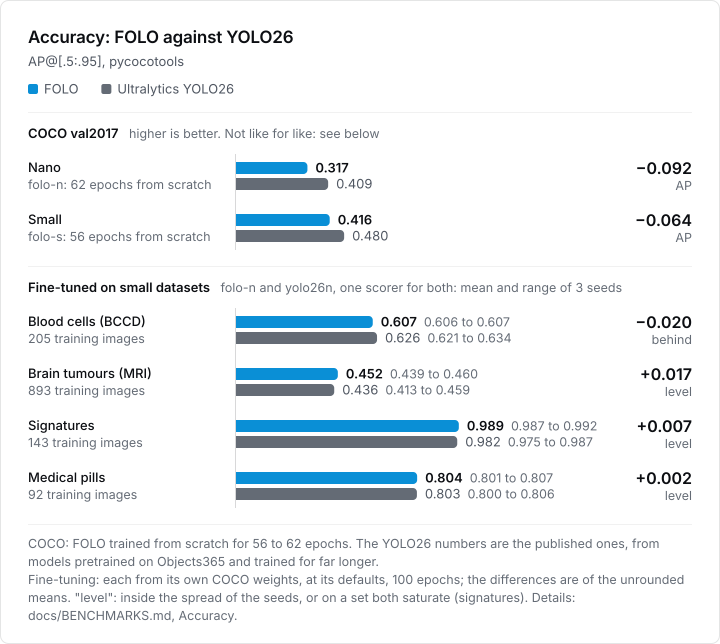
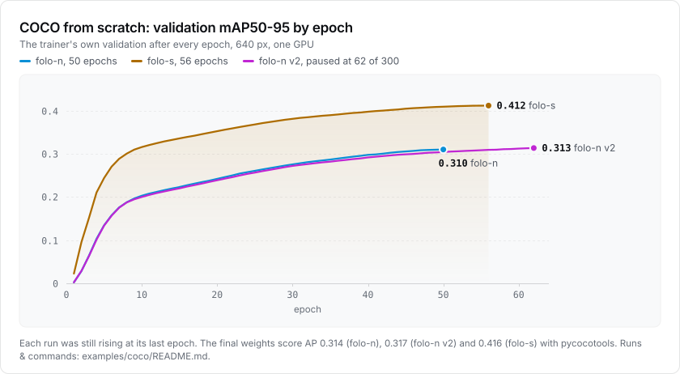

# Benchmarks: FOLO against Ultralytics YOLO

FOLO is meant to be faster than Ultralytics YOLO on the same hardware, at comparable accuracy. This page is the
record behind that claim: how fast both are on one machine and how that was measured, how accurate FOLO's models are,
and the log of every optimisation round that moved the numbers. "The incumbent" is Ultralytics YOLO26 (8.4.198)
throughout.

- Script: [`bench/baselines/ultralytics_bench.py`](../bench/baselines/ultralytics_bench.py)
- Raw results: [`bench/baselines/results-rtx4080s.json`](../bench/baselines/results-rtx4080s.json) (every incumbent
  number below, plus mean, min, iteration counts, GPU clocks and power before/after each section, and contention
  tags)
- Tables: generated by [`bench/baselines/render_tables.py`](../bench/baselines/render_tables.py); bookkeeping tests:
  `python -m unittest discover -s bench/baselines -p "test_*.py"`
- Charts: drawn by [`tools/charts/render.mjs`](../tools/charts/render.mjs) from
  [`tools/charts/data.json`](../tools/charts/data.json) ([Charts](#charts))

## Summary

On one machine (an RTX 4080 SUPER and an i7-14700KF), at 640×640 and against the incumbent's best configuration for
each row, folo-n is faster than yolo26n on every row measured: 4.3× to 5.9× at batch-1 latency on the GPU, 1.4× to
3.9× at batch-16 throughput, 1.8× on the CPU and 1.9× to 2.7× in training, with about a quarter less GPU memory
allocated. folo-s against yolo26s: 1.3× to 3.7×. The table of record is [FOLO targets](#folo-targets); FOLO's
numbers are medians of runs alternated with its previous build (2026-11-13 for the rows
[hill-climb 3](#hill-climb-3-2026-11-13) moved, the end-to-end ones on trained weights; 2026-11-12 for the rest), the
incumbent's were measured on 2026-11-07. One difference in protocol is open, in the GPU batch-1 latency rows: both sides warm up with 25 calls
(forward) or 10 (end to end), and FOLO's bench then keeps warming until a second has passed (since
[Hill-climb 2](#hill-climb-2-2026-11-12)), which the incumbent's does not ([Method](#method)). The incumbent has not
been measured again with that longer warm-up. The CPU rows warm up with 5 calls on both sides.

<p align="center">
  <picture>
    <source media="(prefers-color-scheme: dark)" srcset="img/charts/speed-by-size-dark.svg">
    
  </picture>
</p>

Accuracy is the other half. Trained from scratch on COCO alone for 56 (folo-s) and 78 epochs (folo-n,
`folo-n-coco-v3`; v2 read 0.317 after 62), FOLO's models are 0.06 to 0.07 AP behind the incumbent's published ones, which were pretrained on Objects365 and trained far longer; how much of the
gap each of those accounts for is not known. On a COCO subset at an equal budget FOLO's trainer and Ultralytics' reach
the same AP per epoch, and fine-tuned on four small datasets folo-n and yolo26n are level on three
([Accuracy](#accuracy)).

<p align="center">
  <picture>
    <source media="(prefers-color-scheme: dark)" srcset="img/charts/accuracy-dark.svg">
    
  </picture>
</p>

### How to read this page

| section | what it holds |
|---|---|
| [Machine](#machine), [Reproduce](#reproduce), [Method](#method) | How the incumbent was measured, and what its numbers say |
| [FOLO targets](#folo-targets) | The table of record: every headline row, folo-n and folo-s against the incumbent's best |
| [Hill-climb 4](#hill-climb-4-2026-11-15-accuracy) | The accuracy round: distillation from folo-s, the first full COCO folo-n under today's defaults (not published) |
| [Hill-climb 3](#hill-climb-3-2026-11-13), [Hill-climb 2](#hill-climb-2-2026-11-12), [Hill-climb](#hill-climb-2026-11-09) | The three engine rounds: before and after, where each gain came from, what was tried and lost |
| [Accuracy](#accuracy) | COCO (the published weights, and hill-climb 4's two unpublished folo-n runs), the equal-budget comparison, fine-tuning on small datasets |
| [FOLO on the GPU](#folo-on-the-gpu), [NMS-free head](#nms-free-head-o2o), [FOLO on the CPU](#folo-on-the-cpu) | The measurement log of the work that built each path. Older numbers are kept with their dates; the current ones are in FOLO targets |
| [Next optimisations](#next-optimisations) | What is known to be left |
| [Results](#results) | Generated tables of every incumbent configuration |

Terms used below:
- **Bar**: the incumbent's best number for a row, the one FOLO has to beat. **Tie**: inside the noise band a section
  states (±10% in the targets table, ±3% in the alternated runs).
- **Hill-climb**: an optimisation round in which several agents each worked on one area (a **lane**) on its own
  branch and kept a notebook; the notebooks are in [notes/hill](notes/hill/). The **fold-in** is the re-measurement of
  the merged result.
- **Row 1** to **row 11**: the rows of the [FOLO targets](#folo-targets) table.
- Short hexadecimal names such as `647b981f` are commits of this repository: the build a number was measured on.
- **The test machine**: the one under [Machine](#machine). It is a shared desktop, which is why sections state the
  load other programs put on it.

### Charts

The charts on this page, in the README and in [examples/coco](../examples/coco/README.md) are SVG files in
`docs/img/charts`, one per theme, drawn by `tools/charts/render.mjs` (plain Node, no dependencies) in the colours of
`design/tokens.json`. Their numbers are in `tools/charts/data.json`, each group with the section of this page it was
copied from. After changing a number here, change it there and run `node tools/charts/render.mjs`; the `site`
workflow runs it with `--check` and fails when a committed chart differs from the data.

## Machine

| item | value |
|---|---|
| GPU | NVIDIA GeForce RTX 4080 SUPER, 16 GB, driver 621.01 (WDDM) |
| CPU | Intel Core i7-14700KF: 8 P-cores + 12 E-cores = 20 cores, 28 threads |
| OS | Windows 11 (10.0.26300) |
| Python / torch | 3.12.10 / torch 2.11.0+cu128 (CUDA 12.8, cuDNN 9.19.0) |
| Ultralytics | 8.4.198 |
| Models | YOLO26n / s / m, COCO-pretrained `.pt` (80 classes), 640x640 |

## Reproduce

```sh
python bench/baselines/ultralytics_bench.py --weights-dir <dir with yolo26n.pt, yolo26s.pt, yolo26m.pt> \
    --work-dir <work dir> --out bench/baselines/results-rtx4080s.json
python bench/baselines/render_tables.py bench/baselines/results-rtx4080s.json --update docs/BENCHMARKS.md
```

`--sections params,gpu_fwd,gpu_e2e,cpu,train_step,train` picks sections; re-running one section merges it into the
existing JSON. `--quick` is a smoke test. Weights and the synthetic dataset are not committed. The script writes only
under `--work-dir` and `--out`.
- It sets `YOLO_CONFIG_DIR` to the work dir before importing Ultralytics, so the user's own `settings.json` and font
  cache are never touched.
- It turns off auto-install and telemetry.
- It sends runs to the work dir.
- It refuses to start if any checkpoint is missing, because Ultralytics would otherwise download it next to the
  given path.
- Each dataset size gets its own `data-<train>-<val>-seed<n>` directory.
- `sections_meta` in the JSON records the environment and config each section was measured with.

A full run is about 9 minutes of GPU work (2 training repeats) plus about 5 minutes of CPU benchmarks, not counting the time spent waiting for other jobs.

## Method

**Inference (`gpu_fwd`, `cpu`)** times the model's forward pass: the `nn.Module` Ultralytics runs at inference
(Conv+BN fused, eval mode, `torch.inference_mode()`), fed a random tensor that is already on the device. For YOLO26
the forward includes the head's decode and its one-to-one top-k (`max_det=300`). YOLO26 is NMS-free, so there is no
NMS anywhere.
- **Latency.** Every call is synchronised on both sides (`torch.cuda.synchronize()` then `perf_counter`), after 25
  warm-up calls (10 at batch 16). We report the median and p90 over 100 calls at batch 1, 30 at batch 16.
- **Throughput** ("img/s") is a separate run of the same number of calls back to back with a single synchronise at
  the end, so the CPU can queue work ahead of the GPU.
- **Precisions:**
  - `fp32` is PyTorch's default, where cuDNN convolutions are allowed to use **TF32** tensor cores.
  - `fp32-strict` turns TF32 off. That is the fair comparison for a true-f32 FOLO kernel.
  - `fp16` is `model.half()` with fp16 input.
- **cuDNN autotuning.** Each configuration runs with `cudnn.benchmark` off (the predictor's default) and on.

**End to end (`gpu_e2e`, `cpu` with kind `e2e`)** times `YOLO(...).predict(list_of_images)`, Ultralytics' own
predictor:
- Input is decoded uint8 BGR 640x640 numpy images, from the synthetic val set. JPEG decode is *not* included.
- The pipeline is letterbox, to-tensor, H2D copy, forward, postprocess, `Results`, then `boxes.data.cpu()`, so the
  timing ends with the boxes on the host.
- We also record Ultralytics' own per-image pre/inference/post split.
- fp16 is `quantize=16`. `half=True` is deprecated in 8.4.

**CPU.** fp32, batch 1, 50/30/20 calls for n/s/m after 5 warm-up calls, at 28 threads (all logical), 20 (physical) and
8. Two Ultralytics behaviours matter here:
- **Thread count.** `select_device("cpu")` silently resets torch to `min(8, cores - 1)` threads, and importing
  `ultralytics` sets `OMP_NUM_THREADS=1`. The script forces the thread count before every call and records the count
  actually used. The rows `e2e-ultralytics-default` are what a user gets out of the box (8 threads).
- **Memory layout.** On x86 CPUs with oneDNN, AutoBackend switches the weights to `channels_last`, so the forward-only
  rows do the same.

Before each CPU row the script waits (up to 120 s) for system CPU load to drop below 15%. During the row it records
how many CPU cores other processes used: system busy time minus this process's time, divided by wall time.

**Training step (`train_step`)** isolates training compute from data loading:
- One fixed batch of 16 random 640x640 images (8 random boxes each) stays on the GPU.
- A step is `model.loss(batch)` (YOLO26's E2E loss: one-to-many + one-to-one heads with the task-aligned assigner),
  `backward`, then SGD (momentum 0.937, Nesterov), with `torch.autocast(fp16)` + `GradScaler` for AMP.
- We report the median over 30 steps after 10 warm-up steps, and the peak `max_memory_allocated`.

**Trainer (`train`)** is `YOLO("yolo26x.pt").train(...)` on a synthetic set:
- **Data.** 512 train / 64 val images, 640x640 JPEG: random rectangles, ellipses and triangles (3 classes, 1–8 per
  image) on blurred colour noise, YOLO format, written to `<work dir>/data`.
- **Settings.** `imgsz=640, batch=16, workers=8, epochs=2, close_mosaic=0, optimizer=MuSGD, val=False, plots=False`,
  and the Ultralytics defaults otherwise (including `deterministic=True`).
  - `close_mosaic=0` keeps mosaic on in both epochs. With the default `close_mosaic=10` and `epochs=2`, mosaic would
    close immediately.
  - `MuSGD` is what `optimizer=auto` picks for real runs of more than 10k iterations. A 64-iteration run would get
    AdamW.
- **Timing.** Callbacks synchronise CUDA and timestamp every batch.
  - **"epoch-2 img/s"** is 512 / epoch-2 wall time. This is the sustained throughput, data-loader stalls included, and
    the trainer bar.
  - "median-batch equivalent img/s" is 16 / median batch time over both epochs, minus the first 5 batches (worker
    spawn, cuDNN/allocator warm-up). It is a per-step speed that ignores stalls, kept as a diagnostic only. For
    example, yolo26s AMP run 1 shows 142 here but only 82 img/s sustained.
- **Memory.** Peak memory is torch's `max_memory_allocated` / `max_memory_reserved`, read before the final
  validation.
- **Image counting.** Images are counted per completed batch, so a partial last batch, or a batch size that
  Ultralytics halves after an OOM (recorded as `effective_batch`), is reported correctly.
- **Repeats.** Each run is a fresh process. Each configuration ran 3 times.

**Contention (the GPU and CPU are shared with other agents).**
- **GPU.** Before each section, and before each training run, the script waits until no other process is using
  more than 5% of any GPU engine. It reads the Windows "GPU Engine" performance counters per process, so an idle
  process that merely holds a CUDA context does not count. A background sampler then tags every result row with the
  peak load of any other process, taken over the samples that overlap that row (`other_gpu_load_pct`), and with
  how many successful samples that was (`contention_samples`). A failed query counts in `contention_errors`, never
  as quiet. A row with 0 successful samples was not observed, which is not the same as quiet.
- **CPU.** Training runs also wait for system CPU load below 20%, and record the CPU-cores used by other processes
  during each epoch.

**What was observed in this run.** The committed rows predate `contention_samples`. At that time the sampler took
one sample about every 6.5 s, so a sub-second row was not necessarily sampled itself.
- No sample taken during the `gpu_fwd`, `gpu_e2e` and `train_step` sections (74 s, 18 s and 37 s of wall time)
  saw another process loading the GPU. The inference numbers are therefore very likely uncontended, but not proven
  row by row.
- During training runs, other processes were seen at 6–8% of a GPU engine in 3 of the 9 runs; the trainer table lists
  them.

**What the numbers say:**
- **Batch-1 GPU latency is launch-bound, not compute-bound.** YOLO26n, s and m all take 5–8 ms at batch 1, even
  though m does 12x the FLOPs of n. That time is PyTorch eager dispatching a few hundred kernels from Python under
  Windows WDDM. fp16 does not help at batch 1. This is the cheapest win available to FOLO: fewer, fused kernels and a
  native dispatch loop.
- **At batch 16 the GPU is busy.** fp16 is about 1.6–2x faster than TF32 fp32, and strict fp32 is about 10% slower
  than TF32 fp32. `cudnn.benchmark` makes no difference.
- **The predictor's pre- and postprocess cost more than the forward at batch 16.** For YOLO26n, the forward takes
  6.8 ms per 16 images in fp16, but end to end takes 25.6 ms. Letterbox and normalisation run on one CPU thread
  (`OMP_NUM_THREADS=1`).
- **CPU inference.** 28 threads (all logical, including E-cores) is consistently the slowest and noisiest on this
  hybrid CPU. 8 and 20 threads are best, and their difference is within noise for yolo26n. Other processes used 1–12
  cores during CPU rows (see the column), so treat CPU numbers as ±20%. Compare FOLO against them in a same-session
  A/B run.
- **The trainer is host-bound and very sensitive to CPU load.**
  - With about 3 cores busy elsewhere, yolo26n AMP sustained 224 img/s, close to its 252 img/s compute ceiling.
  - With about 17 cores busy elsewhere, yolo26s sustained 123 img/s; its best run reached 171.
  - The best of three runs is the fair bar. The spread is real and shows how much a lean host-side loop is worth.
- **fp32 training is only about 20% slower than AMP for yolo26n.** It is about 1.8x slower for yolo26s, and it uses
  about 1.8x the memory.

## FOLO targets

FOLO "beats the incumbent" when, on this machine with a quiet GPU and the same model size, folo-n beats the bars
below. The bars come from the best incumbent configuration; FOLO's comparable configuration is noted in each row.
The architectures differ: FOLO's first head is NMS-based (anchor-free decoupled head, as in YOLOv8/11), while YOLO26 is
NMS-free. **FOLO's end-to-end numbers must include its NMS.** Compare folo-n against yolo26n, folo-s against yolo26s,
and so on. When FOLO's params/GFLOPs land, list them in the model-size table so the comparison stays honest about
model size.

**Measured 2026-11-13 on `main` after [hill-climb 3](#hill-climb-3-2026-11-13)** (ffa0f8cb: PRs #253–#260) against
`main` before that climb (e5a6ccf0), the two binaries alternated run by run, for the rows the climb could move: rows
1, 2, 5, 6 and 8 (and the folo-s cells of 8). Each such cell is the median of the rounds kept (min–max), then
e5a6ccf0's median in the same session; rows 1 and 2 also give `main` with plans off (`FOLO_GPU_NO_PLAN=1`). Rows 5, 6
and 8 are measured on trained weights from this climb on (the published `folo-n-coco` / `folo-s-coco`, the first 16
val2017 images, resized to 640×640 for rows 5 and 6): untrained weights pass no candidate at `conf` 0.25, so
candidate-first would skip the whole box branch there. Load: 0–8% GPU from other processes and 1.3–3.3 other CPU
cores for the GPU cells (row 6: 0–1% and 1.6–2.7, the quiet runs of its pass); the CPU cells are loaded (1.3–4.6
other cores for row 8, up to 7.4 for the regression checks; row 8's three quiet runs tie too).
Rows 3, 4, 7 and 9 were re-measured as regression checks and did not move (ties, or a few percent inside
overlapping ranges), so they keep their 2026-11-12 cells with a note;
rows 10 and 11 were not re-measured (row 9 did not move). Per section in [Hill-climb 3](#hill-climb-3-2026-11-13) and
[notes/hill/r3-fold-in.md](notes/hill/r3-fold-in.md).

**Measured 2026-11-12 on `main` after [hill-climb 2](#hill-climb-2-2026-11-12)** (the cells not re-measured above; a37f7f23: PRs #181–#205; row 10
also on e4fa2b43, with #206) against `main` before that climb (647b981f), the two binaries alternated run by run,
3–8 rounds: each cell is the median of the rounds (min–max), then 647b981f's median in the same session. Load: 0–4%
GPU from other processes, with 15–21% bursts in two of the eight inference rounds; about one other
CPU core busy during the folo-n and folo-m CPU rows, up to 4.5 for folo-s; per section in
[Hill-climb 2](#hill-climb-2-2026-11-12) and [notes/hill/r2-fold-in.md](notes/hill/r2-fold-in.md). Inside ±10% of the bar is a
tie. The 2026-11-09 table (the first hill-climb's build against c50211ba) is in [Hill-climb](#hill-climb-2026-11-09).

| # | metric (640x640) | incumbent bar (yolo26n) | FOLO config to compare | folo-n | folo-s |
|---|---|---|---|---|---|
| 1 | GPU forward latency, batch 1, f32 (median) | **4.95 ms** (best of TF32/strict, cudnn.benchmark on/off); 6.04 ms default | f32 | **1.09 ms** (1.08–1.13; e5a6ccf0 1.13; `main` with plans off 1.13), p90 1.11: beats, 4.5x | **2.16 ms** (2.11–2.18; e5a6ccf0 2.21; plans off 2.29): yolo26s 4.87, beats 2.3x |
| 2 | GPU forward latency, batch 1, f16 (median) | **6.25 ms** | f16 | **0.845 ms** on tensor cores (0.82–1.01; e5a6ccf0 1.21, bimodal 0.86–1.31; plans off 0.94); regular f16 1.09 (e5a6ccf0 1.14): beats, 7.4x | **1.30 ms** on tensor cores (1.28–1.31; e5a6ccf0 1.65; plans off 1.41); regular f16 2.13 (2.16): yolo26s 7.47, beats 5.7x |
| 3 | GPU forward throughput, batch 16, f32 | **1454 img/s** (TF32 convs); 1334 img/s strict fp32 | f32 | **2081 img/s** (2048–2098; 647b981f 1619): beats TF32 by 43%. 2026-11-13: a tie (synchronised median 7.81 vs 7.84 ms against e5a6ccf0) | **819 img/s** (743–826; 647b981f 624): yolo26s 627, beats by 31% (was a tie). 2026-11-13: a tie |
| 4 | GPU forward throughput, batch 16, f16 | **2370 img/s** | f16 | **4159 img/s** on tensor cores (3127–4187; 647b981f 3081): beats, 1.75x. 2026-11-13: a tie (4148 vs 4166 img/s) | **1799 img/s** on tensor cores (1730–1825; 647b981f 1237): yolo26s 1159, beats 1.55x (was a tie). 2026-11-13: not moved (1738 vs 1800, +3.6% inside overlapping ranges; no plan at batch 16) |
| 5 | GPU end to end, batch 1 (decoded image in, boxes on host) | **6.92 ms** fp32 / 7.11 ms fp16 | f32 or f16, with NMS | **1.60 ms** f32 (1.58–1.62; e5a6ccf0 1.77), p90 1.70; **1.33 ms** on tensor cores (1.28–1.35; e5a6ccf0 1.51), trained weights: beats, 4.3–5.3x | **2.65 ms** f32 (2.63–2.69; e5a6ccf0 4.57, bimodal; in the later pass's quiet runs 2.67 against its fast mode's 2.78, −4%); **1.82 ms** on tensor cores (1.80–1.84; e5a6ccf0 1.98): yolo26s 8.59, beats 3.2x |
| 6 | GPU end to end throughput, batch 16 | **615 img/s** fp16 / 536 img/s fp32 | best FOLO precision | **2428 img/s** on tensor cores (6.59 ms, 6.57–6.60; e5a6ccf0 2174), trained weights; f32 1281 (e5a6ccf0 1251, bimodal: a tie): beats, 3.9x | **1372 img/s** on tensor cores (11.66 ms, 11.48–11.84; e5a6ccf0 1265); f32 764 (e5a6ccf0 707): yolo26s 446, beats, 3.1x |
| 7 | CPU forward latency, batch 1, f32 (best thread count) | **22.8 ms** (8 threads; 25.1 ms at 20) | f32, best thread count | **12.74 ms** at 28 threads (12.63–12.75; 647b981f 15.23): beats, 1.8x. 2026-11-13: a tie under load (14.64 vs 14.46 ms, 3.7–7.4 other cores) | folo-s **29.2 ms** (27.9–29.6; 647b981f 33.3): yolo26s 42.5, beats; folo-m **68.9 ms** (68.7–70.3; 647b981f 77.7): yolo26m 106.6, beats (28 threads) |
| 8 | CPU end to end latency, batch 1 | **24.8 ms** (Ultralytics default, 8 threads) | f32, with NMS | **13.57 ms** at 28 threads on trained weights (13.54–14.13; e5a6ccf0 13.58: a tie; 1.3–4.6 other cores): beats, 1.8x. Untrained (the 2026-11-12 protocol, where `main` now runs no box branch) 13.12 on 2026-11-12. The NMS-free head does not change it ([NMS-free head](#nms-free-head-o2o)) | folo-s **29.4 ms** trained (29.1–29.6; e5a6ccf0 31.0): yolo26s 51.1, beats; folo-m **68.8 ms** untrained (68.3–70.3; 647b981f 79.7, 2026-11-12; no folo-m weights): yolo26m 107.8, beats |
| 9 | Training compute, batch 16 (step only, no data loader) | **202 img/s** fp32 (TF32) / 252 img/s AMP | f32, and AMP | **380 img/s** f32 (375–380; 647b981f 333), **594 img/s AMP** (591–609; 647b981f 544): beats, 1.9x / 2.4x. 2026-11-13: not moved (f32 383 vs 382 img/s, a tie; AMP 583 vs 608, +4% from one slow e5a6ccf0 round inside overlapping ranges, a tie in the one quiet round). With the trainer's gradient clipping (`FOLO_BENCH_CLIP=1`) 376 / 613 (647b981f 345 / 526); with MuSGD 366 / 592 (647b981f 316 / 443) | **162 img/s** f32 (162–162; 647b981f 151), **299 img/s AMP** (299–300; 647b981f 276): yolo26s 105 / 188, beats. With clipping 161 / 296 (647b981f 150 / 268) |
| 10 | Trainer sustained images/s (epoch-2 wall), batch 16, mosaic, 8 workers | **199 img/s** fp32 / 224 img/s AMP (best of 3) | f32, and AMP | **388 img/s** f32 (388–391; 647b981f 358), **613 img/s AMP** (612–615; 647b981f 553), median of 5 quiet rounds: beats, 1.9x / 2.7x ([Hill-climb 2](#the-trainer-row-10-2026-11-12)) | not measured |
| 11 | Training peak GPU memory, batch 16, f32 | **4353 MiB** allocated (5148 MiB reserved); 2435 MiB AMP | f32, and AMP | **3467 MiB**, **2022 MiB AMP** (train step, as 647b981f; yolo26n train step 4517 / 2646, trainer 4353 / 2435): beats. The pool now keeps a step's buffers between steps: it holds up to 4196 MiB and wgpu reserves 4608 MiB in f32 | **6520 MiB**, **3713 MiB AMP** (as 647b981f; yolo26s train step 8245 / 4614): beats |

For yolo26s and yolo26m, read the same bars from the tables below. Rows 1, 3, 9 and 10 are the headline targets,
because FOLO starts in f32. Row 1 is where a native engine should win by the widest margin, since the incumbent is
launch-bound there.

Note on f32: PyTorch's default fp32 lets cuDNN use TF32 for convolutions. A strict-f32 FOLO kernel should be compared
against the `fp32-strict` rows. The default-fp32 rows are what users actually get from the incumbent.

## Hill-climb 4 (2026-11-15): accuracy

The fourth round worked on accuracy only; nothing in it moves a speed row. A frozen teacher (`folo-s-coco`) runs on
the same augmented batch as the folo-n student, and two terms pull the student's raw head outputs towards the
teacher's: a KL to its class probabilities (no temperature, no per-anchor weight) and a KL to its DFL box
distributions at temperature T, weighted per anchor by the teacher's confidence. It is opt-in (`folo train --teacher`, #279, [docs/MODEL.md](MODEL.md) §8.9): without it
training is bit-identical to before, and inference, export and `.folo` files do not change; the configuration (class
gain 0.5, DFL gain 1.5, T 4) was chosen on a proxy and then run once on full COCO
([notes/hill/r4-distill.md](notes/hill/r4-distill.md), which has the commands and the log of every number below).

**Proxy P1** (20,000 train2017 / 2,000 val2017 images at 320 px, folo-n from scratch, 20 epochs, 3 seeds per arm;
COCO AP of `best.folo` on the 2,000 proxy val images):

| arm | AP mean | AP min-max | AP50 | AP75 |
|---|---:|---:|---:|---:|
| teacher (`t4`, chosen) | 0.1550 | 0.1538-0.1565 | 0.248 | 0.161 |
| matching control, no teacher (`cls1`, the same total class gain 1.0) | 0.1281 | 0.1267-0.1296 | 0.213 | 0.131 |
| defaults (`ctl`) | 0.1247 | 0.1238-0.1255 | 0.204 | 0.130 |

**Full COCO** (val2017, 5000 images, 640 px, `folo val --coco`, one read each; pycocotools on the same detections
gives the same numbers). The control is folo-n from scratch for 64 epochs under today's defaults (`auto` rule 5,
MuSGD, AMP, seed 0); the fork is the control's epoch-32 checkpoint continued to epoch 64 with the teacher. Up to
epoch 32 the two are one run, and the fork's first four batches of epoch 33 give the control's losses to every
printed digit:

| model | AP | AP50 | AP75 | AP_S | AP_M | AP_L |
|---|---:|---:|---:|---:|---:|---:|
| control, epoch 64 (not published) | 0.3507 | 0.4996 | 0.3762 | 0.1672 | 0.3816 | 0.5043 |
| **fork, teacher over epochs 33-64** (not published) | **0.3559** | 0.5087 | 0.3842 | 0.1711 | 0.3880 | 0.5128 |
| `folo-n-coco-v3` (published; reproduces 0.340) | 0.3396 | 0.4874 | 0.3671 | 0.1629 | 0.3678 | 0.4943 |
| `folo-s-coco`, the teacher (reproduces 0.416) | 0.4162 | 0.5798 | 0.4519 | 0.2289 | 0.4594 | 0.5845 |

Paired bootstrap over the 5000 images (`bench/fusion/bootstrap.py`, 1000 resamples):

| difference | AP | 95% interval |
|---|---:|---|
| **fork - control: the distillation recipe** | **+0.0052** | [+0.0032, +0.0075] |
| control - v3 | +0.0112 | [+0.0075, +0.0148] |
| fork - v3 | +0.0164 | [+0.0129, +0.0197] |

The recipe's gain is about a sixth of the proxy's against its defaults (+0.030; +0.027 against the matching control
`cls1`) and 8% of the control's gap to the teacher; it shows in every AP column.

**What is not shown.** One training seed per side: the intervals cover the sampling of the evaluation images, not
the training seed. The fork had the teacher on epochs 33-64 only; a whole run with it from epoch 1 is not measured.
Fork - control measures the whole recipe: the fork's supervised class gain stays 0.5 and the teacher's class term adds
0.5, a total of 1.0 ([docs/MODEL.md](MODEL.md) §8.9), and full scale has no control at the same total class gain
(the proxy's `cls1`). Control - v3 compares two recipes that differ in optimizer, schedule length and starting point
(v3 is SGD: v2's 62 epochs from scratch, then 16 annealing epochs from v2's weights, 78 in all); it is not an
ablation. The teacher was trained on train2017, the student's training set.
The teacher's training cost is not measured cleanly (below). Nothing is published: the new weights are local files,
and the downloadable folo-n is still v3 at 0.340.

**Tried and lost** (proxy, seed 0): a mirrored-view consensus teacher (the teacher also run on the batch mirrored
along W, both views averaged) gave 0.1533 against 0.1536 for one view, below its +0.003 bar, and was removed; a
blended class target (`loss.cls_gain=0.25` + `distill.cls_gain=0.25`, the total class gain kept at 0.5) gave 0.1478,
+0.022 over its fair control but −0.006 against the teacher at total class gain 1.0 (0.1536).

**What it cost.** On the proxy, under the shared load of the full-COCO control, an epoch took 38.5 s with the teacher
against 14.1 s without (528 against 1,898 img/s): about 2.7 times per epoch, not profiled. On full COCO the fork's
epochs 33-64 took 19,519 s of completed-epoch wall time (about 5.4 h, without the interrupted partial epochs) and
the control's 11,211 s (about 3.1 h), on different days and each
next to other lanes' jobs, CI runners and at times a game: that is not a cost ratio (in epochs 55-64 the fork's median
epoch was shorter than the control's). No unloaded A/B was taken.

## Hill-climb 3 (2026-11-13)

The third round tried new algorithms rather than kernel tuning. Four lanes, each on its own branches with PRs reviewed
by GPT-6.1 Sol agents and merged one by one, each with a notebook:
- **lazy**, [candidate-first prediction](notes/hill/r3-lazy-head.md): the class branches run dense, and the box
  branch (its 3×3 convs and DFL output) runs only at the pixels whose best class score passes `conf`, bit for bit
  the dense result. On the CPU (#254) and the GPU (#255). It moves only the end-to-end rows: at `conf` 0.25 folo-n
  needs a box at a median of 21 of its 8400 anchors per val2017 image (p99 119), folo-s at 26 (p99 143).
- **plan**, [recorded forward plans and same-canvas batches](notes/hill/r3-plan.md): a `Predictor`'s GPU prediction
  is recorded once per input shape, precision and head settings and then replayed as a flat list of dispatches,
  without the tensor layer, the pool or the bind-group cache (#258; `FOLO_GPU_NO_PLAN=1` turns it off; no plan is made
  at batch 16, which would pin over 256 MiB). `predict_batch` runs on the images' `rect` canvas when they all share one (16 frames of
  1280×720 run at 640×384 instead of 640×640), and pads a batch of mixed canvases square as before (#259).
- **fusion**, [box fusion and the landing run](notes/hill/r3-fusion.md): opt-in box fusion after NMS (#257, #256),
  the evaluator scoring boxes clipped to the image (#253: the internal mAP50-95 of the published weights +0.0002 to
  +0.0003, no COCO number moved), and 16 annealing epochs for `folo-n-coco-v2`, published as `folo-n-coco-v3` by
  #261 ([Accuracy](#accuracy)).
- **refine**, [a learned box refiner](notes/hill/r3-refine.md): a negative result (#260; [Tried and
  lost](#tried-and-lost-2026-11-13)).

Every number below was measured again on `main` ffa0f8cb against `main` before the round (e5a6ccf0), the two
binaries alternated run by run, on an evening the machine was in use (a browser, music, and a game client on the GPU
for part of it); each section says which runs were quiet and keeps only those where it could. The trained-weight
rows use the published `folo-n-coco` and `folo-s-coco` and the first 16 val2017 images; the notebook
([notes/hill/r3-fold-in.md](notes/hill/r3-fold-in.md)) has the commands, the load of every run and the log behind
every cell. Inside ±3% with overlapping ranges is a tie.

### GPU prediction (2026-11-13)

Trained weights (the `gpu_trained` bench, the public `Predictor` at `conf` 0.25), median of the runs (min–max): 6
quiet pairs from two evening passes (4 for the 640×640 batch-1 row; 0–5% other GPU, 1.3–3.3 other cores), and for
the 640×640 batch-16 rows (row 6, added after them) a third pass at 01:08–01:15, its quiet runs only (0–1% other
GPU, 1.6–2.7 other cores: e5a6ccf0 4 of 5; `main` 3 of 5 for folo-n and 2 for folo-s, since one `main` run crashed
after its folo-n rows). The three loaded runs (10.4–17.0 other cores) are left out: on the tensor-core rows they
read 7–9% slower, and one of `main`'s read faster on folo-n's f32 row (10.35 ms):

| row | folo-n e5a6ccf0 | folo-n `main` | folo-s e5a6ccf0 | folo-s `main` |
|---|---|---|---|---|
| f32 e2e b1, 640×640 images (row 5) | 1.77 ms (1.73–1.78) | **1.60** (1.58–1.62), −10% | 4.57 (3.16–4.58), bimodal; third pass 2.78 (2.75–2.81) | 2.65 (2.63–2.69); third pass 2.67 (2.62–2.72), −4% against e5a6ccf0's fast mode |
| f16 tensor cores e2e b1, 640×640 | 1.51 (1.46–1.52) | **1.33** (1.28–1.35), −12% | 1.98 (1.96–2.01) | **1.82** (1.80–1.84), −8% |
| f32 e2e b1, val2017 images (`rect`) | 1.43 (1.42–1.44) | **1.38** (1.36–1.40), −4% | 2.42 (2.36–2.45) | **2.29** (2.27–2.40), −6% |
| f16 tensor cores e2e b1, `rect` | 1.43 (1.36–1.57) | **1.24** (1.21–1.31), −13% | 1.69 (1.65–1.75) | 1.63 (1.60–1.67), −4% |
| f32 e2e b16, 640×640 images (row 6) | 12.79 ms (11.38–15.53), 1251 img/s, bimodal | 12.49 (12.16–12.65), 1281 img/s, −2%: a tie | 22.64 (22.53–22.76), 707 img/s | **20.94** (20.89–20.98), 764 img/s, −8% |
| f16 tensor cores e2e b16, 640×640 (row 6) | 7.36 (7.12–7.41), 2174 img/s | **6.59** (6.57–6.60), 2428 img/s, −10% | 12.65 (12.26–12.72), 1265 img/s | **11.66** (11.48–11.84), 1372 img/s, −8% |
| f32 e2e b16, val2017 images (padded square) | 10.46 ms (10.05–10.89), 1530 img/s | **9.30** (9.04–10.25), 1721 img/s, −11% | 22.37 (22.02–22.77), 715 img/s | 21.53 (20.41–22.45), 743 img/s, −4% |
| f16 tensor cores e2e b16, val2017 images | 6.24 (6.16–6.30), 2566 img/s | **5.81** (5.74–6.06), 2754 img/s, −7% | 11.22 (11.18–11.45), 1427 img/s | **10.70** (10.64–10.93), 1496 img/s, −5% |
| f32 `predict_batch` 16 × 1280×720 | 14.13 (13.43–25.49); third pass 14.16 | 13.95 (10.02–21.17), bimodal; third pass 10.23 (10.17–10.24) | 25.59 (25.37–25.83) | **17.44** (16.05–17.91), −32% |
| f16 tensor cores `predict_batch` 16 × 1280×720 | 9.67 (9.62–9.90) | **7.96** (7.90–8.10), −18% | 14.61 (14.55–14.85) | **11.01** (10.95–11.04), −25% |

The forward rows, random weights (the `gpu` bench, 5 rounds: e5a6ccf0 all 5, `main` and `main` with
`FOLO_GPU_NO_PLAN=1` 4 each, after dropping two runs with 6.4 and 8.0 other cores; 0–8% other GPU, 1.3–2.4 other cores):

| row | folo-n e5a6ccf0 | folo-n `main` | `main`, plans off | folo-s e5a6ccf0 | folo-s `main` | `main`, plans off |
|---|---|---|---|---|---|---|
| f32 forward b1 (row 1) | 1.13 ms (1.13–1.32) | **1.09** (1.08–1.13) | 1.13 (1.12–1.18) | 2.21 (2.16–2.67) | **2.16** (2.11–2.18) | 2.29 (2.22–2.46) |
| f16 forward b1 | 1.14 (1.12–1.44) | **1.09** (1.08–1.09) | 1.15 (1.14–1.50) | 2.16 (2.11–2.72) | 2.13 (2.06–2.33) | 2.20 (2.15–2.26) |
| f16 tensor cores forward b1 (row 2) | 1.21 (0.86–1.31), bimodal | **0.845** (0.82–1.01) | 0.94 (0.87–0.96) | 1.65 (1.32–1.95) | **1.30** (1.28–1.31) | 1.41 (1.38–1.57) |
| f32 forward b16 (row 3), pipelined | 2064 img/s (1804–2083) | 1962 (1827–2089) | 1977 (1882–2074) | 767 (39–826) | 825 (97–828) | 822 (802–828) |
| f32 forward b16, synchronised median | 7.81 ms (7.77–9.47) | 7.84 (7.78–8.76), tie | 8.63 (7.99–8.95) | 20.05 (19.63–22.31) | 19.65 (19.58–19.87), tie | 19.76 (19.62–20.62) |
| f16 tensor cores forward b16 (row 4) | 4148 img/s (3685–4164) | 4166 (4144–4184), tie | 4093 (4052–4185) | 1738 (1493–1823) | 1800 (1626–1823), +3.6%, ranges overlap | 1654 (1573–1818) |
| f32 `predict_batch` 16 × 1280×720 | 14.16 ms (13.65–16.15) | **10.20** (9.62–10.97), −28% | 10.14 (9.77–10.41) | 25.92 (25.39–31.87) | **17.90** (17.87–18.03), −31% | 17.86 (17.76–19.55) |
| f16 tensor cores `predict_batch` 16 × 1280×720 | 10.07 (9.49–11.52) | **7.98** (7.68–8.99), −21% | 8.22 (8.08–8.27) | 15.46 (14.50–18.02) | **11.64** (11.38–13.43), −25% | 11.29 (11.20–12.50) |

Where it comes from:
- **Batch 1, end to end** (row 5, −10% f32 and −12% on tensor cores for folo-n): candidate-first (#255) skips the box
  branch at all but a few dozen pixels, and the plan (#258) replays the device side of a prediction after the
  letterbox. On the same binary the plan's share of the forward is −3.5% (f32) and −10% (tensor
  cores) for folo-n, −6% and −8% for folo-s (plans off against on, above).
- **The forward rows** do not run candidate-first (they are dense by definition), so rows 1 and 2 move by the plan
  alone: folo-n f32 1.13 → 1.09 ms, tensor cores 0.94 → 0.845 ms with plans on, and e5a6ccf0's tensor-core row is
  bimodal (0.86–0.91 ms in two runs, 1.21–1.31 in three).
- **Batch 16**: no plan is made, so the forward rows 3 and 4 do not move (ties, but folo-s on tensor cores +3.6%
  inside overlapping ranges); candidate-first gives −4 to −11% end to end on
  trained weights.
- **1280×720 batches** (−18 to −35%): #259 runs them at 640×384, 60% of the pixels, plus candidate-first.
- The random-weight bench's end-to-end rows are not used for rows 5 and 6: random weights pass no candidate at
  `conf` 0.25, so `main` runs no box branch there at all (folo-n f32 e2e b1 2.64 → 1.79 ms, bimodal on every binary
  that evening; the notebook has them).

### GPU training step (2026-11-13)

`FOLO_GPU_TENSOR_CORES=1 FOLO_BENCH_SECTIONS=train`, batch 16 at 640, SGD, 5 rounds (one quiet: 1.4–1.7 other cores;
the others 3.8–16.5, and a CI test on the GPU beside one e5a6ccf0 run; the GPU-bound medians held their range through
it): f32 ties; folo-n's AMP step is 4% faster at the median, from one slow e5a6ccf0 round, inside overlapping
ranges and a tie in the quiet round (25.87 vs 26.03 ms). Neither is read as a gain: a training step records no plan
and runs the same kernels.

| row | folo-n e5a6ccf0 | folo-n `main` | folo-s e5a6ccf0 | folo-s `main` |
|---|---|---|---|---|
| f32 | 41.73 ms (41.53–42.11), 383 img/s | 41.93 (41.67–42.01), 382 img/s: tie | 99.06 (97.79–99.19), 162 img/s | 98.22 (97.59–98.64), 163 img/s: tie |
| AMP | 27.44 (25.87–36.58), 583 img/s | 26.30 (26.03–27.27), 608 img/s: −4%, ranges overlap; the quiet round 26.03 against 25.87, a tie | 53.82 (53.03–56.45), 297 img/s | 53.28 (53.20–54.69), 300 img/s: tie |
| dispatches, new bind groups, new pool buffers per f32 step | 1117, 0, 0 | the same | 1120, 0, 0 | the same |
| peak memory f32 / AMP | 3467 / 2022 MiB | the same | 6520 / 3713 MiB | the same |

### CPU (2026-11-13)

`cargo bench -p folo-vision --bench cpu_e2e`, 28 threads, at High priority, in two kinds of run: the whole bench
(untrained rows, trained rows, batches of 16; folo-n 6 rounds, folo-s 5 and 3 more later, folo-m 3) with 3.7–7.4
other cores busy (a game open until about 23:50; folo-m and the later folo-s rounds 1.8–4.4), and the trained rows
alone (`FOLO_BENCH_BATCH=0 FOLO_BENCH_UNTRAINED=0`, 60 calls, folo-n 3 rounds with 1.3–4.6 other cores, folo-s 4
rounds with 2.8–8.7 in runs of 4 s). Most runs were above the 3-core quiet rule, so nothing was dropped and every
cell gives its load; the trained 1280×720 frames of folo-s are slower in the whole bench only (below). The runs that
met the rule agree with the cells: row 8 for folo-n with the rows alone reads 13.41 and 13.58 ms on e5a6ccf0 and
13.54 on `main` (1.3–2.5 other cores), and folo-s's trained 1280×720 frame in the whole bench 21.05–22.80 ms
without #259 (6 quiet runs of e5a6ccf0 and f04dce45) and 26.92–29.20 with it (7 of `main` and 25666428; 1.7–2.9
other cores in both). The trained rows cycle the first 16 val2017 images (letterboxed square, or resized to 1280×720
for the `rect` rows):

| row (28 threads) | folo-n e5a6ccf0 | folo-n `main` | folo-s e5a6ccf0 | folo-s `main` | folo-m e5a6ccf0 | folo-m `main` |
|---|---|---|---|---|---|---|
| forward b1 (row 7), whole bench | 14.64 ms (13.61–15.09) | 14.46 (14.16–14.90), tie | 30.48 (29.76–30.70) | 31.41 (30.28–31.75), +3.1%, ranges overlap | 75.32 (74.71–75.76) | 75.47 (75.20–76.07), tie |
| e2e b1, trained, 640×640 (row 8), trained rows alone | 13.58 ms (13.41–14.87) | 13.57 (13.54–14.13), **tie** | 31.00 (30.30–31.48) | **29.40** (29.05–29.64), −5% | no weights | |
| the same, whole bench | 15.65 (14.39–15.79) | 15.36 (14.73–16.13), tie | 31.37 (30.97–32.92) | 31.19 (30.16–31.70), tie | | |
| e2e b1, trained, 1280×720 (`rect` 640×384), trained rows alone | 11.73 (10.88–11.94) | **11.10** (10.82–11.40), −5% | 22.27 (21.08–22.97) | **21.25** (20.48–21.40), −5% | | |
| the same, whole bench | 12.52 (11.19–12.96) | 12.04 (10.43–12.64), −4% | 22.08 (21.46–23.15) | **27.29** (26.39–31.07), **+24%** | | |
| e2e b1, untrained, 640×640 (no box branch on `main`) | 15.45 (13.74–15.63) | 13.84 (12.81–14.05) | 31.18 (30.48–31.61) | 30.11 (29.54–30.44) | 76.46 (75.85–76.92) | 74.23 (73.09–74.54) |
| `predict_batch` 16, trained, val2017 images (padded square) | 151.7 ms (149.6–153.7), 105 img/s | **130.2** (129.0–134.0), 123 img/s, −14% | 385.5 (379.5–392.7), 42 img/s | **354.0** (347.5–363.3), 45 img/s, −8% | | |
| `predict_batch` 16 × 1280×720, trained | 146.7 (143.0–150.6), 109 img/s | **96.5** (93.9–100.2), 166 img/s, −34% | 382.5 (380.3–398.2), 42 img/s | **275.2** (272.8–283.5), 58 img/s, −28% | 1045.8 (1041.2–1056.9), untrained | **667.6** (666.4–669.6), −36% |
| `predict_batch` 16, mixed shapes, untrained | 149.6 (144.0–151.2) | **129.2** (124.9–130.6), −14% | 378.6 (377.4–397.9) | **352.7** (345.8–366.0), −7% | 1056.5 (1054.2–1062.4) | **998.9** (982.4–1001.8), −5% |

- **Row 8 did not move for folo-n on trained weights**: 13.58 → 13.57 ms at 640×640 with the rows alone, a tie in
  the whole bench too (−2%). Candidate-first saves 5% on the 1280×720 frames and 14% on a batch of 16, and folo-s
  gains 5%. On untrained weights `main` runs no box branch at all (−10% for folo-n, the most candidate-first could
  give); with trained weights at 640×640 the saving does not show here. Lane lazy measured −14% at 32–55% CPU load;
  one reading is that the dense box branch is cheap while cores are free and costly when they compete, but that is
  not tested.
  **Read again by lane cpufix** ([notes/hill/r3-cpufix.md](notes/hill/r3-cpufix.md), A): the tie was the spread of
  60-call runs. With 200 calls the same two binaries read 13.88 ms (13.38–14.58) and 13.04 (12.36–13.45), −6%, in 4
  rounds with 1.8–4.0 other cores. In one process, call by call, candidate-first against the dense head is −7% on
  idle cores and −9 to −10% with 8 cores busy, so the load reading holds in part: the dense box branch costs about
  7% of the step on idle cores too. The sparse box branch has no large fixed cost (about 0.3 ms from the first
  candidate on). Row 8's cell keeps the fold-in's 60-call number.
- **Batches of 1280×720 frames**: −28 to −36%, the rect canvas (#259, 60% of the pixels) and candidate-first
  together; a batch of val2017 images, padded square, gains −8 to −14% from candidate-first alone.
- **folo-s's trained 1280×720 row is 24–29% slower on `main` in the whole bench** (22.08 → 27.29 ms in the evening's
  5 rounds, 21.88 → 28.21 ms in 3 later rounds with 1.8–4.2 other cores, every run of both) and 5% faster with the
  trained rows alone or with either the untrained rows or the batches left out (`FOLO_BENCH_BATCH=0`: 22.01 → 20.91
  ms; `FOLO_BENCH_UNTRAINED=0`: 21.94 → 20.87). So it depends on what ran before it in the process; folo-n does not
  show it. A bisect with the same bench (3 rounds each): f04dce45 (candidate-first, before #258 and #259) 21.29 /
  21.45 ms, 25666428 (+ #259) 29.13, ffa0f8cb 26.92–27.29: it arrives with #259, whose CPU change is the rect batch
  the untrained model's `predict_batch` rows now run ([Rows worse than e5a6ccf0](#rows-worse-than-e5a6ccf0)).
  Fixed in #264: it was the CPU buffer cache, not the rect batch itself.
- The forward rows do not move: ties for folo-n and folo-m, and folo-s +3.1% (30.48 → 31.41 ms) inside overlapping
  ranges, −4.7% and −1.3% in the later bisect runs; CPU forward code did not change in the round.

### Accuracy (2026-11-13)

`folo val --coco` of every published COCO checkpoint with and without `--fusion dfl --iou 0.65 --max-det 1000`:
the table is in [Accuracy](#accuracy) ("Box fusion, an option"). Every number matches lane fusion's to four digits,
and `folo-n-coco-v3` matches #261's verification (0.339555 / 0.487367; 0.343357 with the flags). With the default
flags `folo-n-coco`, `-v2` and `folo-s-coco` read 0.3138, 0.3168 and 0.4162, lane fusion's B0 (the clip of #253
moves only the trainer's internal mAP, not the COCO path).

### Tried and lost (2026-11-13)

From the notebooks, measured and not shipped:
- **A learned box refiner** (lane refine): eleven refiners on a frozen folo-n (nine on edge probes of the P3–P5
  features, two on the input image), best +0.0007 AP on the dev split against a +0.005 gate. The top-scoring box per
  object is already 1–3 px from its truth at the median (1.2 / 1.9 / 2.7 px for small / medium / large objects); the
  remaining error is a tail (occlusion, ambiguous extent) that local edges do not settle, and a refiner that helps
  the looser duplicates costs the tight top boxes more than it gains.
- **C3k sibling fusion** (lane lazy: the two 1×1 convs that read a C3k block's input run as one): a tie (folo-n
  forward b1 1.14 → 1.13 ms on the GPU, CPU 15.21 → 15.12 ms).
- **Lattice pooling** in box fusion (a weighted product of the members' DFL distributions on the kept box's bin
  lattice): below even plain NMS on the dev split (−0.0009 / −0.0017 / −0.0133 AP for v1 / v2 / folo-s), since a
  power distorts DFL's sub-bin position and the levels' lattices are offset from each other. **The censoring guard** (down-weighting
  a side whose mass sits on the last DFL bin): within ±0.0001 AP; only 0.02% of sides put more than 0.3 of their mass
  there. Soft-NMS, Matrix NMS, per-level score offsets and a DFL temperature tied or lost as well.
- **The plan's copy-slot variant** (copying each call's input into the plan's own buffer instead of rebinding it): a
  tie at batch 1, +2.7 to +6.2% at batch 16 (a 79 MB f32 input and the head outputs copied per call).
- **Plans at batch 16**: a ceiling of 0.5–3.7% and a tie, while pinning 316–617 MiB; the 256 MiB cap now leaves
  batch 16 unplanned.
- **Mixed-canvas batches as one pass per canvas on the CPU**: four passes of four images +4.7% (median of 6 rounds)
  against one padded square pass, so mixed batches stay square.

From the lead's counsel before the round, not built:
- **A learned rescoring pass** (a second look at each candidate to correct its score): redundant with the IoU-aware
  score TAL already trains, with low odds of a measurable gain; the cluster's neighbours (box fusion) were the unused
  information instead.
- **An upsample-commute rewrite** (a 1×1 conv applied before the nearest upsample instead of after): 2.4% of the
  FLOPs, at most 0.15 ms on the CPU and 1.5% at GPU batch 16, inside the tie band; its GPU form is the epilogue add
  that already lost in hill-climb 2.
- **An integer CPU path**: i16 accumulation leaves 9-bit weights and 11-bit activations at K = 2304 and Winograd needs
  about 4 more bits, so the 3×3 convs (37% of the FLOPs) would only tie; at most 1.2× on rows 7 and 8, not exact, a
  second kernel family, and int8 loses mAP without quantisation-aware training.
- **Video delta inference** (recomputing only what changed since the last frame): not exact with real cameras, whose
  noise changes every pixel.

### Against the lanes' own claims (2026-11-13)

The lanes measured under each other's load (often 30–100% CPU) and, late in the day, beside a game on the GPU.
Where a number here differs from a lane's by more than noise:
- **The plan's +5.4% on the folo-n f32 training step** (plan: 52.5 → 55.3 ms beside another GPU process, unresolved):
  does not reproduce, +0.5% here (41.73 → 41.93 ms, inside both builds' range). Its AMP −8.6% is −4% here (27.44 → 26.30 ms, from one slow e5a6ccf0 round, inside
  overlapping ranges) and a tie in the quiet round (25.87 → 26.03 ms).
- **The plan's batch-1 gains** (plan: row 1 −23%, row 2 −35% with two binaries under 5–88% CPU load; −3.5% / −5.7%
  in its quieter `gpu_latency` rounds; about −5% f32 and −10% tensor cores for folo-n and a tie for folo-s with plans
  toggled in one process): plans off against on on `main`'s binary here read −3.5% and −10% for folo-n, as its
  quiet numbers, and −6% / −8% for folo-s, where the lane had a tie.
- **The plan's slower batch-16 rows** (plan: +2.4 to +5.3% under load): not slower here (ties, and folo-s on tensor
  cores +3.6% faster inside overlapping ranges, 1738 → 1800 img/s); no plan is made at batch 16.
- **"The mixed-batch slow mode no longer reproduces on `main`"** (plan): it does, on both builds (folo-n f32
  `predict_batch` of 16 mixed shapes, 35–39 ms in 3 of 9 runs against 10.5–14.6; random weights), so it predates
  the round. A leftover ([Next optimisations](#next-optimisations)).
- **The plan's 1280×720 batches** (plan, against `main` with candidate-first already in: −21 / −14 / −32 / −21% for
  folo-n f32, folo-n tensor cores, folo-s f32, folo-s tensor cores): −28 / −21 / −31 / −25% here against e5a6ccf0 on
  random weights, which add candidate-first's gain (overstated there), and on trained weights folo-n tensor cores −18%,
  folo-s −32% / −25%. folo-n f32 on trained weights is bimodal on `main` (10.0 ms in 3 of 10 runs, 11–21 ms in the
  others), so it is not read as a gain.
- **Lazy's GPU batch 16** (lazy: folo-n f32 −10.5%, tensor cores −11.7%, folo-s f32 −8.9%, tensor cores −4.1%): −11%,
  −7%, −4% and −5% here; the folo-n tensor-core and folo-s f32 gains are smaller here.
- **Lazy's "row 5 not established"**: established here for folo-n, −10% (f32) and −12% (tensor cores) at 640×640
  (−10% and −8% in the third pass), and −8% for folo-s on tensor cores; folo-s f32 is smaller than the evening's
  −42%: e5a6ccf0 has a slow mode (4.57 ms in three of five evening runs), and in its fast mode (the third pass's
  quiet runs) it reads 2.78 ms against `main`'s 2.67, −4%.
- **Lazy's CPU row 8** (lazy: folo-n 17.49 → 15.02 ms, −14%, at 32–55% CPU load; counsel's estimate before the round
  −9 to −12%): does not reproduce, a tie here on trained weights (13.58 → 13.57 ms with the rows alone, −2% in the
  whole bench; 1.3–7.4 other cores; lane cpufix later read −6% with 200 calls, above). Its 1280×720 frame (−8%) is −5% here and its batch of 16 (−12%) −14%. folo-s,
  which the lane could not read under load: −5% at 640×640 and on the 1280×720 frame with the rows alone.
- **The plan's CPU batch of 1280×720 frames** (plan: −16.6%, #259 alone): −20% (untrained) and −21% (trained) here
  for #259 alone in the bisect (f04dce45 against 25666428, folo-s), −34% for folo-n against e5a6ccf0 with
  candidate-first in it. The lane did not see the folo-s single-frame slowdown its change brings in the whole bench
  ([Rows worse than e5a6ccf0](#rows-worse-than-e5a6ccf0)).

Everything else agrees within noise: plan's 0 mismatches and lazy's bit-identity are not re-tested here, but the
detections per image of every trained row are the same on both builds (folo-n 3.6 / 3.8 / 3.8, folo-s 4.6 / 5.3 /
4.8); the training step's dispatches, bind groups, pool buffers and peak memory are unchanged; and every accuracy
number of lane fusion reproduces to four digits.

### Rows worse than e5a6ccf0

- **folo-s on the CPU, a trained 1280×720 frame after the untrained model's rows in one process**: +24 to +29% (22.08
  → 27.29 and 21.88 → 28.21 ms, every run; the only row slower in every run), and 5% faster than e5a6ccf0 when those
  rows did not run first. It arrives with #259 (f04dce45 21.29 / 21.45 ms, 25666428 29.13), so something the untrained
  model's rect `predict_batch` leaves behind in the process slows the next model's single 640×384 calls. Reproduce:
  `FOLO_BENCH_SCALE=s FOLO_BENCH_ITERS=40 FOLO_BENCH_BATCH=16 FOLO_BENCH_WEIGHTS=<dir>/folo-s-coco.folo
  FOLO_BENCH_IMAGES=<val2017> cargo bench -p folo-vision --bench cpu_e2e`, the `trained 1280x720 (rect 640x384)` row;
  with `FOLO_BENCH_BATCH=0` or `FOLO_BENCH_UNTRAINED=0` it is fast. It does not change any prediction (the same
  detections).
  **Fixed in #264** ([notes/hill/r3-cpufix.md](notes/hill/r3-cpufix.md), B). The cause was the CPU buffer cache,
  which never evicted: once the untrained rows' batches had filled it (1 GiB), the buffers the trained model's box
  branch needs at 640×384 could never get in and were allocated fresh on every call. #259 added the lengths that
  filled it; the cache's policy caused it. The cache now evicts lengths that have gone unused when it is full.
  8ea21bab against #264 in the whole bench (4 to 8 rounds, 1.4–2.0 other cores): this row 26.36 → 21.26 ms (−19%;
  20.95 with the cache cleared first, the new control row), folo-s's `predict_batch` of 16 × 1280×720 frames 264.2 →
  194.6 ms (−26%), folo-n's 89.4 → 68.8 (−23%), row 8 in the whole bench 14.48 → 13.61 ms for folo-n (−6%) and
  29.48 → 28.43 for folo-s (−3.6%). CPU training steps tie.
- **folo-n f32 `predict_batch` of 16 × 1280×720 frames on the GPU, trained weights**: not slower at the median (14.13 →
  13.95 ms) but bimodal on `main` in the two evening passes (10.0 ms in 3 of 10 runs, 11–21 ms in the others;
  e5a6ccf0 13.4–15.1, one 25.5), and steady in the third pass (10.23 ms, 10.17–10.24, against 14.16: −28%). Not
  explained.
- **folo-n f32 forward at batch 16, pipelined**: 2064 → 1962 img/s (−5%) with overlapping ranges, and the synchronised
  median ties (7.81 vs 7.84 ms); no plan is made at batch 16 and that path did not change, so it is read as noise.
- **folo-s CPU forward b1**: +3.1% in the whole bench (30.48 → 31.41 ms) with overlapping ranges, and −4.7% and
  −1.3% in the later bisect runs (29.52 → 28.14 against e5a6ccf0, 28.86 → 28.49 against f04dce45): noise; the
  forward did not change.
- **folo-n f32 `predict_batch` of 16 mixed shapes, GPU, random weights**: 14.53 → 23.46 ms at the median (+61%),
  because 2 of `main`'s 4 runs fell in a 35–39 ms slow mode that e5a6ccf0 shows too (1 of 5 runs); the fast mode is
  10.5–14.6 ms on both builds, and `main` with plans off reads 12.28 ms (11.27–13.59). Not read as a regression of
  the round (the mode predates it), and not explained.

Nothing else measured is slower than e5a6ccf0. One `main` run of the `gpu_trained` bench crashed with an access
violation at the switch from folo-n's predictors to folo-s's, once in 30 runs of `main`'s GPU benches and in none of
e5a6ccf0's 25; not reproduced ([notes/hill/r3-fold-in.md](notes/hill/r3-fold-in.md), Leftovers).

## Hill-climb 2 (2026-11-12)

Nine lanes, each on its own branches with its own PRs (reviewed by GPT-6.1 Sol agents, merged one by one into
`main`), measured against `main` before the climb (647b981f) under each other's load and kept a notebook with their
method, commands, A/B tables and negative results: [GPU dispatch cost and the buffer pool](notes/hill/r2-gpu-dispatch.md)
(lanes gpu-dispatch and gpu-pool), [forward GEMM / conv kernels](notes/hill/r2-gpu-gemm.md),
[the GPU training step](notes/hill/r2-gpu-train.md), [the CPU](notes/hill/r2-cpu.md) (lanes cpu and cpu2),
[trainer start-up, validation, loader caches and checkpoint writes](notes/hill/r2-trainer.md) (lanes trainer and trainer2)
and [learning](notes/hill/r2-learn.md) (`auto` rules 4 and 5). 27 PRs merged (#181–#207, of which #192, #193 and #195 fix
tests and #196, #200, #204, #205 and #207 are notebooks). Every number below was measured again on `main` a37f7f23
(row 10 also on e4fa2b43, which adds #206) against 647b981f on a quieter machine, the binaries alternated run by run
([notes/hill/r2-fold-in.md](notes/hill/r2-fold-in.md): commands, load per run, and the log behind every cell). 647b981f's `gpu`
bench got the merged bench's latency warm-up (a second of back-to-back calls, #203) and a pool counter, so its
batch-1 rows are steady state too; the earlier tables of this page used 25 warm-up calls. Inside ±3% is a tie.

### GPU inference (2026-11-12)

`FOLO_GPU_TENSOR_CORES=1 FOLO_BENCH_SECTIONS=forward,predict cargo bench -p folo-vision --bench gpu`, 8 rounds from
two sessions (0–4% GPU from other processes, with 15–21% bursts in two rounds; 1.0–13.9 other CPU cores):

| row | folo-n 647b981f | folo-n `main` | folo-s 647b981f | folo-s `main` |
|---|---|---|---|---|
| f32 forward b1 (p90) | 2.13 ms (2.07–3.04), p90 2.20 | **1.14 ms** (1.13–1.33), p90 1.17 | 3.96 ms (3.85–7.68) | **2.24 ms** (2.16–2.28) |
| f32 forward b16 | 1619 img/s (1598–1650) | **2081 img/s** (2048–2098) | 624 img/s (197–642) | **819 img/s** (743–826) |
| f32 e2e b1 | 2.92 ms (2.85–4.46) | **1.75 ms** (1.69–2.05) | 4.90 ms (4.53–6.04) | **3.04 ms** (2.82–5.65) |
| f32 e2e b16 | 1189 img/s (1094–1233) | **1469 img/s** (1440–1500) | 580 img/s (560–584) | **699 img/s** (681–713) |
| f16 forward b1 | 2.16 ms (2.05–3.47) | **1.15 ms** (1.11–1.33) | 3.80 ms (3.63–5.29) | **2.14 ms** (2.10–2.53) |
| f16 forward b16 | 1953 img/s (1852–2020) | **2339 img/s** (2297–2413) | 804 img/s (724–807) | **934 img/s** (908–935) |
| f16 e2e b1 / b16 | 2.95 ms / 1405 img/s | **1.69 ms / 1601 img/s** | 4.37 ms / 681 img/s | **2.84 ms / 767 img/s** |
| f16 tensor cores forward b1 (p90) | 1.85 ms (1.59–2.37), p90 2.00 | **0.95 ms** (0.87–1.55), p90 1.07 | 2.18 ms (2.12–4.02) | **1.36 ms** (1.35–1.44) |
| f16 tensor cores forward b16 | 3081 img/s (2729–3112) | **4159 img/s** (3127–4187) | 1237 img/s (1147–1250) | **1799 img/s** (1730–1825) |
| f16 tensor cores e2e b1 | 2.52 ms (2.14–3.49) | **1.56 ms** (1.41–2.48) | 2.80 ms (2.72–3.91) | **2.12 ms** (1.91–2.60) |
| f16 tensor cores e2e b16 | 1840 img/s (1584–1916) | **2155 img/s** (1724–2312) | 979 img/s (941–990) | **1337 img/s** (1279–1348) |
| upload + letterbox b16 (f32) | 2.5–2.9 ms | 2.4–2.7 ms, tie | | |

Where it comes from:
- **Batch 1** (−45–50% for folo-n): convs that read their concatenation and channel-slice inputs in place, 48
  copies per forward gone (#185, [r2-gpu-dispatch.md](notes/hill/r2-gpu-dispatch.md)); split-K for forward convs with few
  output tiles, which halves the GEMM time of every layer below 160 px at batch 1 (#186,
  [r2-gpu-gemm.md](notes/hill/r2-gpu-gemm.md)); cached bind groups (#182: none created after the first calls); and a wait
  that polls the device for up to 2 ms before blocking (#203). The spin's share on a quiet machine is 4–6% (f16
  tensor cores 0.96 → 0.90 ms, f32 1.19 → 1.14, [r2-fold-in.md](notes/hill/r2-fold-in.md)); its larger gains in the lane's
  table were measured with a busy CPU, where a blocked thread woke on another core.
- **Batch 16**: #185 (42 copies → 6 at batch 16), #186, the forward gather through a per-column tap mask (#199,
  +2–4%), and for tensor cores 64×64 / 64×128 tiles instead of 128×128 for forward convs (#202: folo-s f16 b16
  +25%, folo-m +18%).
- folo-s f32 and f16 tensor cores at batch 16 now beat the yolo26s bars by 31% and 55%; both were ties.
- The folo-n f16 tensor-core batch-16 forward of `main` read 4149–4187 img/s in one session and 3127–3886 in the
  other, the slower one the quieter (0–1% other GPU); the clocks were not logged, so the cause is not known. folo-s f32 batch 16 is bimodal on both builds (one
  647b981f round at 197 img/s; rounds with a p90 of 120–180 ms on both).

**Accuracy**: `folo val` of `folo-n-coco` on val2017, f32: mAP50 0.44944638 → 0.4494464, mAP50-95 0.30999148 →
0.30999136. Not bit-identical any more: a build of #186 alone gives `main`'s digits, so it is split-K's summation
order (−1.2·10⁻⁷). gpu-gemm's notebook has `--half --tensor-cores` within 0.0001 of 647b981f's.

### GPU training step (2026-11-12)

`FOLO_GPU_TENSOR_CORES=1 FOLO_BENCH_SECTIONS=train cargo bench -p folo-vision --bench gpu` (`FOLO_BENCH_CLIP=1`,
`FOLO_BENCH_OPTIM=musgd`), batch 16 at 640, 3 rounds each (0–8% GPU from other processes, except a game at 11–16% in
one 647b981f round of the clip and the MuSGD holds; 1.0–10.7 other cores). img/s at the median step:

| row | folo-n 647b981f | folo-n `main` | folo-s 647b981f | folo-s `main` |
|---|---|---|---|---|
| f32 | 333 (330–334) | **380** (375–380), +14% | 151 (151–152) | **162** (162–162), +7% |
| AMP | 544 (540–546) | **594** (591–609), +9% | 276 (276–278) | **299** (299–300), +8% |
| f32, clip 10 | 345 (344–346) | **376** (371–376) | 150 (147–150) | **161** (161–161) |
| AMP, clip 10 | 526 (512–559) | **613** (588–616) | 268 (143–275) | **296** (293–300) |
| f32 / AMP, MuSGD | 316 / 443 | **366 / 592** | 136 / 229 | **154 / 276** |
| MuSGD step time over SGD, f32 / AMP | +5.4% / +22.6% | **+3.9% / +0.2%** | +11.1% / +20.7% | **+5.4% / +8.3%** |
| split f32: forward / backward / SGD | 13.1 / 34.9 / 1.2 ms | 12.4 / 29.4 / 1.2 ms | 31.6 / 73.3 / 1.5 ms | 29.5 / 68.6 / 1.4 ms |
| MuSGD optimizer phase, f32 / AMP | 6.8 / 8.2 ms | **2.1 / 2.7 ms** | 14.6 / 14.4 ms | **5.8 / 6.8 ms** |
| new bind groups / new pool buffers per f32 step | 1109 (every dispatch) / 55 | **0 / 0** | 1109 / 53 | **0 / 0** |
| peak memory f32 / AMP | 3467 / 2022 MiB | the same | 6520 / 3713 MiB | the same |

Where it comes from: the pool hands out the oldest free buffer of a size class and keeps what a step needs, so every
request of a step gets the buffer it got the step before (#198: bind groups 100% reused, no buffer created or
zero-filled per step, [r2-gpu-dispatch.md](notes/hill/r2-gpu-dispatch.md) second wave); weight-gradient `B` tiles loaded
in runs of pixels and a stem tile (#184, [r2-gpu-train.md](notes/hill/r2-gpu-train.md)); MuSGD's Muon step in fused
kernels, 1225 → 53 dispatches (#191); for AMP also the tensor-core tiles of #202 in the forward. The MuSGD rows
compare two holds a few minutes apart, not one interleaved run.

### The trainer, row 10 (2026-11-12)

`bench/trainer/ab.py train`, the incumbent's protocol ([Method](#method), "Trainer"), 5 rounds, three binaries
alternated, 1.1–3.9 other cores:

| epoch-2 sustained | 647b981f | `main` a37f7f23 | e4fa2b43 (+ #206) | bar |
|---|---|---|---|---|
| f32 | 358 img/s (357–358) | **388** (388–391), +8% | 387 (387–388) | 199 |
| AMP | 553 img/s (550–555) | **613** (612–615), +11% | 608 (605–614) | 224 |

`auto` resolves to AdamW on 647b981f (rule 3, a 64-iteration run) and to MuSGD on `main` (rule 5), so `main` is
faster with the heavier optimizer. #206 (checkpoints written on a writer thread) ties. Windows with 3–17 other cores
busy swung both binaries between rounds (f32 131–384 img/s); their best rounds (f32 348 → 384, AMP 535 → 598) agree.

### Start-up, first epoch, validation and loader (2026-11-12)

| row | 647b981f | `main` | PRs |
|---|---|---|---|
| `folo train` on COCO, process start to the first optimizer step, warm caches | 36.5 s (24.1–39.4) | **1.28 s** (1.12–1.65) | #183 (scan cache, pipeline cache), #201 |
| the same, FOLO caches deleted before every run | 32.7 s (31.8–40.2) | 33.0 s (29.7–45.5), tie | |
| first epoch (row-10 set), warm caches, f32 / AMP | 2.67 / 3.88 s | **1.89 / 2.27 s** | #183, #201 |
| pipeline compile left on the training thread, warm, f32 / AMP | not timed | **0.001 / 0.008–0.011 s** | #201 (precompile on workers from a kernel list) |
| first epoch with an empty driver shader cache, kernel list kept, f32 / AMP | | **2.86 / 3.48 s** | #201 |
| first-ever epoch, empty driver cache and no kernel list, f32 | 13.80 s (13.66–14.02) | 14.02 s (13.85–14.28), tie | |
| first-ever epoch, empty driver cache and no kernel list, AMP | 21.34 s (21.21–21.51) | 22.94 s (22.86–22.98), **+7.5%** | see below |
| `folo predict` of one image, process wall | 0.48 s (0.45–0.65) | **0.37 s** (0.36–0.98) | #201 |
| `folo val` on COCO val2017 (5000 images), process wall | 8.0 s (6.9–9.7) | **4.5 s** (4.4–5.7) | #187 (device-side multi-label candidates), #185, #186 |
| loader on 1080p JPEGs, 16 workers, full train transform | 174 samples/s (156–193); `main` without the cache 185 | **1206** (1185–1337) with `--cache ram` | #190 |

The first-ever AMP epoch (a machine's first run: an empty driver cache and no kernel list yet; a driver update alone
keeps the list and gets the 3.5 s row) is 1.6 s slower in all
six rounds, also with `--optimizer adamw` on both builds (21.66 → 23.11 s), so it is compilation of the kernel
variants the climb added, not MuSGD; every later run compiles from the list on the workers (3.5 s) or finds the
pipelines cached (2.3 s). `folo val`'s AP: see [GPU inference](#gpu-inference-2026-11-12).

### CPU (2026-11-12)

`cargo bench -p folo-vision --bench cpu_e2e` and `--bench train_step`, `tools/bench-ab.ps1` at High priority, 28
threads, 3 rounds (train step 5), in a quiet window: 0.7–1.3 other cores (folo-n, folo-m), 1.1–4.5 (folo-s), 0.6–5.6
(batch 16), 3.1–4.8 (train step).

| row (28 threads) | folo-n 647b981f | folo-n `main` | folo-s 647b981f | folo-s `main` | folo-m 647b981f | folo-m `main` |
|---|---|---|---|---|---|---|
| forward b1 | 15.23 ms (15.14–15.38) | **12.74 ms** (12.63–12.75), −16% | 33.27 ms | **29.24 ms**, −12% | 77.74 ms | **68.94 ms**, −11% |
| e2e b1, 640×640 | 15.90 ms (15.53–16.18) | **13.12 ms** (13.12–13.14), −17% | 33.44 ms | **29.66 ms**, −11% | 79.66 ms | **68.75 ms**, −14% |
| e2e b1, 1280×720 | 12.36 ms | **10.30 ms** | 23.25 ms | **21.08 ms** | 54.30 ms | **47.69 ms** |
| `predict_batch` 16 | 152.1 ms (140.4–154.8), 105 img/s | 143.6 ms (140.0–147.6), 111 img/s, −6% (ranges overlap) | | | | |
| train step (folo-n, 320 px, b16) | 246.9 ms (245.0–250.1) | 238.8 ms (235.5–238.9), −3.3%; forward + loss 79.4 → 70.4 ms | | | | |

Where it comes from: conv forwards that read the weights in place instead of packing them on one thread, max pooling
without indices in inference, batched matmuls that split the pool (#181, −11%); Winograd F(2×2, 3×3) for 3×3
stride-1 inference convs, weights transformed once and kept with the weight tensor (#197, −6–11%); BatchNorm
statistics in one pass with AVX2 per-plane loops in training (#189; with #181, forward + loss −11%)
([r2-cpu.md](notes/hill/r2-cpu.md)). Under load the same comparison reads 16.9–17.4 → 14.0–14.2 ms (folo-n, 2–13 other
cores). Not re-run: the 8-pinned-P-core rows of the first fold-in.

### Learning (2026-11-12)

Quoted from [r2-learn.md](notes/hill/r2-learn.md) (three seeds per side unless noted; not re-run here):

| | 647b981f | `main` (#188 + #194) | reference |
|---|---:|---:|---:|
| COCO proxy P1 AP (folo-n from scratch, 320 px, 20 epochs) | 0.0757 | **0.1234** (+63%) | Ultralytics 8.4.198, one run each: MuSGD 0.1133, SGD 0.0853 |
| shapes gate mAP50-95 (one seed) | 0.892 | **0.934** | pass bar 0.75 |
| BCCD fine-tune, test AP | 0.607 | **0.625** | yolo26n 0.626 |
| medical-pills / signature / brain-tumor | 0.804 / 0.989 / 0.452 | 0.807 / 0.989 / 0.450 | yolo26n 0.803 / 0.982 / 0.436 |

`auto` rule 4 (#188) picks MuSGD at lr0 0.01, momentum 0.937 and a bias warmup from 0.1 for every run (rule 3 picked
AdamW at or below 10,000 iterations and zeroed the bias warmup) and drops the 100-iteration warmup floor; rule 5
(#194) uses MuSGD step weights 0.5 / 0.5 for runs from scratch and keeps 0.2 / 1.0 for fine-tunes (docs/MODEL.md
§8.2).

### Tried and lost

From the notebooks, measured and not shipped: residual adds fused into the conv epilogue (a tie or worse on the wall
clock, the f16 tensor-core rows lost); a pipelined image upload (four flushes cost more than the overlap saved);
sweeping the whole bind-group cache on every pool eviction (the optimizer phase 4x slower); f32 tile shapes alone
for the 20 / 40 px layers (at most 11% per layer); a warp-wide weight-gradient run along `k` (4-way bank conflicts on
tensor cores); cached f16 weight copies and an accumulator first pass for AMP (real GPU savings, an end-to-end tie);
CPU thread counts per layer, a smaller pool, the neck's tail beside the head, a parallel shifted-rows copy (all ties
or losses under load); stride-phase CPU input gradients, a backward without the stored `g'`, banded stride-2 convs,
Winograd F(4×4, 3×3) (1.1–1.9x per core, a tie in the forward under load); AdamW lr0 0.002, MuSGD lr0 0.005 / 0.02,
YOLO26's published MuSGD weights, a one-epoch warmup on fine-tunes; `loss.cls_gain` 1.0 (+4.5% on the proxy, −0.006
on BCCD); one precompile worker per core (driver contention).

### Against the lanes' own claims

Where a number here differs from the lane's by more than noise:
- **CPU, folo-n forward b1** (cpu2: 12.33 ms, 15.81 → 12.33 against 647b981f): 12.74 ms here with about one core
  busy (+3.3%, at the edge of the tie band), and 14.0–14.2 ms in two earlier sessions with 1.5–9.1 cores busy; the gain against 647b981f is −16%
  here, not −22%. folo-s: −12% here (33.27 → 29.24) against −20% claimed (34.30 → 27.34). folo-m agrees (68.94 vs
  68.39 ms).
- **The wait spin** (gpu-dispatch): its unresolved f16 tensor-core batch-1 regression (1.25 → 1.50 ms) does not
  reproduce on a quiet machine (0.96 → 0.90 ms with the spin), and its end-to-end batch-1 gains (−15% / −31%) are
  −3% / −4% here.
- **MuSGD's overhead** (gpu-train: f32 "none, MuSGD measured 4–6% faster", AMP +7%): +3.9% (f32) and +0.2% (AMP)
  for folo-n, +5.4% / +8.3% for folo-s. MuSGD is not faster than SGD here.
- **First start without a cache** (trainer: 48.7 → 41.8 s from a directory listing instead of a stat per image): a
  tie here (32.7 vs 33.0 s, the FOLO cache folder deleted before every run).
- **"Identical AP"** (trainer, gpu-gemm): identical to five digits; at eight, mAP50-95 moved by −1.2·10⁻⁷ with #186.

Everything else agrees within noise or measures better here: gpu-gemm's final forward table (folo-n f32 b16 2107 vs
2081 img/s here, f16 tensor cores 4168 vs 4159; folo-s 830 vs 819 and 1822 vs 1799), gpu-pool's 0 new bind groups
and buffers per step, the warm COCO start (3.5 s under heavy load in the notebook, 1.28 s here), `folo val` (6.7 s,
4.5 s here), `--cache ram` (6x, 6.5x here), the compile left on the training thread, warm (0.001–0.011 s) and
with an empty driver cache and a kernel list (2.93–3.00 s here, 3.73–5.20 s under load in the notebook).

### Rows worse than 647b981f

- **A first-ever AMP epoch** with an empty driver shader cache and no kernel list: +1.6 s (+7.5%; +6.7% with AdamW
  on both). The climb added kernel variants in #184, #186, #199 and #202 (and #191's Muon kernels under MuSGD); not
  bisected. Only a run with no kernel list yet and a cold driver cache (a machine's first) pays it; after a driver
  update the list is kept and the epoch takes 3.5 s.
- **`folo val`'s AP in the 7th digit** (#186's summation order), not an accuracy loss.

Nothing else measured is slower than 647b981f.

## Hill-climb (2026-11-09)

Five agents each optimised one area on its own branch, measured against `main` (c50211ba) under each other's load, and
wrote a notebook with their method, commands, A/B tables and negative results:
[GPU inference](notes/hill/gpu-infer.md), [the GPU training step](notes/hill/gpu-train.md),
[the trainer's data pipeline, host loop and validation](notes/hill/trainer-data.md), [the CPU](notes/hill/cpu.md) and
[learning](notes/hill/learn.md) (accuracy per epoch, the `auto` optimizer rule, MuSGD). The branches were merged into
`hill/integration` (8d2cc5fc, current `main` included), and every number below was measured again on that merged
build against `main` before the climb, on a quiet machine: the binaries alternated run by run, 3 rounds, the shared
GPU / CPU lock held around each run, the medians of the rounds with their min–max. Load per section is stated with
each table. Inside ±10% is a tie.

### GPU inference

`FOLO_GPU_TENSOR_CORES=1 FOLO_BENCH_SECTIONS=forward,predict cargo bench -p folo-vision --bench gpu`, 640×640,
80 classes. `forward`: the fused model, input on the GPU, batch 1 synchronised latency, batch 16 pipelined throughput;
`e2e`: the predictor on decoded `u8` images, boxes on the host (batch 16 as 16 / median call); `upload`: the
predictor's upload + letterbox of a batch of 16. 0–3% GPU from other processes before every section.

| row | folo-n `main` | folo-n merged | folo-s `main` | folo-s merged |
|---|---|---|---|---|
| f32 forward b1 | 2.88 ms (2.85–3.29) | **2.09 ms** (2.08–2.31) | 5.16 ms (4.84–5.37) | **3.87 ms** (3.86–4.36) |
| f32 forward b16 | 1488 img/s (1485–1503) | **1648 img/s** (1627–1652) | 630 img/s (622–635) | 666 img/s (643–667), tie |
| f32 e2e b1 | 3.76 ms (3.71–3.89) | **2.63 ms** (2.62–3.16) | 5.92 ms (5.81–6.28) | **4.52 ms** (4.52–5.20) |
| f32 e2e b16 | 759 img/s (746–778) | **1239 img/s** (1237–1246) | 451 img/s (431–452) | **583 img/s** (555–586) |
| f16 forward b1 | 3.21 ms (2.99–3.61) | **2.07 ms** (2.05–2.39) | 4.73 ms (4.59–5.23) | **3.73 ms** (3.71–4.22) |
| f16 forward b16 | 1752 img/s (1707–1763) | **1991 img/s** (1926–2001) | 719 img/s (648–731) | 771 img/s (763–788), tie |
| f16 e2e b1 | 3.89 ms (3.88–4.37) | **2.64 ms** (2.62–2.95) | 5.76 ms (5.62–6.37) | **4.62 ms** (4.55–4.62) |
| f16 e2e b16 | 814 img/s (749–842) | **1410 img/s** (1297–1427) | 493 img/s (481–505) | **667 img/s** (631–680) |
| f16 tensor cores forward b1 | 2.39 ms (2.33–2.64) | **1.65 ms** (1.62–1.69) | 3.22 ms (3.09–3.39) | **2.26 ms** (2.16–3.31) |
| f16 tensor cores forward b16 | 2836 img/s (2834–2870) | 3078 img/s (3069–3082), tie (+9%) | 1188 img/s (1164–1192) | 1237 img/s (1184–1245), tie |
| f16 tensor cores e2e b1 | 3.34 ms (3.26–3.42) | **2.21 ms** (2.16–2.70) | 4.12 ms (4.09–4.61) | **2.84 ms** (2.77–3.51) |
| f16 tensor cores e2e b16 | 960 img/s (952–977) | **1898 img/s** (1735–1900) | 663 img/s (636–681) | **986 img/s** (943–989) |
| upload + letterbox b16 (f32) | 8.41 ms | **2.52 ms** | 8.31 ms | **2.60 ms** |

The folo-s regular-f16 batch-16 forward was bimodal in the first three rounds on *both* binaries (484 or 732 img/s
for `main`, 456–797 for the merged build); its row is from five further alternated rounds, where neither binary
dropped. Where it comes from: batch-1 latency from submitting the head of a pass early (the GPU starts while the
host still encodes the rest, [below](#command-batching-the-merged-flush-policy)), the end-to-end rows from the parallel
upload through reused mapped staging memory (8.4 → 2.5 ms per batch of 16), the f32 batch-16 forward from narrow
GEMM tiles for convs with few output channels, the f16 forward from the unrolled depthwise kernel
([notes/hill/gpu-infer.md](notes/hill/gpu-infer.md)). folo-s f32 forward b1 (3.87 ms) now beats yolo26s's 4.87 ms, which it was
behind; the batch-16 forwards of folo-s tie with `main` and with the bars.

**Accuracy** is unchanged: `folo val` of `folo-n-coco` on val2017 gives mAP50 0.44945 / mAP50-95 0.30999 on the
merged build, the digits of `main` ([Validation](#validation)); the gpu-infer notebook has `--half` (0.31008) and
`--half --tensor-cores` (0.31003), within 0.0001 of f32.

### GPU training step

`FOLO_GPU_TENSOR_CORES=1 FOLO_BENCH_SECTIONS=train cargo bench -p folo-vision --bench gpu`, batch 16 at 640, the fixed
batch with 8 boxes per image, SGD; `FOLO_BENCH_CLIP=1` adds the trainer's global-norm gradient clipping
(`clip_grad_norm` 10 through a `GradAccumulator`, the trainer's default; `main`'s bench file got the same 9-line
option for this A/B). img/s at the median step; 0–3% GPU from other processes before every section.

| row | folo-n `main` | folo-n merged | folo-s `main` | folo-s merged |
|---|---|---|---|---|
| f32 | 242 img/s (242–248) | **327 img/s** (327–330), +35% | 121 img/s (119–122) | **151 img/s** (147–154), +25% |
| AMP | 345 img/s (318–370) | **537 img/s** (535–552), +56% | 194 img/s (193–199) | **273 img/s** (262–275), +41% |
| f32, clipped | 237 img/s (231–238) | **342 img/s** (334–345), +44% | 80 img/s (56–106) | **150 img/s** (147–152) |
| AMP, clipped | 313 img/s (264–316) | **542 img/s** (516–543), +73% | 123 img/s (57–171) | **266 img/s** (261–273) |
| f32 split: forward / backward / SGD | 15.6 / 48.8 / 3.8 ms | 13.1 / 34.4 / 1.3 ms | 34.5 / 96.0 / 3.7 ms | 33.0 / 75.3 / 1.4 ms |
| AMP split: forward / backward / unscale + SGD | 10.7 / 28.2 / 5.1 ms | 7.7 / 18.7 / 2.0 ms | 19.8 / 56.3 / 5.6 ms | 17.0 / 38.9 / 2.4 ms |
| clip + SGD phase, f32 / AMP | 20.8 / 22.6 ms | 2.3 / 3.0 ms | 30.3 / 29.9 ms | 2.9 / 3.0 ms |
| dispatches / submissions per step, f32 | 1328 / 3 | 1109 / 21 | 1328 / 3 | 1109 / 21 |
| dispatches per step, clipped f32 | 3497 | 1178 | 3533 | 1178 |
| peak memory f32 / AMP | 3467 / 2022 MiB | 3467 / 2022 MiB | 6520 / 3713 MiB | 6520 / 3713 MiB |

`main`'s clipped folo-s rows swing by 2–3x between rounds (its clipping is about 2200 extra small dispatches per
step); the merged build's agree within 4%. With clipping on, the merged step is as fast as without it. Where it
comes from: a submission every 64 dispatches, weight-gradient spatial sizes as specialisation constants, stride-phase
input gradients, multi-tensor optimizer / unscale / EMA / accumulation / clipping kernels, weight-gradient tiles by
shape ([notes/hill/gpu-train.md](notes/hill/gpu-train.md)).

### The trainer (row 10)

The incumbent's protocol ([Method](#method), "Trainer"): `folo train --data <work dir>/data --model folo-n
--epochs 2 --batch 16 --imgsz 640 --workers 8 --close-mosaic 0 --device gpu:0 [--amp]`, a fresh process per run,
`bench/trainer/ab.py` alternating the binaries; sustained = the epoch-2 images over the epoch's wall time, loader
stalls included. The loader's start-up is in that time for `main`; the merged build starts epoch 2's loader during
epoch 1's validation, so most of its start-up is not. 7–14 other CPU cores were busy during the f32 runs, 2–11 during AMP.

| | `main` best (rounds) | merged best (rounds) | bar |
|---|---|---|---|
| f32, epoch 2 | 216 img/s (216 / 212 / 199) | **347 img/s** (335 / 303 / 347) | 199 |
| AMP, epoch 2 | 302 img/s (278 / 302 / 232) | **500 img/s** (425 / 427 / 500) | 224 |
| f32, epoch 1 (pipeline compilation, buffer pool growth) | 62–72 img/s, 9.8–12.5 s with validation | 39–42 img/s, 13.3–15.5 s | |
| process wall, f32 / AMP (medians) | 14.6 / 27.1 s | 17.3 / 19.6 s | |

The trainer-data branch alone tied `main` in f32 (201 vs 205 img/s: the epoch is the GPU step); merged with the
faster step, sustained f32 beats the bar by 1.7x and AMP by 2.2x. One regression: **the first f32 epoch is about
4 s slower** on the merged build (13.3–15.5 s against 9.8–12.5 s), so this 2-epoch f32 run's process wall is 2.7 s
longer; the AMP first epoch is not slower (4.7–21.6 s against 18.9–23.1 s, wide in both). Epoch 1 is mostly
pipeline compilation, and the merged build compiles more pipeline variants (weight-gradient kernels specialised per
shape, the new tiles); that is the likely cause, not isolated. A persistent pipeline cache
([next optimisations](#next-optimisations)) would remove it for every run after the first.

### Validation

`folo val --model folo-n-coco.folo --data datasets/coco --device gpu:0` (val2017, 5000 images),
`bench/trainer/ab.py val`, 3 rounds: process wall **29.6 s → 8.9 s** (`main` 27.3–68.3, merged 8.8–9.2), the
evaluation itself 14.4 → 6.7 s. mAP50 0.44944638 and mAP50-95 0.30999148 from both binaries, to the last digit. `val`
now opens only the evaluated split (`main` probed the 118k train2017 headers too) and downloads, NMS-es and scores a
batch on a second thread while the next batch's forward runs ([notes/hill/trainer-data.md](notes/hill/trainer-data.md)).

### CPU

`cargo bench -p folo-vision --bench cpu_e2e` (`FOLO_BENCH_SCALE`, `FOLO_BENCH_BATCH=16`, `FOLO_BENCH_ITERS=60`) and
`--bench train_step` (folo-n, 320 px, batch 16, AdamW), alternated with `tools/bench-ab.ps1` at High priority, 28
threads; other processes used 3–8 cores during these runs. Batch-1 rows are medians of 60 calls.

| row (28 threads) | folo-n `main` | folo-n merged | folo-s `main` | folo-s merged | folo-m `main` | folo-m merged |
|---|---|---|---|---|---|---|
| forward b1 | 17.7 ms (17.2–18.5) | 18.3 ms (17.4–18.4), tie | 37.0 ms | 37.5 ms, tie | 81.6 ms | 82.8 ms, tie |
| e2e b1, 640×640 | 18.6 ms (17.8–18.7) | 18.6 ms (18.6–19.2), tie | 37.3 ms | 37.5 ms, tie | 81.4 ms | 82.9 ms, tie |
| e2e b1, 1280×720 | 14.8 ms | 15.0 ms, tie | 26.4 ms | 26.6 ms, tie | 53.3 ms | 53.5 ms, tie |
| `predict_batch` 16 | 223 ms, 72 img/s | **151 ms, 106 img/s** (+47%) | 609 ms, 26.3 img/s | **443 ms, 36.1 img/s** (+37%) | 1619 ms, 9.9 img/s | **1230 ms, 13.0 img/s** (+32%) |
| train step (folo-n, 320 px, b16) | 360.6 ms (354.5–361.4), 44.4 img/s | **269.4 ms** (264.0–275.3), **59.4 img/s** (−25%) | | | | |

On 8 pinned P-cores (`-Affinity 5555`) the batch-1 rows tie too, with 2–18 cores busy elsewhere: forward folo-n 19.2
→ 18.0 ms, folo-s 38.9 → 40.3, folo-m 101.9 → 104.4. **CPU batch-1 latency is unchanged by the climb** (the CPU agent
could not measure its scheduling questions on a loaded machine); folo-s and folo-m beat the yolo26s / yolo26m bars at
batch 1 on both builds. The batch and training gains come from running a batch as concurrent two-image forwards, fused
BatchNorm + SiLU in training and a conv weight gradient over shifted rows read in place ([notes/hill/cpu.md](notes/hill/cpu.md)).

### Command batching (the merged flush policy)

Two branches changed when the open command batch is submitted (`crates/folo-gpu/src/context/batch.rs`, `bump`): gpu-infer
submitted 16 dispatches after an idle wait and doubled the limit per submission up to 1024; gpu-train submitted every
64. The merge does both: 16 after a wait, doubling up to the flush interval (default 64, `FOLO_GPU_FLUSH_EVERY`).
Three settings on the merged build, 3 rounds alternated: the default, a fixed 64 (the ramp disabled in a local build),
and the ramp up to 1024 (`FOLO_GPU_FLUSH_EVERY=1024`); 0–4% GPU from other processes before every section.

| | default (16 → 64) | fixed 64 | 16 → 1024 |
|---|---|---|---|
| folo-n f32 forward b1 | **2.14 ms** (2.11–2.21) | 2.41 ms (2.37–4.81) | 2.18 ms (2.14–3.04) |
| folo-n f16 tensor cores forward b1 | **1.41 ms** (1.40–1.44) | 1.72 ms (1.61–5.45) | 1.54 ms (1.43–2.02) |
| folo-s f32 forward b1 | **3.92 ms** | 4.29 ms | 3.95 ms |
| folo-s f16 tensor cores forward b1 | 2.29 ms | 2.56 ms | 2.20 ms |
| folo-n f32 / f16 TC forward b16 | 1655 / 3078 img/s | 1610 / 3058 | 1649 / 3114 |
| folo-s f32 / f16 TC forward b16 | 666 / 1238 img/s | 664 / 1242 | 666 / 1249 |
| folo-n AMP train step | 518 img/s (514–537), 31 submissions | 542 (526–547), 28 | 528 (494–534), 14 |
| folo-s AMP train step | 268 img/s (263–274) | 271 (251–272) | 272 (272–274) |

The ramp is worth 10–20% of batch-1 latency over a fixed 64; batch 16 and the training step tie in all three. Ramping
to 1024 ties the default everywhere (folo-n f16 tensor cores at batch 1 is 9% faster with the default), so the merged
policy stays as it is.

### Learning gates

The shapes gate (docs/MODEL.md §10.6: folo-n, 320 px, 30 epochs, batch 16, seed 0, `--device gpu:0`) with the
merged `folo` (`auto` → AdamW lr0 0.00125, unchanged by `auto` rules 2 and 3 for 4 classes; rule 4 picks MuSGD
here and measured 0.985 / 0.926, docs/MODEL.md §10.6): f32 final mAP50 0.980 /
mAP50-95 **0.892** (reference 0.898), gate first met at epoch 9, 90 s wall; `--amp` 0.979 / **0.895** (reference
0.899), first met at epoch 9, 6 steps skipped for overflow in epoch 1, 100 s wall (`main`: 182 / 200 s). Both are
within 0.01 of the reference, with no non-finite batch. The merged kernels add in other orders, so a run follows a
different rounding trajectory than `main`'s; the learn agent's five-seed SGD check on the COCO proxy found the merge
indistinguishable from `main` (mean AP 0.0848 vs 0.0857, 3 of 5 seeds lower; [notes/hill/learn.md](notes/hill/learn.md)).

### Against the agents' own claims

No merged number is more than 10% worse than the claim in its notebook. Every GPU inference row beats or ties
the gpu-infer table (the closest, folo-n f32 forward b16, 1648 vs 1660 img/s, is a tie at −0.7%), the training step is above gpu-train's
alternated medians (folo-n 327 / 537 vs 307 / 502 img/s, folo-s 151 / 273 vs 140 / 246; its quiet-window single run
gave 327 / 533 and 153 / 269), `folo val` takes 8.9 vs 10.8 s (quiet here, under load in the notebook), the CPU train step 269 vs 280–295 ms and folo-n
`predict_batch` 151 vs 159–163 ms. `main` measured faster here than in the agents' tables too (the folo-n f32 step
242 vs 226 img/s, folo-n f32 e2e b16 759 vs 683 img/s): this machine was quiet, theirs was not. The one claim that
changed is row 10 in f32: a tie on the trainer-data branch alone, a clear win merged.

## Accuracy

Speed only counts at comparable accuracy, so this section tracks FOLO's accuracy on real data.

**COCO val2017** ([examples/coco](../examples/coco/README.md); `folo val --coco`, pycocotools-exact, cross-checked on
the same detections with pycocotools itself, all 12 stats equal to 6e-16). folo-n trained from scratch for 50 epochs
(8.7 h on the RTX 4080 SUPER), published as `folo-n-coco` (release `weights-v1`). v2 runs the same recipe with
mixed precision on a 300-epoch schedule; it was **paused after epoch 62** (8.0 h) and its weights at the pause are the
interim `folo-n-coco-v2` (release `weights-v2`). v3 gives v2's weights the ending its schedule never reached: 16
more epochs from `folo-n-coco-v2` (78 in all; SGD at lr0 0.005 decaying linearly to 1%, momentum 0.9, no warmup,
mosaic off for the last 8, AMP, seed 0; 1.58 h on the RTX 4080 SUPER, hill-climb 3's lane fusion,
[notes/hill/r3-fusion.md](notes/hill/r3-fusion.md), Part 0), published as `folo-n-coco-v3` (release `weights-v4`);
the trainer's own mAP50-95 was still rising at its last epoch (0.3355, +0.0004). folo-s was trained from scratch for
**56 epochs** with AMP on one rented RTX PRO 4000 Blackwell (9.5 h of epochs, about $5.60 for the pod), published as
`folo-s-coco` (release `weights-v3`). Measured again on 2026-11-13 with `main`'s `folo val`
([notes/hill/r3-fold-in.md](notes/hill/r3-fold-in.md), Accuracy): every published file reads the AP below.

*Nano*

| model | params | training | AP | AP50 | AP75 | AP_S | AP_M | AP_L |
|---|---:|---|---:|---:|---:|---:|---:|---:|
| folo-n, f32 | 2.6 M | **50 epochs from scratch**, FOLO trainer | **0.314** | 0.455 | 0.339 | 0.144 | 0.335 | 0.458 |
| folo-n, f16 (`--half`) | 2.6 M | the same weights | 0.314 | 0.455 | 0.339 | 0.144 | 0.335 | 0.458 |
| folo-n v2, f32 | 2.6 M | 62 of 300 epochs from scratch (paused; LR still 0.90 · lr0, mosaic on), AMP | 0.317 | 0.458 | 0.343 | 0.153 | 0.344 | 0.453 |
| folo-n v2, f16 (`--half`) | 2.6 M | the same weights | 0.317 | 0.458 | 0.343 | 0.153 | 0.344 | 0.453 |
| **folo-n v3, f32** (`folo-n-coco-v3`) | 2.6 M | **v2 + 16 annealing epochs** (78 in all), SGD, AMP | **0.340** | 0.487 | 0.367 | 0.163 | 0.368 | 0.494 |
| folo-n v3, f16 (`--half`, `folo-n-coco-v3-f16`) | 2.6 M | the same weights, fused f16 file | 0.339 | 0.487 | 0.367 | 0.163 | 0.367 | 0.494 |
| folo-n control, f32 (**NOT PUBLISHED**, hill-climb 4) | 2.6 M | 64 epochs from scratch, `auto` rule 5 (MuSGD), AMP, seed 0 | 0.3507 | 0.4996 | 0.3762 | 0.1672 | 0.3816 | 0.5043 |
| folo-n fork, f32 (**NOT PUBLISHED**, hill-climb 4) | 2.6 M | the control's epoch 32, then epochs 33-64 with the folo-s teacher (`--teacher`) | 0.3559 | 0.5087 | 0.3842 | 0.1711 | 0.3880 | 0.5128 |
| YOLO11n (Ultralytics, published) | 2.6 M | Ultralytics recipe (not given on its model page) | 0.395 | | | | | |
| YOLO26n (Ultralytics, published) | 2.4 M | 150 epochs Objects365-v1, then 245 epochs COCO, evolved hyperparameters ([paper](https://arxiv.org/abs/2606.03748)) | 0.409 (e2e 0.401) | | | | | |

*Small*

| model | params | training | AP | AP50 | AP75 | AP_S | AP_M | AP_L |
|---|---:|---|---:|---:|---:|---:|---:|---:|
| **folo-s, f32** | 9.5 M | **56 epochs from scratch**, FOLO trainer, `auto` → MuSGD (rule 3), AMP | **0.416** | 0.580 | 0.452 | 0.229 | 0.459 | 0.584 |
| folo-s, f16 (`--half`) | 9.5 M | the same weights, fused f16 file | 0.416 | 0.580 | 0.452 | 0.229 | 0.460 | 0.584 |
| YOLO11s (Ultralytics, published) | 9.4 M | Ultralytics recipe (not given on its model page) | 0.470 | | | | | |
| YOLO26s (Ultralytics, published) | 9.5 M | Objects365 pretraining, a long COCO schedule, evolved hyperparameters ([paper](https://arxiv.org/abs/2606.03748)) | 0.480 | | | | | |

**This is not like for like:** YOLO26's numbers come from more data (Objects365 pretraining), a longer schedule and a
tuned recipe (YOLO11's is not documented on its model pages), and the architectures differ. The gaps cannot be split
into those causes, and no equal-budget COCO comparison has been run.

<p align="center">
  <picture>
    <source media="(prefers-color-scheme: dark)" srcset="img/charts/coco-curves-dark.svg">
    
  </picture>
</p>

None of the three runs had stopped improving when it ended (the trainer's own validation after each epoch, which
reads a little lower than the pycocotools-exact AP of the tables):

- **folo-n.** v1 ended at its schedule's floor, not at a plateau: mAP50-95 rose every epoch, by 0.0009 per epoch over
  the last five. The longer v2 schedule passed v1 at epoch 58 and was still gaining about 0.0008 per epoch when it
  was paused at epoch 62, before its learning-rate decay and close-mosaic phases. **It is still paused**: all
  training for this round ran on rented GPUs with a fixed budget of about $9, and the remaining 238 epochs (about
  29 h on the RTX 4080 SUPER, 25–45 h on what $9 rents) did not fit next to folo-s and the fine-tuning benchmark.
  It can be resumed from its checkpoint ([examples/coco, Resume (v2)](../examples/coco/README.md#resume-v2)); what
  the full schedule reaches is not known. v3 (2026-11-13) does not resume it: it gives v2's weights a short ending
  (the learning rate decayed to 1%, mosaic off) and gains 0.023 AP over v2 (0.317 → 0.340). folo-n v3 is **0.06–0.07
  AP behind the published nano models** (v2 was 0.08–0.09, v1 0.08–0.10).
- **folo-s.** 56 epochs (103,544 optimizer steps, 9.49 h of epochs on a 140 W card) reach **AP 0.416 / AP50 0.580**,
  **0.05–0.06 AP behind YOLO11s / YOLO26s** and above both published nano models. That is the epoch budget's floor,
  not a plateau: internal mAP50-95 rose in every one of the 56 epochs, and the last six gains (0.0007 to 0.0001)
  shrank with the linear decay to `lr0 · lrf`, not at a healthy learning rate.

The speed rows above should be read with these gaps in mind. **The folo-n 0.314 / 0.317 are unchanged by the
first two hill-climbs**: both checkpoints were trained with SGD before them; v3's 16 epochs used SGD as well (the
original run's optimizer). folo-s is the first full-scale run with the hill-climb's trainer (the `auto` rule, MuSGD).

**Hill-climb 4 (2026-11-15), not published.** The two rows marked NOT PUBLISHED are the first folo-n trained under
the current defaults (the control: from scratch, 64 epochs, `auto` rule 5, MuSGD, AMP, seed 0) and the first
distilled one (the fork: the control's epoch-32 checkpoint continued to epoch 64 with the frozen `folo-s-coco` as
teacher, `folo train --teacher`). The teacher adds +0.0052 AP [+0.0032, +0.0075] over the control
([Hill-climb 4](#hill-climb-4-2026-11-15-accuracy)). Their weights are local files only: the downloadable folo-n is
still `folo-n-coco-v3` (0.340), which stays the number in the Summary and the charts until weights are published.

**Box fusion, an option** (hill-climb 3, #257; docs/MODEL.md §9.4): `--fusion dfl --iou 0.65 --max-det 1000` on
`folo val` and `folo predict` moves the four edges of each box NMS keeps to a weighted mean over the candidates of its
class that overlap it (IoU at least `--fusion-iou`, 0.75, the kept box included), each side weighted by the member's score times the
precision of its DFL distribution on that side, with NMS at IoU 0.65 instead of 0.7 and up to 1000 detections per
image instead of 300. Scores, classes and which boxes are kept stay NMS's. It is off by default, and every table
above is without it. On the published weights (one deterministic run each, `main`'s `folo val --coco`):

| weights | default AP / AP50 / AP75 | with the fusion flags | gain |
|---|---|---|---:|
| `folo-n-coco` | 0.3138 / 0.4554 / 0.3392 | 0.3181 / 0.4612 / 0.3424 | +0.0043 |
| `folo-n-coco-v2` | 0.3168 / 0.4578 / 0.3428 | 0.3202 / 0.4634 / 0.3457 | +0.0034 |
| `folo-n-coco-v3` | 0.3396 / 0.4874 / 0.3671 | **0.3434** / 0.4922 / 0.3692 | +0.0038 |
| `folo-s-coco` | 0.4162 / 0.5798 / 0.4519 | **0.4186** / 0.5840 / 0.4537 | +0.0025 |

Every cell matches lane fusion's own ([notes/hill/r3-fusion.md](notes/hill/r3-fusion.md), Headline) to four digits.
From its paired bootstrap (not run again here; every interval above zero except the NMS change on folo-s): the NMS
settings alone give +0.0000 to +0.0009, the DFL weights +0.0003 to +0.0010 over plain score-weighted voting, and
the rest is voting. What it costs: `folo val` took 4–9 s
by default and 6–14 s with the flags in these single runs (not an A/B; lane fusion's per-image timing is in its
notebook), since the flags keep up to 1000 detections per image and read back each candidate's side moments. The
server, Studio, ONNX export and the wasm build do not offer it yet ([Next optimisations](#next-optimisations)).

**Equal budget on a COCO proxy** (the hill-climb's learn agent, [notes/hill/learn.md](notes/hill/learn.md)): 20,000 train2017 /
2,000 val2017 images pre-shrunk to 320 px (all 80 classes), folo-n against Ultralytics 8.4.198 YOLO11n, both from
scratch on the same files, 320 px, 20 epochs, real batch 64, AMP, mosaic closed for the last 5; COCO AP
(pycocotools) of each trainer's best checkpoint on the 2,000 proxy val images:

| optimizer (both trainers the same) | FOLO AP | Ultralytics AP |
|---|---:|---:|
| `auto` before the climb (AdamW lr0 0.000119 for 80 classes) | 0.0164 | 0.0166 |
| SGD lr0 0.01 | 0.0860 / 0.0855 (seeds 0 / 1) | 0.0853 |
| MuSGD lr0 0.01 (`--optimizer musgd`, new) | **0.1131 / 0.1155** | 0.1133 |
| FOLO's `auto` after the climb (rule 2: AdamW lr0 floored at 0.001) | 0.0747 | |

- **Per epoch, FOLO's trainer learns as well as the reference**: level under every shared setting, training losses
  equal epoch by epoch, and a step-by-step read of the reference (init, loss, assigner, augmentation, optimizer
  groups, schedule, EMA, clipping) found no divergence that changes results. The gap to the published nano numbers
  is schedule and data, not a trainer defect.
- **The `auto` rule fix** (rule 2): `auto` picks AdamW for runs of at most 10,000 iterations with an LR fit that falls
  with the class count, 0.000119 for 80 classes; from scratch it barely learns in 20 epochs. FOLO now floors it at
  0.001: 4.5x the reference's default result on the proxy. The floor binds from 6 classes on, so datasets with fewer
  classes (such as the 4-class shapes gate) resolve to the settings they had.
- **MuSGD** (rule 3): the reference's `auto` choice since 8.4 for runs over 10,000 iterations (full COCO), now
  implemented in folo-nn (docs/MODEL.md §8.2) and `auto`'s long-run choice. +0.031 AP over SGD on the proxy (ten
  times the seed noise), level with the reference's own MuSGD, at about 17% more step time; it passes SGD's 20-epoch
  AP at about epoch 13. That was measured with `--optimizer musgd` at momentum 0.937 and warmup_bias_lr 0.1; rule 3
  shipped momentum 0.9 and warmup_bias_lr 0 (the proxy's 6,260 iterations and the shapes gate resolved AdamW).
  Rule 4 (docs/MODEL.md §8.2) picks MuSGD at momentum 0.937 and warmup_bias_lr 0.1 for every run, and rule 5, the
  current one, adds step weights 0.5 / 0.5 for runs from scratch (proxy 0.1234 AP against rule 4's 0.1135,
  [Hill-climb 2](#learning-2026-11-12)); MuSGD's step overhead is now 0–8% ([GPU training
  step](#gpu-training-step-2026-11-12)), not 17%. **The
  shipped rule-3 recipe has since run once at full scale** (2026-11-11): the folo-s COCO run above resolved `auto` to
  MuSGD (103,544 optimizer steps > 10,000; lr0 0.01, momentum 0.9, warmup_bias_lr 0), trained 56 epochs under AMP
  without a non-finite batch (44 of 103,544 steps skipped for gradient overflow) and reached AP 0.416. That shows the
  rule-3 recipe works at scale. It is one run with no SGD twin at that scale, so it does not show how much MuSGD gains
  over SGD on full COCO. Old checkpoints resume with the rule they started with (`TrainConfig.auto_rule`), so the
  paused 300-epoch folo-n COCO run keeps SGD.

### Fine-tuning on small datasets

What most users do: fine-tune pretrained weights on a few hundred of their own images. folo-n starts from FOLO's
COCO weights (`folo-n-coco-v2`, COCO AP 0.317), YOLO26n from Ultralytics' `yolo26n.pt` (COCO AP 0.409, with
Objects365 pretraining), so FOLO starts from weaker weights and may well lose here; the table says what was
measured. Harness, datasets and the full protocol: [bench/finetune](../bench/finetune/README.md). The same matrix
was then run for the small pair: folo-s from `folo-s-coco` (COCO AP 0.416) against YOLO26s from `yolo26s.pt`
(published COCO AP 0.480).

- **Protocol**: both tools at their out-of-the-box fine-tuning defaults (`optimizer: auto`, their own augmentation;
  FOLO in f32, Ultralytics with its default AMP), 640 px, batch 16, 100 epochs (both tools' default; neither can
  stop early at its default patience of 100), seeds 0, 1, 2; plus folo-n from scratch (seed 0) as the control.
  The small pair has no from-scratch control: what was left of the budget went to its 24 fine-tunes, so its table
  is marked partial (24 of 28 runs).
- **One scorer**: each run's best checkpoint predicts the evaluation split with its own validation pipeline (conf
  0.001, at most 300 detections, 640 px; FOLO with NMS at IoU 0.7, YOLO26n with its NMS-free head) into COCO
  detections JSON, and pycocotools scores both against one ground truth built from the YOLO labels: AP@[.5:.95] and
  AP50, mean and min–max over the seeds. Neither tool's self-reported mAP is compared.
- **The scorer is checked** on COCO val2017 (5,000 images, original annotations): folo-n-coco-v2 scores 0.31682
  there, exactly what `folo val --coco` reports; yolo26n scores 0.4080 against its published 0.409 (Ultralytics'
  own metric says 0.4023, computed differently).
- BCCD is scored on its test split, the other three (which have no test split) on val. The evaluation splits are
  small (23 to 223 images), so differences of a few hundredths are within the seed spread; the min–max shows it.
- **Where it ran** (2026-11-11): every run on one GPU type, an NVIDIA A40 (48 GB) rented from RunPod's Secure Cloud.
  FOLO through its own cloud feature (docs/CLOUD.md), one pod per run, the Linux build of commit `ee846c88`, f32 on
  Vulkan; `folo val` of the copied-back `best.folo` on the CPU of the control plane. Ultralytics 8.4.198 with torch
  2.5.1+cu124 on one `ubuntu:22.04` pod (NVIDIA driver 595.91): seed 0 of every dataset alone on the GPU, seeds 1
  and 2 two at a time (to fit the budget), which changes no number but their training time. The whole matrix
  cost about $1.55 of A40 time: $0.93 for FOLO's 19 pods (FOLO's own per-pod estimates; $0.856 of it is in the
  result files, the rest is 3 runs repeated after a runner bug) and $0.62 for Ultralytics' two pods (by uptime,
  one of them a pod that never started); the from-scratch control of brain-tumor ran a little later than the
  rest, on the same GPU type. bench/finetune/README.md has the accounting and its sources.
- **The small pair** ran the same day on the same GPU type: folo-s through FOLO's cloud feature again (12 pods,
  $0.98 by FOLO's per-pod estimates), YOLO26s on two `ubuntu:22.04` pods with all runs three at a time on one GPU
  ($0.57 by uptime), which is why YOLO26s has no training time in its table.

<!-- finetune:begin -->
| dataset | domain | licence | classes | train images | train boxes | scored on: images / boxes |
|---|---|---|---:|---:|---:|---|
| [BCCD blood cells](https://github.com/Shenggan/BCCD_Dataset) | microscopy | MIT | 3 | 205 | 2804 | test: 72 / 945 |
| [Brain tumor (MRI)](https://docs.ultralytics.com/datasets/detect/brain-tumor/) | medical imaging | AGPL-3.0 | 2 | 893 | 925 | val: 223 / 241 |
| [Signatures on documents](https://docs.ultralytics.com/datasets/detect/signature/) | documents | AGPL-3.0 | 1 | 143 | 143 | val: 35 / 35 |
| [Medical pills](https://docs.ultralytics.com/datasets/detect/medical-pills/) | industrial / product photos | AGPL-3.0 | 1 | 92 | 1623 | val: 23 / 399 |

**folo-n against yolo26n**: all 28 runs of the matrix measured.

| dataset | folo-n fine-tuned AP | AP50 | yolo26n fine-tuned AP | AP50 | FOLO − Ultralytics (AP) | folo-n from scratch AP | AP50 | folo-n min / run | yolo26n min / run |
|---|---|---|---|---|---:|---|---|---:|---:|
| bccd | 0.607 (0.606–0.607) | 0.883 (0.875–0.892) | 0.626 (0.621–0.634) | 0.911 (0.911–0.911) | -0.020 | 0.590 | 0.900 | 3.2 | 3.6 |
| brain-tumor | 0.452 (0.439–0.460) | 0.613 (0.605–0.617) | 0.436 (0.413–0.459) | 0.591 (0.564–0.612) | +0.017 | 0.372 | 0.532 | 10.1 | 11.7 |
| signature | 0.989 (0.987–0.992) | 1.000 (1.000–1.000) | 0.982 (0.975–0.987) | 1.000 (1.000–1.000) | +0.007 | 0.920 | 1.000 | 3.5 | 2.6 |
| medical-pills | 0.804 (0.801–0.807) | 0.995 (0.995–0.996) | 0.803 (0.800–0.806) | 0.998 (0.998–0.998) | +0.002 | 0.737 | 0.984 | 2.5 | 2.2 |

Minutes per run of yolo26n: only the runs that had the GPU to themselves; the others trained side by side with other runs on one GPU (their accuracy counts, their time does not).

**folo-s against yolo26s, partial**: 24 of the 28 runs of the matrix have been measured.

| dataset | folo-s fine-tuned AP | AP50 | yolo26s fine-tuned AP | AP50 | FOLO − Ultralytics (AP) | folo-s from scratch AP | AP50 | folo-s min / run | yolo26s min / run |
|---|---|---|---|---|---:|---|---|---:|---:|
| bccd | 0.600 (0.597–0.604) | 0.884 (0.876–0.896) | 0.621 (0.616–0.624) | 0.913 (0.908–0.919) | -0.020 | not run | not run | 5.4 |  |
| brain-tumor | 0.447 (0.411–0.472) | 0.604 (0.560–0.645) | 0.367 (0.360–0.371) | 0.503 (0.501–0.505) | +0.080 | not run | not run | 17.4 |  |
| signature | 0.992 (0.991–0.994) | 1.000 (1.000–1.000) | 0.980 (0.978–0.981) | 1.000 (1.000–1.000) | +0.012 | not run | not run | 4.2 |  |
| medical-pills | 0.806 (0.806–0.807) | 0.997 (0.997–0.997) | 0.805 (0.802–0.810) | 0.998 (0.997–0.998) | +0.001 | not run | not run | 3.0 |  |

Minutes per run of yolo26s: blank, because every one of its runs trained side by side with other runs on one GPU (their accuracy counts, their time does not).

Trained on: NVIDIA A40; NVIDIA A40 (vulkan).
<!-- finetune:end -->

**Reading.** Despite the weaker starting point (COCO AP 0.317 against 0.409), folo-n fine-tuned to the same accuracy
as YOLO26n on three of the four datasets and lost on one:
- **BCCD (blood cells): YOLO26n is better**, by 0.020 AP (0.607 against 0.626) and 0.028 AP50, and the seed ranges
  do not overlap (folo-n 0.606–0.607, YOLO26n 0.621–0.634). This is the dataset with the most objects per image
  (about 14, small and touching), where the stronger pretraining is most likely to show.
- **Brain tumor (MRI): level.** folo-n's mean is 0.017 higher, but YOLO26n's seeds spread over 0.413–0.459 and
  folo-n's over 0.439–0.460, so the difference is inside the noise of three seeds on 223 images.
- **Signatures and pills: level.** Pills differ by 0.002 AP, inside the seed spread. On signatures folo-n's mean is
  0.007 higher and its three seeds are all above YOLO26n's, but only just (the closest pair is 0.9874 against
  0.9871), and the set is saturated for both (AP50 1.000, AP 0.98–0.99 on 35 images): this dataset cannot tell the
  two apart.
- **What the pretrained weights buy** (folo-n from scratch, one seed, the same 100 epochs): 0.017 AP on BCCD,
  0.067 on pills, 0.069 on signatures and 0.080 on brain-tumor. From-scratch training on these small sets gets
  surprisingly close, which says as much about the datasets (few classes, large or regular objects) as about the
  weights.
- **Training time** is close: folo-n (f32 on Vulkan) took 0.9 to 1.4 times as long per run as YOLO26n (AMP on
  CUDA) on the small sets and less on brain-tumor (10.1 against 11.7 minutes). The two clocks are not identical:
  FOLO's runs from the cloud run's `started` to `finished` (it includes copying the checkpoints back), Ultralytics'
  is the wall time of `train()` (its label cache and AMP check included); YOLO26n's minutes are of seed 0 alone.
- Four datasets and three seeds are a small sample: this says FOLO's fine-tuning is competitive on small, simple
  datasets, not that it matches YOLO26n in general (on full COCO it is 0.09 AP behind).

**The small pair** (folo-s from COCO AP 0.416 against YOLO26s from 0.480) reads the same way, with one surprise:
- **BCCD: YOLO26s is better**, by 0.020 AP (0.600 against 0.621) and 0.029 AP50; the seed ranges do not overlap
  (folo-s 0.597–0.604, YOLO26s 0.616–0.624). The same loss, by the same margin, as the nano pair.
- **Brain tumor: folo-s is better, by 0.080 AP** (0.447 against 0.367), and the ranges do not overlap (folo-s
  0.411–0.472, YOLO26s 0.360–0.371). The gap comes from YOLO26s doing worse here than YOLO26n (0.367 against
  0.436, all three seeds, same pipeline and scorer; its own per-epoch validation plateaus early), not from
  folo-s doing better than folo-n (0.447 against 0.452). Why YOLO26s under-fits this dataset at its defaults was
  not investigated, so this is one dataset's result, not evidence that folo-s fine-tunes better in general.
- **Signatures: folo-s is 0.012 AP higher** (0.992 against 0.980; ranges 0.991–0.994 and 0.978–0.981) on a
  saturated set (AP50 1.000 for both, 35 images). **Pills: level** (0.806 against 0.805).
- **The bigger model brought no consistent accuracy gain in these four default-recipe comparisons**, for either
  tool: folo-s is within 0.007 AP of folo-n on all four (0.600 / 0.447 / 0.992 / 0.806 against 0.607 / 0.452 /
  0.989 / 0.804), at 1.2 to 1.7 times the training time (3.0 to 17.4 minutes per run against 2.5 to 10.1), and
  YOLO26s is level with or below YOLO26n. Why was not investigated (the datasets are small and have one to three
  classes; no recipe was tuned per size).

## FOLO on the GPU

`cargo bench -p folo-vision --bench gpu` ([`crates/folo-vision/benches/gpu.rs`](../crates/folo-vision/benches/gpu.rs);
`FOLO_BENCH_SCALES=n,s` is the default). Same machine, wgpu 30 on Vulkan, release build, 2026-11-08. FOLO computes in
strict f32 everywhere (no TF32, no tensor cores), so rows 1 and 3 are also comparable with the incumbent's
`fp32-strict` rows.

This section and its subsections record the rounds that built the GPU path, each with its own branch, date and load;
the current numbers are `main`'s after the second hill-climb ([Hill-climb 2](#hill-climb-2-2026-11-12),
[FOLO targets](#folo-targets)).

**Model size.** folo-n has 2,624,064 parameters and 6.54 GFLOPs at 640 (docs/MODEL.md §4; 2,616,232 parameters
fused), folo-s 9,458,736 and 21.59 GFLOPs. That is about 19% (n) and 3% (s) more compute than fused yolo26n /
yolo26s (5.5 / 20.9 GFLOPs by Ultralytics' count, which counts slightly more than ours), so equal speed means FOLO
does more work per second.

**Method** (it mirrors the incumbent's, see [Method](#method)):
- Weights are untrained (seed 0), 80 classes, 640×640, f32. Inference uses the fused model (`FoloModel::fuse()`:
  BatchNorm folded into the conv, then Conv + bias + SiLU as one kernel per conv), eval mode, `no_grad`, with the
  input already on the GPU.
- **Latency**: every call synchronised (`folo_core::backend::synchronize`), 25 warm-up calls, median of 100 (batch
  1) or 30 (batch 16). **Throughput**: the same calls back to back with one synchronise at the end.
- **End to end**: `folo_vision::predict::Predictor` (`predict` at batch 1, `predict_batch` at 16) on decoded `u8`
  RGB 640×640 images, like Ultralytics' `YOLO.predict`. The raw `u8` pixels are uploaded, letterboxed and divided
  by 255 on the GPU (bit-exact with the CPU letterbox), the forward runs, one kernel decodes the head (DFL
  expectation, boxes, sigmoid, best class) and keeps only the anchors above `conf`, one small download brings back
  the counts and candidates, class-aware NMS runs on the CPU (predict defaults) and the boxes are mapped back
  through the letterbox. The timing ends with the boxes on the host. With untrained weights almost nothing passes
  `conf = 0.25`, so NMS is cheaper than it would be with a trained model (by about 0.1–0.3 ms per image, see
  `benches/post.rs`); the decode always covers every anchor.
- **Training step**: one fixed batch of 16 random images with 8 random boxes each, on the GPU. A step is the
  train-mode forward (fused BatchNorm + SiLU kernels), the detection loss (task-aligned assigner on host copies of
  the head outputs), backward, and SGD (momentum 0.937, Nesterov, weight decay 5e-4 on the decay group, fused update
  kernel). 3 warm-up steps, median of 10. No AMP, no EMA and no data loader, like the incumbent's `train_step`.
- **Peak memory**: the buffer pool's peak live bytes over the measured calls (`PoolStats::peak_live_bytes`, the
  counterpart of torch's `max_memory_allocated`). Pool size classes round each buffer up by at most 25%.
- **Noise.** The GPU and CPU are shared with other agents. Before each section the bench idles for 1 s and prints
  `nvidia-smi`'s utilisation. The inference rows (forward and end to end) were re-measured on branch
  `perf/inference-2` in a quiet window: 0–4% GPU load from other processes before each section and 6% CPU load at
  the start (a training job had kept the machine at 60–100% for hours before; a run during that load gave 6.31 ms
  and 737 img/s end to end, so the end-to-end rows are not sensitive to it). Repeated runs move the GPU-bound rows
  by about ±10% and the host-bound ones by up to ±30%, so treat single-digit differences as ties. The training
  columns are from branch `train/gpu`.

| f32 | forward b1 median (p90, min) | forward b16 pipelined | e2e predict b1 median | e2e predict b16 | train step b16 | peak memory: infer b16 / train b16 |
|---|---|---|---|---|---|---|
| folo-n | **2.99 ms** (3.39, 2.79) | **1385 img/s** (11.55 ms) | **5.18 ms** (5.69, 4.05) | **722 img/s** (22.16 ms) | **219 img/s** (73.0 ms; train/gpu) | 423 MiB / **3474 MiB** |
| folo-s | 5.51 ms (6.56, 5.03) | 617 img/s (25.92 ms) | **7.87 ms** (8.27, 6.44) | 394 img/s (40.57 ms) | **109 img/s** (146.6 ms; train/gpu) | 782 MiB / 6541 MiB |

Where the time goes (medians with each phase synchronised on its own, so the phases add up to more than the end-to-end
row):
- **Forward**: 117 dispatches in one queue submission at batch 1 (165 at batch 16, where more convolutions take the
  split-K path). Pipelined, batch-1 folo-n is about 2.0 ms of GPU work; the rest of the 3 ms synchronised latency is
  submission and readback overhead.
- **End to end, folo-n**: batch 1 is 0.9 ms upload + letterbox, 3.2 ms forward and 0.24 ms decode, download and NMS
  (was 1.8, 4.5 and 2.7 ms with the letterbox on the CPU and the whole decoded head downloaded). Batch 16 is 9.1,
  12.7 and 0.7 ms (was 17.7, 15.4 and 21.8): the decode no longer downloads 45 MB, and what is left on the host is
  copying 16 × 1.2 MB of pixels into the upload. Back to back (no wait between calls) batch 16 runs at 730 img/s.
  Same session, `main`'s path (CPU letterbox, full decoded download): 6.20 ms and 363 img/s.
- **Training step, folo-n** (branch `train/gpu`, the loss on the GPU): 73.0 ms median (219 img/s; min 64.9 ms), with
  each phase synchronised: forward 17.2 ms, loss 0.9 ms (assigner, BCE, CIoU + DFL as kernels; the only readback is
  the 12-float `stats`), backward 48.4 ms, SGD 4.7 ms; 1 352 dispatches and 3 submissions per step, peak 3474 MiB. The
  same run with the previous host assigner (`detection_loss_host`, which downloads the raw head, 77 MB at batch 16):
  loss 34.4 ms. Before the change the step was 112 ms (forward 18, loss 39, backward 49, SGD 5). A second run on a quiet
  GPU gave the same 72.95 ms (forward 19.4, loss 1.0, backward 49.6, SGD 5.3). folo-s: 146.6 ms (109 img/s; forward
  37.8, loss 0.9, backward 105.4, SGD 8.7; peak 6541 MiB), against 234 ms (forward 42, loss 62, backward 120, SGD 16)
  before.

### Half precision (f16)

`FOLO_BENCH_PRECISION=f32,f16` (the default) runs the inference sections in both precisions: the fused model
converted with `Module::to_dtype(F16)`, f16 input, the predictor letterboxing into f16 and decoding the f16 head
(docs/GPU.md, *Half precision*). Branch `gpu/f16-inference`, 2026-11-08. **No quiet window**: another agent's COCO
training run held the GPU at 69–85% for the whole session (measured before each section), so the absolute numbers
are about twice the quiet ones above; f32 and f16 alternate in the same process, so the ratios are the result. Two
passes:

| folo-n, under load | forward b1 median | forward b16 pipelined | e2e b1 median | e2e b16 back to back | peak memory b16 forward |
|---|---|---|---|---|---|
| f32 | 6.63 / 6.61 ms | 699 / 696 img/s | 9.13 / 9.62 ms | 401 / 375 img/s | 423 MiB |
| f16 | 8.08 / 7.72 ms | **810 / 723 img/s** | 8.51 / 9.44 ms | **427 / 456 img/s** | **211 MiB** |

| folo-s, under load | forward b1 median | forward b16 pipelined | e2e b1 median | e2e b16 back to back | peak memory b16 forward |
|---|---|---|---|---|---|
| f32 | 11.66 / 11.74 ms | 273 / 259 img/s | 12.98 / 12.45 ms | 225 / 132 img/s (a load spike; medians 210 / 210) | 782 MiB |
| f16 | 11.69 / 11.47 ms | **347 / 354 img/s** | 15.06 / 13.19 ms | **270 / 270 img/s** (medians 245 / 243) | **391 MiB** |

- **Accuracy** (`folo val`, f32 → `--half`, GPU): shapes folo-n (examples/shapes) mAP50 0.98057 → 0.98057,
  mAP50-95 0.90090 → 0.90096; 2-class 1080p models folo-n 0.69663 → 0.69661 / 0.40876 → 0.40878, folo-s 0.70704 →
  0.70823 / 0.42228 → 0.42325. Every gap is within 0.002 (largest 0.0012).
- **What f16 buys today**: half the activation memory, +15–35% batch-16 forward throughput (more for folo-s, whose
  wider layers move more bytes), +7–20% end to end at batch 16, nothing at batch 1 (launch- and latency-bound).
- **Why it is not 1.6–2x like the incumbent's fp16**: FOLO's f16 is storage. The GEMM and conv kernels keep f32
  tiles in workgroup memory and f32 FMAs, and on Ada non-tensor f16 arithmetic is no faster than f32, so only memory
  traffic shrinks. cuDNN's fp16 runs on tensor cores. The RTX 4080 SUPER exposes them to wgpu 30 on Vulkan
  (`EXPERIMENTAL_COOPERATIVE_MATRIX`, 16×16×16 f16 → f32): that is the next step for rows 2, 4 and 6.

### Tensor cores (f16)

`FOLO_GPU_TENSOR_CORES=1` with `FOLO_BENCH_PRECISION=f32,f16,f16tc` (the default list) adds an `f16tc` pass: the
same f16 model with its GEMMs and convs on tensor cores (docs/GPU.md, *Tensor cores*; depthwise convs and the
elementwise, pooling, concat and decode kernels are unchanged). Branch `gpu/tensor-cores`, 2026-11-08. **No quiet
window again**: the COCO training run held the GPU at 17–86% (68–85% for most sections, `nvidia-smi` before each
section), so absolute numbers are roughly half the quiet ones and only the same-session ratios are the result. The
three precisions ran back to back in one process per scale:

| under load | forward b1 median (pipelined) | forward b16 pipelined | e2e b1 median (back to back) | e2e b16 back to back (median) |
|---|---|---|---|---|
| folo-n f32 | 7.35 ms (4.42) | 744 img/s | 9.77 ms (9.62) | 367 img/s (373) |
| folo-n f16 | 8.13 ms (4.48) | 790 img/s | 8.67 ms (9.38) | 436 img/s (427) |
| folo-n f16, tensor cores | **5.84 ms (3.01)** | **1264 img/s** | **8.35 ms (6.95)** | **548 img/s (488)** |
| folo-s f32 | 10.03 ms (7.90) | 41 img/s (a load spike; median 249) | 19.19 ms (16.76) | 131 img/s (196) |
| folo-s f16 | 12.98 ms (8.95) | 339 img/s | 13.69 ms (14.67) | 249 img/s (259) |
| folo-s f16, tensor cores | **7.86 ms (4.49)** | **554 img/s** | **9.37 ms (8.82)** | **328 img/s (336)** |

- **What tensor cores buy**: +60–63% batch-16 forward throughput over the regular f16 kernels (folo-n and folo-s),
  +26–32% end to end at batch 16 (the host-side upload, 13 ms of folo-n's 29 ms batch, is untouched), and a
  faster batch-1 forward (folo-s 13.0 → 7.9 ms). Per kernel (`cargo bench -p folo-gpu --bench conv / gemm`, same
  load): 3×3 convs 1.5–3.4x faster, 1×1 convs tie (memory-bound), HGEMM 4096³ 37 vs 18 TFLOPS.
- **Against the bars**: under this load folo-n's 1264 img/s is behind yolo26n's quiet 2370 img/s fp16 forward and
  548 img/s behind its 615 img/s end to end; folo-s's 554 / 328 img/s are behind yolo26s's 1159 / 446. The same
  load halved the f32 rows (744 vs 1385 img/s quiet), so the bars may be close in a quiet window, but that is not
  measured, and the table keeps them as behind until it is.
- **Accuracy** (`folo val --half --tensor-cores`, GPU, against f32 and `--half` as in
  [Half precision](#half-precision-f16)): shapes folo-n mAP50 0.98057 → 0.98057, mAP50-95 0.90090 → 0.90097; 2-class
  1080p models folo-n 0.69663 → 0.69843 / 0.40876 → 0.40849, folo-s 0.70704 → 0.70705 / 0.42228 → 0.42320. Every gap
  is within 0.002 (largest 0.0018).
- **Training** uses them with `--amp`: see [Mixed-precision training](#mixed-precision-training-amp).

### Mixed-precision training (AMP)

`folo train --amp` (docs/MODEL.md §8.8): the forward under folo-core's `autocast` (f16 activations, every conv and
matrix product on tensor cores with f32 accumulation, softmax in f32), the loss in f32, backward of the loss times a
dynamic loss scale (the conv input gradients f16 on tensor cores, the weight gradients written straight to f32), then
the unscale and overflow check on the GPU (one fused kernel per gradient buffer, one flag readback), SGD on the f32
master weights. `cargo bench -p folo-vision --bench gpu` with `FOLO_GPU_TENSOR_CORES=1` runs it after the f32 step
(`FOLO_BENCH_TRAIN=f32,amp`, the default): the incumbent's `autocast` + `GradScaler` step, on the same fixed batch of
16 at 640 with 8 boxes per image, 3 warm-up steps, median of 10. Branch `train/amp`, 2026-11-08. **Quiet window**:
`nvidia-smi` showed 0% from other processes before each section (the COCO training job was idle), and f32 and AMP
ran back to back in one process per scale.

| train step b16, 640 | f32 median (img/s) | AMP median (img/s) | AMP / f32 | split f32: fwd / loss / bwd / step (ms) | split AMP: fwd / loss / bwd / unscale + check + step (ms) | peak f32 / AMP | incumbent AMP |
|---|---|---|---|---|---|---|---|
| folo-n | 64.78 ms (247) | **52.19 ms (307)** | 1.24x | 16.3 / 0.7 / 49.8 / 4.4 | 12.8 / 0.8 / 29.0 / 7.1 | 3467 / **2022 MiB** | yolo26n 63.3 ms (252), 2646 MiB |
| folo-s | 140.63 ms (114) | **87.51 ms (183)** | 1.61x | 36.1 / 0.7 / 103.9 / 4.7 | 23.3 / 0.8 / 60.1 / 8.0 | 6520 / **3713 MiB** | yolo26s 85.2 ms (188), 4614 MiB |

- **Against the bars**: folo-n's AMP step beats yolo26n's (307 vs 252 img/s, +22%) at 24% less memory (2022 vs
  2646 MiB); folo-s ties yolo26s (183 vs 188 img/s, inside the ±10% run-to-run noise) at 20% less memory. folo-n
  and folo-s do 19% / 3% more FLOPs than yolo26n / s.
- **Where it comes from**: the backward is 1.7x faster (tensor-core input and weight gradients, half the bytes in every
  elementwise and BatchNorm pass), the forward 1.3–1.5x. The step phase costs 2.7–3.3 ms more than f32's SGD: the
  copies into the gradient buffers, the unscale-and-check kernels and the one wait for the overflow flag. The first
  version checked overflow with tensor ops (about 900 more dispatches per step): 23.5 ms for that phase and 257 img/s.
- The f32 step measured 247 img/s here against the 219 in the table above (an earlier, busier session); only the
  same-session ratio is the AMP result.
- The scaler skipped 2 (folo-n) and 3 (folo-s) of the 13 steps for overflow at the start (scale 2^16 → 2^14 / 2^13);
  the skipped steps are in the median like any other.

**Accuracy: the shapes gate** (docs/MODEL.md §10.6, examples/shapes: folo-n, 320 px, 30 epochs, batch 16, seed 0,
`--device gpu:0`), f32 and `--amp` back to back on this branch (0–1% other GPU load before each run):

| | gate first met | final mAP50 | final mAP50-95 | best mAP50-95 (epoch) | non-finite batches | steps skipped for overflow | wall clock |
|---|---|---|---|---|---|---|---|
| f32 | epoch 10 (0.932 / 0.782) | 0.978 | 0.898 | 0.8979 (29) | 0 | | 182 s |
| AMP | epoch 9 (0.924 / 0.763) | 0.981 | **0.899** | 0.8992 (30) | 0 | 6, all in epoch 1 (scale 2^16 → 2^10, then stable) | 200 s |

Final mAP50-95 0.8992 vs 0.8978 (+0.0014; the bound is 0.01), so AMP **passes** the gate with the f32 result. Curves
(epoch: train loss, mAP50, mAP50-95; f32 | AMP):

| epoch | f32 loss | f32 mAP50 | f32 mAP50-95 | AMP loss | AMP mAP50 | AMP mAP50-95 |
|---:|---:|---:|---:|---:|---:|---:|
| 1 | 12.883 | 0.000 | 0.000 | 13.322 | 0.000 | 0.000 |
| 2 | 8.974 | 0.123 | 0.054 | 9.775 | 0.074 | 0.028 |
| 3 | 6.338 | 0.319 | 0.179 | 6.670 | 0.278 | 0.149 |
| 4 | 5.013 | 0.502 | 0.342 | 5.191 | 0.492 | 0.319 |
| 5 | 4.253 | 0.634 | 0.465 | 4.333 | 0.619 | 0.448 |
| 6 | 3.766 | 0.799 | 0.623 | 3.795 | 0.731 | 0.556 |
| 7 | 3.405 | 0.861 | 0.654 | 3.382 | 0.871 | 0.702 |
| 8 | 3.140 | 0.899 | 0.721 | 3.113 | 0.872 | 0.674 |
| 9 | 2.983 | 0.895 | 0.741 | 2.990 | 0.924 | 0.763 |
| 10 | 2.830 | 0.932 | 0.782 | 2.825 | 0.936 | 0.795 |
| 12 | 2.610 | 0.949 | 0.804 | 2.614 | 0.941 | 0.796 |
| 14 | 2.463 | 0.964 | 0.819 | 2.472 | 0.960 | 0.831 |
| 16 | 2.338 | 0.966 | 0.836 | 2.323 | 0.968 | 0.828 |
| 18 | 2.271 | 0.963 | 0.853 | 2.258 | 0.970 | 0.860 |
| 20 | 2.213 | 0.974 | 0.865 | 2.200 | 0.976 | 0.868 |
| 22 | 2.148 | 0.971 | 0.862 | 2.132 | 0.977 | 0.873 |
| 24 | 2.083 | 0.977 | 0.883 | 2.075 | 0.979 | 0.885 |
| 26 | 1.820 | 0.977 | 0.887 | 1.817 | 0.981 | 0.888 |
| 28 | 1.759 | 0.979 | 0.897 | 1.751 | 0.981 | 0.892 |
| 30 | 1.737 | 0.978 | 0.898 | 1.734 | 0.981 | 0.899 |

The AMP curve trails by a fraction of an epoch early on (its first 6 steps were skipped while the scale backed off)
and tracks f32 within run-to-run noise from epoch 7. **Speed on this run**: at 320 px the step is a quarter of the
640 px one and the epoch is bound by the data loader, validation and per-dispatch overhead, so AMP gives no speedup
here (200 vs 182 s wall clock; the per-window overflow wait and the autocast casts cost more than the smaller GEMMs
save). The 640 px training step above is where AMP pays.

**Verdict** (`main` after the second hill-climb, [Hill-climb 2](#hill-climb-2-2026-11-12); the tables above in this
section are the earlier rounds that got there). folo-n beats yolo26n on every GPU row: batch-1 forward 1.14 vs 4.95
ms (f32) and 0.95 vs 6.25 ms (f16 on tensor cores), batch-16 forward 2081 vs 1454 img/s (f32 against TF32
convolutions) and 4159 vs 2370 (f16), end to end 1.75 vs 6.92 ms at batch 1 and 2155 vs 615 img/s at batch 16, the
training step 380 vs 202 img/s (f32) and 594 vs 252 (AMP), the trainer's sustained rate 388 vs 199 / 613 vs 224
img/s, and training memory (3.4 vs 4.4 GiB; 2.0 vs 2.6 GiB with AMP), while doing 19% more FLOPs. folo-s beats
yolo26s on every row too: batch-1 forward 2.24 vs 4.87 ms (1.36 vs 7.47 on tensor cores), batch-16 forward 819 vs 627
img/s (f32) and 1799 vs 1159 (f16 on tensor cores), end to end 3.04 vs 8.59 ms and 1337 vs 446 img/s, the training
step 162 vs 105 and 299 vs 188 img/s.

### Trainer throughput (the server's reference numbers)

These rows predate both hill-climbs, which made the training step about 1.3–1.7x faster ([Hill-climb](#hill-climb-2026-11-09),
[Hill-climb 2](#hill-climb-2-2026-11-12)); a server that measures its own throughput replaces them.

What a whole training run sustains, data loader and augmentation included, read from the `metrics.jsonl` of runs on
this machine (2026-11-08): the median over epochs of each epoch's last `step` event (`imgs_per_s`: the epoch's images
over its training time, validation excluded), epoch 1 left out. "val" is the rest of the epoch (validation pass and
checkpoint writes) as images per second of the validation split. These are the `reference` rows of
`GET /api/system/throughput` and the fallback of `POST /api/runs/estimate` (docs/API.md, *Throughput and
estimates*) on a server that has not measured a size itself. Other jobs shared the machine during most of these runs,
so treat them as typical, not best.

| run | arch, imgsz, batch | images (train / val) | workers | mosaic epochs img/s | close-mosaic img/s | val img/s | epoch 1 img/s |
|---|---|---|---|---|---|---|---|
| COCO train2017, 50 epochs | folo-n, 640, 16, f32 | 118 287 / 5 000 | 16 | **208** | **215** | **266–284** | 168 |
| 1080p JPEGs, 300 epochs | folo-s, 640, 16, f32 | 2 030 / 203 | 16 | **105** | **110** | ~97 (overhead-bound) | 100 |
| shapes, 30 epochs (two runs) | folo-n, 320, 16, f32 | 2 000 / 200 | 8 | **438–441** | **468–475** | 330–400 | 147–225 |
| shapes gate, 30 epochs | folo-n, 320, 16, amp | 2 000 / 200 | 8 | **406** | **430** | 290–500 | 122 |
| shapes, 30 epochs, CPU under load | folo-n, 320, 16, f32 | 2 000 / 200 | 8 | **14** | **20** | ~60 | 17 |

- **amp at 640** has no whole-run measurement yet: the reference is the f32 trainer rate times the training-step
  ratio of [Mixed-precision training](#mixed-precision-training-amp) (1.24 for folo-n: 258 / 267 img/s; 1.61 for
  folo-s: 169 / 177 img/s). At 320 px amp is slower than f32 (406 vs 438), as the gate run above found.
- **Other sizes** scale from the nearest row by compute (GFLOPs at the image size): rates go with the compute ratio
  to the 0.55, which fits both folo-n 640 → 320 px (208 → 440 img/s for a quarter of the compute) and folo-n → folo-s
  at 640 (208 → 105 for 3.3x); beyond 4x larger to the 0.8, beyond 4x smaller to the 0.25. Batch-1 latency grows
  more slowly (GPU: to the 0.35, from rows 1 and 5: 5.18 → 7.87 ms for folo-n → folo-s).
- **Loaders differ by dataset**: 1920×1080 JPEGs keep folo-n at 640 near 100–150 img/s with mosaic (four
  decodes per sample) and near 185 without, while COCO's smaller images give 208 / 215. The server's own
  measurements are keyed by device, arch, imgsz and amp, not by dataset.
- **First epoch**: 4–9 s slower than a steady one on the GPU in the shapes runs (pipeline compilation, buffer pool growth); the
  reference adds 6 s.
- **Peak memory**: the reference model is 16 bytes per parameter (weights, gradients, optimizer state, EMA) plus the
  activations, measured per image from the training-step peaks above (folo-n 214.6 MiB, folo-s 399.8 MiB per 640 px
  image in f32; amp × 0.58 / 0.56) and Studio's per-image ratios for folo-m / l / x. It reproduces the 3474 MiB step
  peak of folo-n, and gave 898 MiB for a folo-n 320 px batch-16 probe that measured 891 MiB.

## NMS-free head (o2o)

`folo train --head o2o` (docs/MODEL.md §6.6, as in YOLOv10 / YOLO26's end-to-end mode): a one-to-one copy of the
head on detached features, trained with dual assignment (TAL top-7, then one positive per gt) next to the usual
one-to-many loss, predicting with a top-k selection and no NMS. Branch `vision/nms-free`, 2026-11-09, RTX 4080 SUPER
shared with a long COCO training run (**78–86% GPU utilisation** from that job during every measurement below; the
CPU was shared with builds too).

**Accuracy: the shapes gate** (docs/MODEL.md §10.6: folo-n, 320 px, 30 epochs, batch 16, seed 0, `--device gpu:0`,
`--head o2o`). The dual-head model has 3,022,040 parameters (the o2o branch adds 431,436 to folo-n's 2,590,604 at
nc = 4; inference runs one branch, so the inference cost is unchanged). 30 epochs in 340 s (8.8–19.7 s per epoch,
shared GPU), no non-finite batch.

| folo-n, shapes val (EMA, `folo val`) | mAP50 | mAP50-95 | P | R | gate first met |
|---|---:|---:|---:|---:|---|
| dual-head model, **o2o head, top-k, no NMS** (its default) | **0.954** | **0.865** | 0.910 | 0.878 | epoch 14 (0.911 / 0.780) |
| the same model, o2m head + NMS (`--head o2m`) | 0.977 | 0.879 | 0.978 | 0.913 | |
| o2m-only model (the f32 gate run above, for reference) | 0.978 | 0.898 | | | epoch 10 (0.932 / 0.782) |

The o2o head **passes** the gate (≥ 0.90 / 0.75) with margin, but it is behind NMS on the same model by 0.023 mAP50
and 0.015 mAP50-95, and the dual-trained o2m branch ends 0.019 mAP50-95 below the o2m-only run: the one-to-many loss
weight falls to 0.1 by the last epoch, as MODEL.md specifies. One-to-one training also converges more slowly early
on (mAP50-95 0.344 vs 0.465 at epoch 5), the cost MODEL.md §1 anticipated for short runs on small data. Curve
(epoch: train loss, which is the weighted sum of both branches, so it is not comparable with an o2m run's;
mAP50; mAP50-95):

| epoch | 1 | 3 | 5 | 7 | 10 | 14 | 18 | 22 | 26 | 30 |
|---|---:|---:|---:|---:|---:|---:|---:|---:|---:|---:|
| loss | 13.212 | 6.371 | 4.385 | 3.543 | 3.037 | 2.727 | 2.571 | 2.486 | 2.070 | 2.002 |
| mAP50 | 0.000 | 0.188 | 0.484 | 0.702 | 0.864 | 0.911 | 0.931 | 0.943 | 0.952 | 0.954 |
| mAP50-95 | 0.000 | 0.096 | 0.344 | 0.553 | 0.718 | 0.780 | 0.812 | 0.843 | 0.842 | 0.865 |

**Speed: end to end** (`FOLO_BENCH_WEIGHTS=<the shapes o2o best.folo> FOLO_BENCH_IMAGES=<shapes val> cargo bench -p
folo-vision --bench head`): the predictor on decoded `u8` images at 640 px (the 320 px shapes frames upscaled),
predict defaults (conf 0.25, max_det 300), the two heads of the same model alternating call by call. Batch 1 is
`predict` (rect), batch 16 `predict_batch`. Medians:

| | o2o (top-k, no NMS) | o2m + NMS | postprocess per image (o2o / NMS) |
|---|---:|---:|---|
| CPU b1, 28 threads | 26.59 ms | 26.66 ms | 0.70 / 0.75 ms |
| CPU b16, 28 threads | 37.7 img/s | 36.2 img/s | 0.76 / 0.79 ms |
| CPU b1, 8 threads | 38.00 ms | 38.07 ms | 0.68 / 0.67 ms |
| CPU b16, 8 threads | 26.4 img/s | 25.9 img/s | 0.58 / 0.71 ms |
| GPU b1 (f32) | 9.10 ms | 9.22 ms | 0.63 / 0.62 ms |
| GPU b16 (f32) | 484 img/s | 504 img/s | 0.09 / 0.09 ms |
| *rerun after the COCO job had ended (GPU 2–12% before each run):* | | | |
| CPU b1, 28 threads | 24.58 ms | 25.13 ms | 0.58 / 0.62 ms |
| CPU b16, 28 threads | 53.8 img/s | 53.4 img/s | 0.50 / 0.48 ms |
| GPU b1 (f32) | 4.37 ms | 4.34 ms | 0.33 / 0.32 ms |
| GPU b16 (f32) | 1025 img/s | 1010 img/s | 0.06 / 0.05 ms |

Honest reading: **at predict settings the NMS-free head buys nothing measurable** on either device. All the
differences are inside the run-to-run noise of the shared machine (the GPU b16 one even goes the other way). With
a confidence threshold of 0.25 a trained model leaves a few candidates per image (4–5 here), and NMS over them takes
microseconds. The post-processing time is the decode (the per-anchor class maximum and the DFL boxes of the
candidates), which both heads pay. The CPU end-to-end gap to yolo26n (row 8 at the time: 26.9 vs 24.8 ms) was in
the forward pass and letterbox, not in NMS, so this head did not close it ([End to end at batch
1](#end-to-end-at-batch-1) did). The quieter rerun's 24.58 ms is a 4-class model on
easy images with a lighter machine load, not row 8's 80-class setting, and its 0.55 ms gap between the heads is ten
times the post-processing difference, i.e. noise.

Where it does pay is **many candidates**: validation (conf 0.001, multi-label) and crowded scenes. Post-processing
alone on one 640 px image's decoded head, 8400 anchors × 80 classes (`cargo bench -p folo-vision --bench post`, CPU):

| | NMS (o2m) | top-k (o2o) |
|---|---:|---:|
| predict (conf 0.25, best class) → 300 | 0.63 ms | 0.64 ms |
| val (conf 0.001, multi-label) → 300 | 6.60 ms | **0.75 ms** |
| val, uniform scores (672k pairs above conf, 30k cap for NMS) → 300 | 10.46 ms | **0.70 ms** |

So the top-k is 9–15x faster than NMS when candidates are plentiful, and its cost does not grow with them. On these
validation sets the whole `folo val` call is too short to show it (0.25–0.31 s for 200 images either way).

**ONNX.** `folo export --format onnx --decode` of an o2o model has the selection in the graph (`detections:
[B, K, 6]`, final, no NMS for the consumer; f32 rows even in an f16 graph). Parity with onnxruntime
(`crates/folo-cli/tests/onnx.rs`) is score error 7e-7 and box error 2e-5 relative in f32 (fixed and dynamic shapes),
7e-4 / 1.5e-2 in f16.

## FOLO on the CPU

`cargo bench -p folo-vision --bench model` (folo-n, 80 classes, untrained, fused, `no_grad`, f32, batch 1, 640×640;
`RAYON_NUM_THREADS` picks the pool). Branch `perf/inference-2`, 2026-11-08. The machine was never quiet during these
runs: another agent's training job held 44–100% of the CPU, so these are upper bounds; each was alternated with the
same harness built from `main` in the same session. Like [FOLO on the GPU](#folo-on-the-gpu), this section keeps the
rounds that built the CPU path; the current numbers, folo-s and folo-m included, are in
[Hill-climb 2, CPU](#cpu-2026-11-12).

| f32, batch 1 | 8 threads | 20 threads | 28 threads |
|---|---|---|---|
| forward, `main` (median) | 41.7 ms | 38.7 ms | 35.8 ms |
| forward, this branch (median) | 25.9 ms | 24.5 ms | **21.4 ms** |
| predictor end to end (`u8` image in, boxes out) | 29.6 ms | | 26.9 ms |

Under 97–100% load at High process priority the forward was 19.9 ms at 28 threads (`main` 33.7). What changed:
- conv2d reads its GEMM's B operand in place from a padded, stride-phase-split copy of the input instead of an
  im2col expansion (3×3 64→64 at 80×80: 58 → 143 GFLOPS on one P-core, 0.79 ms on 8 threads); GEMM tasks pack
  their own L2-sized B blocks;
- the backbone and neck never write their concatenations (`conv2d_act_cat`), the head's six branches run side by
  side, the SiLU epilogue is AVX2 (error ≤ 5e-7 relative, tested), depthwise planes are AVX2, max pooling is
  separable, and the CPU decode looks only at candidate anchors.

Row 7 is beaten even under that load; row 8 (end to end, 24.8 ms) was not: about 5 ms over the forward was
letterbox, decode and NMS on a contended machine. The next section closes it.

### End to end at batch 1

`cargo bench -p folo-vision --bench cpu_e2e` ([`benches/cpu_e2e.rs`](../crates/folo-vision/benches/cpu_e2e.rs)):
folo-n, 80 classes, untrained (seed 0), fused, f32, 28 threads, predict defaults; `Predictor::predict` on a decoded
`u8` RGB image, like Ultralytics' CPU `e2e` rows (640×640 frames), plus a 1280×720 frame (resized and padded to
640×384) and the 640×640 frame again with 20 ms of idle time before every call (a 30 fps camera: the rayon workers
are asleep when the call starts). Medians of 100 calls after 5 warm-up calls, with the predictor's own
preprocess / inference / postprocess split. Branch `perf/cpu-e2e`, 2026-11-09. **Never quiet**: another agent's
training job (CPU data loading) and other agents' builds used **9–13 cores** during every High-priority run and
up to 16 at normal priority (the CPU time of all other processes over the run's wall time). `main` and the branch were built from the same bench file in
separate target directories and alternated run by run, three rounds each. At High process priority the rounds
agree within 0.5 ms:

| 28 threads, High priority | e2e 640×640 | pre / inf / post | e2e 1280×720 | pre / inf / post | 640×640 after 20 ms idle | forward alone |
|---|---|---|---|---|---|---|
| `main` | 23.11 / 23.52 / 23.71 ms | 2.0 / 19.2 / 2.2 | 18.16–18.39 ms | 1.5–2.0 / 14.9–15.5 / 1.1–1.5 | 23.41–23.51 ms | 19.34–19.57 ms |
| this branch | **18.53 / 18.87 / 18.95 ms** | **0.18 / 18.5 / 0.10** | **14.98–15.30 ms** | **0.40 / 14.6 / 0.08** | 18.85–19.07 ms | 18.44–18.74 ms |

At normal priority the same machine swings 2–3x between runs (medians of 22–245 ms for either build as other jobs
burst). In the quietest round (about 6 cores busy elsewhere; the first version of the load sampler miscounted
exiting processes, so this one is approximate) `main` measured 25.08 ms and the branch **21.65 ms**. Across seven
alternated normal-priority rounds the branch's 640×640 preprocess and postprocess stayed at 0.19–0.39 /
0.12–0.19 ms, against `main`'s 1.5–2.6 / 1.3–2.3 ms. The 20 ms idle row costs 0.1 ms of preprocess over back-to-back calls in both
builds, so waking the pool is not a factor. Thread count, High priority: 37.2 / 29.4 / 22.8 / 19.4 ms at 8 / 16 /
20 / 28 threads, so 28 stays the default (FOLO's per-thread GEMM efficiency looked below oneDNN's, whose 8 threads run
the forward in 22.8 ms; [Per-core efficiency](#per-core-efficiency) found that mostly the load, and what was left).

What changed (results are bit for bit `main`'s; every new kernel has a bit-exactness test against the path it
replaces):
- **Fused letterbox** (`Letterbox::apply_planar_f32` in folo-data): resize, padding and `u8 → f32 / 255` in one
  pass, rows in parallel, straight into the input tensor, with no intermediate canvas and no serial
  interleaved-to-planar loop. The resize rows come from the same code as `resize_into` (`RowResizer`), so it is bit
  for bit `apply` + the old conversion. The input buffer comes from folo-core's buffer cache instead of a fresh
  4.9 MB `vec!` every call (whose first-touch page faults cost as much as the copy). Preprocess at 640×640:
  2.0 → 0.18 ms.
- **Box prefilter** (the ≥ 2x downscale before bilinear, e.g. 1280×720 → 640×360): one `u32` vertical sum per output
  row, then a multiply-shift rounding division that is exact for blocks up to 65536 pixels (tested against the `u64`
  reference, which still handles larger blocks). 1280×720 preprocess: 1.5–2.0 → 0.40 ms.
- **CPU decode**: the head outputs are read in place (`with_f32_slice`) instead of copied (4.8 MB per call), and the
  candidate extraction runs over blocks of 1024 anchors in parallel (the CPU counterpart of the GPU candidate
  kernel), joined in anchor order. Postprocess: 2.2 → 0.10 ms.
- **Stem conv** (3 → 16, 3×3, stride 2 at 640): a direct kernel for convs with at most 4 input channels. Per output
  row the 27 taps are gathered into L1, and each output channel is 27 FMAs per pixel in the GEMM's order, so the
  output is bit for bit the GEMM path's. The shifted-rows path filled its phase copy with one task per input channel
  (three tasks). The stem layer: 1.46 → 0.41 ms, so the forward is about 1 ms faster.
- Not changed, after measuring: the rayon pool (the idle row above); NMS (a few microseconds at predict settings);
  the head's `cat` of the six branch outputs (0.3 ms, bandwidth-bound).

### Per-core efficiency

Branch `perf/cpu-gemm`, 2026-11-09. Question: at 8 threads the forward measured 37 ms against Ultralytics' 22.8 ms,
so where do FOLO's convs lose per-core throughput? Two benches, each built from the same source for `main` and the
branch in separate target directories and alternated run by run, at High process priority; 1 / 4 / 8 threads pinned
one per P-core (logical CPUs 2, then 0, 2, 4, …), 28 threads unpinned. The machine is shared with other agents and
CI; "busy" is the CPU time of all other processes over each run's wall time, in cores.

- [`benches/conv_infer.rs`](../crates/folo-core/benches/conv_infer.rs) (`cargo bench -p folo-core --bench conv_infer`):
  every distinct conv of the folo-n forward (640×640, batch 1, fused bias + SiLU), timed alone and weighted by how
  often the forward runs it, grouped by kernel path. 6.48 GFLOP per forward.
- `cpu_e2e` (above): the fused forward alone, and `Predictor::predict` end to end.

**First, the 37 ms was the machine, not the kernels.** With 2–6 other cores busy instead of 9–13, `main` runs the
forward in 17.6–20.9 ms on 8 P-cores (table below), already under Ultralytics' 22.8 ms (measured with 4 cores busy).
Under load every 8-thread parallel region waits for its slowest thread, and with all 8 pinned threads sharing cores
with other jobs, the median call of a small conv runs 1.5–2x its fastest.

**Where per-core efficiency goes** (one P-core unless stated):
- The 6×16 AVX2 micro-kernel is not it: a 256³ sgemm runs at 139 GFLOP/s, 79% of the core's 176 (2 FMA ports × 8
  lanes × 2 flops × 5.5 GHz), and the 3×3 / 1×1 conv groups run at 100–110 GF/s when the machine is quiet.
- **B packing order**: each B micro-panel read one cache line from each of up to 256 rows (`KC`), a pattern the
  hardware prefetcher cannot follow once B is out of L2. A 64×6400×256 sgemm (a 1×1 256→64 conv at 80×80) ran at
  57 GF/s against 106 for 64×512×256. Packing a whole `KC` block row by row (`Operand::pack_panels`) takes it to
  101 GF/s. In the conv table this matters when other jobs evict the input from L3 (median-call 1×1 totals 38.2 /
  35.9 / 25.8 → 33.1 / 30.4 / 26.0 ms over three rounds); on a quiet cache it is within noise (fastest calls 23.1 →
  22.6 ms).
- **Stride-2 phase split**: `ShiftedRows` filled each phase element by element with a bounds test. It now pads each
  input row once and deals out both column phases in one pass (64 channels at 160×160: 1.2 → 0.66 ms, about one
  core's bandwidth). The stride-2 group: 19.8 → 16.6 ms.
- **Depthwise**: nine load/add/store passes over each output row, scalar tails on 20- and 40-wide rows, the epilogue
  as another pass, one rayon task per 400-pixel plane. Now the plane is copied once with its zero padding and each
  output vector is its taps' FMAs in registers, four vectors at a time, bias + SiLU applied before the store, planes
  grouped into ≥ 16K-output tasks: 2.35 → 1.63 ms.
- **The epilogue**: bias + SiLU now run on the micro-kernel's accumulators before the store at the last K block
  (same `silu8` lanes, so bit for bit the old row pass) instead of as a pass over each finished tile. A small gain:
  SiLU itself costs about a cycle per output (an AVX2 division), a quarter of a K = 64 conv's FMAs. Not changed,
  because training shares it.
- **Threading** (8 threads): every parallel call from outside the rayon pool is injected into the pool's queue and
  the caller sleeps until a worker wakes it. A 64×400×64 GEMM (a 1×1 conv at 20×20) took 28 µs that way, 17 µs
  started from a worker. `FoloModel::forward` and `Predictor::predict` on the CPU now run on a worker
  (`folo_core::cpu::in_pool`, which carries the caller's grad mode and autocast state), so the forward's hundred-odd
  parallel calls start inside a pool. It is a dedicated pool of the same size: a worker waiting on its parallel work
  runs other jobs of its pool, and in the global pool those would see the forward's per-thread state (tested).
- **Fresh allocations**: buffers under 256 KB bypassed folo-core's buffer cache, and on Windows a fresh 100–250 KB
  block comes back zeroed through page faults. The 230 KB padded input of a 32-channel 40×40 conv took 80 µs to
  build fresh and 13 µs reused; a SiLU over a 64×20×20 activation 85–110 µs against 47 µs. The cache now takes
  buffers from 16 KB. `ShiftedRows` and A packing also go parallel only above 64K / 128K floats, a few channels
  (panels) per task, instead of one task per channel: a 32-channel 40×40 copy made 32 tasks of about a microsecond.
- Not changed, after measuring: the stem (3 → 16 at 640: memory- and epilogue-bound; running its 27 taps through
  the GEMM micro-kernel, gathered or as phase rows, was no faster, so the direct kernel stays), weight pre-packing
  (A packing is about 5 µs of a small conv), and the micro-kernel shape.

**GFLOPS per core**, folo-n conv groups, sum over the forward of each shape's fastest call in three alternated
rounds (`conv_infer`; per-forward GFLOP in brackets). 1 thread: 2–23 cores busy; 8 threads: 2–16 busy. The 8-thread
k×k rows come from a second three-round run after the parallel-threshold change, the others from the first.

| group | 1 thread, `main` | 1 thread, branch | 8 threads, `main` (per thread) | 8 threads, branch (per thread) |
|---|---|---|---|---|
| stem 3→16 s2 (0.09) | 2.36 ms, 37.6 GF/s | 2.28 ms, 38.8 GF/s | 0.39 ms, 28.4 | 0.43 ms, 25.8 |
| 3×3 stride 2 (1.65) | 19.77 ms, 83.5 | **16.60 ms, 99.5** | 2.64 ms, 78.2 | **2.45 ms, 84.2** |
| 3×3 stride 1 (2.39) | 21.86 ms, 109.3 | 21.73 ms, 109.9 | 4.09 ms, 73.0 | 4.03 ms, 74.1 |
| 1×1 (2.33) | 23.08 ms, 100.8 | 22.61 ms, 102.9 | 5.95 ms, 48.9 | **5.47 ms, 53.2** |
| depthwise 3×3 (0.03) | 2.35 ms, 11.0 | **1.63 ms, 15.9** | 0.51 ms, 6.3 | **0.36 ms, 9.0** |
| all convs (6.48) | 69.73 ms, 92.9 | **64.85 ms, 99.9** | 13.58 ms, 59.6 | **12.74 ms, 63.6** |

Median-call totals per forward, same rounds: 1 thread 108.5 / 95.4 / 76.3 → 97.7 / 85.6 / 73.3 ms; 8 threads 22.8 /
21.7 / 23.3 → 19.0 / 19.3 / 22.4 ms. Per thread, 8 threads still run the convs at about 60% of one thread's rate:
the 20×20 and 40×40 layers (about 60 of the forward's convs, 1–30 MFLOP each) give each thread only a few tiles of
10–20 µs, and a parallel region waits for its slowest tile.

**Forward and end to end** (`cpu_e2e`, `FOLO_BENCH_ITERS=60`, medians of three alternated rounds, ms):

| threads | busy cores | forward, `main` | forward, branch | e2e 640×640, `main` | e2e 640×640, branch | e2e 1280×720, `main` | e2e 1280×720, branch |
|---|---|---|---|---|---|---|---|
| 1 | 2–6 | 76.9 / 83.8 / 73.5 | **73.3 / 73.7 / 72.5** | 84.1 / 82.3 / 74.8 | 73.3 / 82.6 / 73.7 | 49.5 / 54.1 / 45.6 | **43.4 / 52.8 / 44.6** |
| 4 | 2–3 | 24.6 / 27.8 / 24.6 | **22.1 / 27.4 / 21.8** | 25.4 / 24.8 / 24.5 | 22.1 / 27.9 / 22.5 | 16.2 / 16.3 / 16.2 | 14.3 / 18.5 / 14.4 |
| 8 | 2–6 | 17.6 / 18.3 / 20.9 | **14.8 / 16.6 / 18.7** | 17.8 / 18.7 / 21.9 | **15.3 / 15.6 / 19.1** | 11.9 / 14.5 / 17.8 | **10.7 / 12.3 / 13.7** |
| 28 | 8–11 | 18.0 / 17.6 / 18.7 | **16.9 / 17.5 / 17.1** | 18.2 / 18.3 / 18.5 | **16.8 / 16.7 / 17.1** | 14.2 / 14.6 / 14.5 | **13.1 / 13.4 / 13.0** |

The branch is ahead in every pair except the second 4-thread round and the second 1-thread end-to-end round
(82.3 vs 82.6 ms). On this
quieter machine 8 P-cores beat 28 threads (the E-cores and the extra synchronisation cost more than they add at
this model size); the default pool stays at rayon's (all threads) because under other jobs' load, as in the
section above, 28 threads were faster.

**Accuracy.** Every change but one leaves the forward bit for bit `main`'s: the packing order, phase split, buffer
cache and thread placement move no arithmetic, and the in-register epilogue uses the row pass's lanes (the
few-channel stem test still checks the GEMM path bit for bit with bias, SiLU and ReLU). The stride-1 depthwise kernel
now sums its taps with fused multiply-adds over the zero-padded plane instead of a multiply and an add per valid tap,
so its outputs can differ from `main`'s by rounding; it is tested against an f64 reference within the f32 summation
bound `K · 2^-23 · Σ|w·x|` (K = taps), plus SiLU's 5e-7 relative error, over edge shapes (rows narrower than a vector,
ragged tails, taps that only see padding, dilation, channel multipliers, accumulation). The same test covers the
GEMM paths (1×1 with ragged tiles and K over one block, stride-1/2/3 and mixed-stride phases, groups, the stem path).
Results stay bitwise identical from run to run and across thread counts.

## Next optimisations

By expected gain, from the leftovers of the hill-climb 2 and 3 notebooks (each has the measurements behind its item;
the earlier climbs' items that shipped are gone: bind groups, the convs' concatenations at inference, validation
readback, the pipeline cache, MuSGD's step cost, split-K, `--cache ram`, the COCO header cache; hill-climb 3 shipped
none of the numbered items and adds the list after them):
1. **f32 weight gradients and the training forward's concatenations** (row 9 f32: 380 img/s, the lane's target was
   390). folo-n's weight gradients take 10.6–10.8 GPU-ms plus 1.0–1.2 ms of split-K reductions per step, where the
   forward convs do the same FLOPs in about 7 ms: the regular tiles (4×4 / 4×8 per invocation) and the column
   reduction of the partial slabs are next. The training-mode `ConvBnAct::forward_cat` still copies its parts (1.4 /
   0.6 GPU-ms f32 / AMP, plus the backward's strided copies); a recorded conv over the parts built on #185's
   `gemm_cat` would remove them ([notes/hill/r2-gpu-train.md](notes/hill/r2-gpu-train.md)).
2. **The f32 GEMM kernel** (rows 1, 3 and the f32 forward of row 9): the 128×128×8 f32 tile reaches 21–23 TFLOPS on
   the 80 px convs (26 on a plain GEMM of the same size, 31 on a 4096³ GEMM) and the f32 forward is still about 80%
   GEMM; register blocking or 128×64 / 64×128 f32 tiles with `BK` 16, tuned on conv shapes
   ([notes/hill/r2-gpu-gemm.md](notes/hill/r2-gpu-gemm.md)).
3. **Accuracy at full scale**: the full COCO run under `auto` rule 5 is done (folo-n 0.3507, and 0.3559 with the
   folo-s teacher over its second half; [Hill-climb 4](#hill-climb-4-2026-11-15-accuracy), not published). Open: a
   whole distilled run with the teacher from epoch 1, a second seed per side, the teacher's training cost without
   other load, publishing the weights; then `loss.cls_gain` by class count (+4.5% on the 80-class proxy, −0.006 on
   BCCD), `o2o_attached_epochs` with three seeds, an EMA time constant for short fine-tunes; BCCD is level with
   yolo26n (0.625 vs 0.626), likely limited by the pretrained weights it started from (v2, COCO AP 0.317 vs 0.409;
   v3's 0.340 has not been fine-tuned) ([notes/hill/r2-learn.md](notes/hill/r2-learn.md)). Post-hoc box
   refinement is not the way (Hill-climb 3, Tried and lost): the next accuracy step has to change training
   (distillation from folo-s, a longer schedule; v3's landing still gained 0.0004 in its last epoch), judged first on
   the top boxes' edge error by object size ([notes/hill/r3-refine.md](notes/hill/r3-refine.md)).
4. **CPU batch 1** (folo-n 12.7 ms; the cpu2 target was 12.5): pointwise convs at 40² and 20² (4.9 of 12.4 ms of
   convs timed alone, 50–300 GF/s, waiting on the pool), Winograd F(4×4, 3×3) measured on a quiet machine (1.1–1.9x
   per core, a tie under load), stride-2 convs as four phase convs with Winograd F(2, 2) (about 1.4x fewer
   multiplies), the head's depthwise convs; CPU training: weight gradients (66 ms of the step) and BatchNorm's
   backward (34 ms, memory-bound) ([notes/hill/r2-cpu.md](notes/hill/r2-cpu.md)).
5. **A first-ever start** (a machine's first run: no kernel list yet, a cold driver cache): 21–23 s (AMP) / 14 s (f32) of serial driver
   compilation on the training thread, 1.6 s more than 647b981f for AMP ([Hill-climb 2](#rows-worse-than-647b981f)).
   Deferred dispatch encoding in folo-gpu `context/`, so the precompile workers compile what the first epoch meets in
   parallel; the tensor-core self-test kernels on the workers too ([notes/hill/r2-trainer.md](notes/hill/r2-trainer.md)).
6. **`folo val`** (4.5 s on COCO): the scoring thread waits in the two downloads of each batch, which cover the
   forward and the readback without separating them; a GPU profile of a validation batch first
   ([notes/hill/r2-trainer.md](notes/hill/r2-trainer.md)).
7. **Tensor-core tiles beyond folo-n / folo-s at 640**: folo-m / folo-l's 256–768-channel layers alone, grouped convs
   and 1080p inputs were not swept (folo-m gained 18% at batch 16 from the folo-s sweep); a split-K threshold by `K`
   for tensor cores (≤ 2%) ([notes/hill/r2-gpu-gemm.md](notes/hill/r2-gpu-gemm.md)).
8. **AMP step overhead and Muon's GEMMs**: cached f16 weight copies and an accumulator first pass save about 1 GPU-ms
   and 330 dispatches per AMP step but measured a tie under load (branch `train/amp-step`, re-measure quietly);
   the Muon gram GEMMs take 1.14 GPU-ms per folo-n step ([notes/hill/r2-gpu-train.md](notes/hill/r2-gpu-train.md)).
9. **Batch-1 latency for spaced-out calls**: with 200 ms between calls the GPU drops to P8 (16 ms per f32 call); the
   driver decides the clocks (its "Prefer maximum performance" mode for the process), FOLO cannot through Vulkan
   ([notes/hill/r2-gpu-dispatch.md](notes/hill/r2-gpu-dispatch.md)).

From hill-climb 3's notebooks (not ranked against the list above):
- **The access violation seen once in `main`'s GPU bench** ([notes/hill/r3-fold-in.md](notes/hill/r3-fold-in.md),
  Leftovers): not reproduced in 4500 predictor lifetimes with forward plans and 4500 without, nor in 20 more runs of
  that bench ([notes/hill/r3-cpufix.md](notes/hill/r3-cpufix.md), C). Unexplained. The CPU slowdown after a rect
  batch that stood beside it here is fixed (#264, [Rows worse than e5a6ccf0](#rows-worse-than-e5a6ccf0)).
- **The sparse box branch's fixed cost on the CPU**: about 0.3 ms from the first candidate on, 2% of folo-n's row 8
  (`conv0`'s two-pass Winograd over a few tiles and the full-map outputs it allocates). A per-level pipeline and
  single-threaded small passes were tried and tied ([notes/hill/r3-cpufix.md](notes/hill/r3-cpufix.md), A). The
  quiet repeat of row 8 that stood here is done: −6% with 200 calls, not a tie.
- **The GPU batch-1 floor** (rows 1, 2, 5): with plans, the folo-n batch-1 forward is about 1.0 ms of GPU time in
  f32 and 0.8 ms on tensor cores, in 138–146 dispatches. Fewer dispatches (fused small layers) and a look at the
  gaps between dependent dispatches; the device letterbox inside the plan (it uploads the image, which a plan
  refuses; prediction and the planned step differ by 0.3–0.4 ms); a model-wide version counter instead of the
  0.03–0.09 ms per-replay walk of 300–400 tensors ([notes/hill/r3-plan.md](notes/hill/r3-plan.md)).
- **Training-step plans** (row 9): a step records no plan, and its host side is a design of its own
  ([notes/hill/r3-plan.md](notes/hill/r3-plan.md)).
- **Box fusion everywhere and cheaper** (Accuracy, "Box fusion, an option"): `--fusion` in the server's predict
  API, Studio, ONNX export and folo-wasm (where `dfl` falls back to `vote`); the side moments read only at the
  candidates instead of a `[B, 8, A]` readback (most of the 0.25–0.3 ms the GPU path pays); the ±2-bin window
  expectation (+0.0003 AP on top, needs the same change in three decodes)
  ([notes/hill/r3-fusion.md](notes/hill/r3-fusion.md)).
- **The bimodal rows** ([notes/hill/r3-fold-in.md](notes/hill/r3-fold-in.md), Leftovers): folo-n f32
  `predict_batch` of 16 × 1280×720 frames on trained weights (10.0 or 11–21 ms run by run on `main`), the 35–39 ms mode
  of a folo-n f32 batch of mixed shapes on both builds, the random-weight end-to-end batch-1 rows on every binary.
  The GPU clocks per run are the first thing to log.
- **The validation decode on the candidates** (one kernel emitting multi-label pairs, and boxes only where a pair
  is) and the candidate-first break-even sweeps (`benches/candidates.rs`, `FOLO_BENCH_SWEEP=1`)
  ([notes/hill/r3-lazy-head.md](notes/hill/r3-lazy-head.md)).

## Results

<!-- tables:begin -->
### Machine

| item | value |
|---|---|
| GPU | NVIDIA GeForce RTX 4080 SUPER (16376 MiB), driver 621.01 |
| CPU | Intel(R) Core(TM) i7-14700KF (20 cores / 28 threads) |
| OS | Windows-11-10.0.26300-SP0 |
| Python | 3.12.10 |
| torch | 2.11.0+cu128 (CUDA 12.8, cuDNN 91900) |
| ultralytics | 8.4.198 |
| sections | params, gpu_fwd, gpu_e2e, cpu, train_step, train |
| date | 2026-11-07T23:30:44-0800 |

### Headline (medians; img/s = throughput)

| model | GPU fwd b1 fp32 ms | GPU fwd b1 fp16 ms | GPU fwd b1 best ms | GPU fwd b16 fp32 img/s | GPU fwd b16 fp16 img/s | GPU e2e b1 fp32 ms | GPU e2e b16 fp16 img/s | CPU fwd b1 best ms | CPU e2e b1 best ms |
|---|---|---|---|---|---|---|---|---|---|
| yolo26n | 6.04 | 6.29 | 4.95 | 1444 | 2370 | 6.92 | 615 | 22.8 (8 thr) | 24.8 (8 thr) |
| yolo26s | 6.04 | 7.67 | 4.87 | 627 | 1159 | 8.59 | 446 | 42.5 (20 thr) | 51.1 (20 thr) |
| yolo26m | 7.17 | 6.79 | 6.79 | 250 | 497 | 7.72 | 318 | 106.6 (20 thr) | 107.8 (20 thr) |

| model | precision | train step img/s | trainer last-epoch img/s, best | trainer range | trainer peak alloc MiB |
|---|---|---|---|---|---|
| yolo26n | AMP | 252 | 224 | 128-224 (3 runs) | 2435 |
| yolo26n | fp32 (TF32 convs) | 202 | 199 | 117-199 (3 runs) | 4353 |
| yolo26s | AMP | 188 | 171 | 82-171 (3 runs) | 4494 |
| yolo26s | fp32 (TF32 convs) | 105 | not run |  |  |

### Model size (Ultralytics `model.info()`, 640x640)

| model | params | GFLOPs | fused params | fused GFLOPs | FOLO params | FOLO GFLOPs |
|---|---|---|---|---|---|---|
| yolo26n | 2,572,280 | 6.2 | 2,408,932 | 5.5 |  |  |
| yolo26s | 10,009,784 | 23.1 | 9,496,140 | 20.9 |  |  |
| yolo26m | 21,896,248 | 75.6 | 20,411,132 | 68.4 |  |  |

### GPU forward pass (input already on the GPU, ms; img/s = pipelined throughput)

| model | precision | batch | cudnn.benchmark | median | p90 | img/s | other GPU load | FOLO median |
|---|---|---|---|---|---|---|---|---|
| yolo26n | fp32 | 1 | off | 6.04 | 7.55 | 163 | none seen (legacy sampler) |  |
| yolo26n | fp32 | 16 | off | 10.97 | 11.57 | 1444 | none seen (legacy sampler) |  |
| yolo26n | fp32 | 1 | on | 6.00 | 7.41 | 152 | none seen (legacy sampler) |  |
| yolo26n | fp32 | 16 | on | 11.02 | 11.54 | 1454 | none seen (legacy sampler) |  |
| yolo26n | fp32-strict | 1 | off | 5.35 | 6.55 | 165 | none seen (legacy sampler) |  |
| yolo26n | fp32-strict | 16 | off | 12.06 | 12.64 | 1334 | none seen (legacy sampler) |  |
| yolo26n | fp32-strict | 1 | on | 4.95 | 5.80 | 179 | none seen (legacy sampler) |  |
| yolo26n | fp32-strict | 16 | on | 12.02 | 12.65 | 1333 | none seen (legacy sampler) |  |
| yolo26n | fp16 | 1 | off | 6.29 | 7.09 | 153 | none seen (legacy sampler) |  |
| yolo26n | fp16 | 16 | off | 6.82 | 9.53 | 2370 | none seen (legacy sampler) |  |
| yolo26n | fp16 | 1 | on | 6.25 | 7.00 | 140 | none seen (legacy sampler) |  |
| yolo26n | fp16 | 16 | on | 6.81 | 7.72 | 2164 | none seen (legacy sampler) |  |
| yolo26s | fp32 | 1 | off | 6.04 | 6.83 | 160 | none seen (legacy sampler) |  |
| yolo26s | fp32 | 16 | off | 25.34 | 26.02 | 627 | none seen (legacy sampler) |  |
| yolo26s | fp32 | 1 | on | 5.59 | 6.24 | 169 | none seen (legacy sampler) |  |
| yolo26s | fp32 | 16 | on | 25.39 | 26.04 | 626 | none seen (legacy sampler) |  |
| yolo26s | fp32-strict | 1 | off | 4.87 | 5.58 | 193 | none seen (legacy sampler) |  |
| yolo26s | fp32-strict | 16 | off | 28.43 | 28.97 | 564 | none seen (legacy sampler) |  |
| yolo26s | fp32-strict | 1 | on | 6.57 | 10.98 | 133 | none seen (legacy sampler) |  |
| yolo26s | fp32-strict | 16 | on | 28.46 | 29.10 | 564 | none seen (legacy sampler) |  |
| yolo26s | fp16 | 1 | off | 7.67 | 13.89 | 100 | none seen (legacy sampler) |  |
| yolo26s | fp16 | 16 | off | 14.04 | 14.76 | 1159 | none seen (legacy sampler) |  |
| yolo26s | fp16 | 1 | on | 7.47 | 11.65 | 108 | none seen (legacy sampler) |  |
| yolo26s | fp16 | 16 | on | 14.03 | 14.80 | 1149 | none seen (legacy sampler) |  |
| yolo26m | fp32 | 1 | off | 7.17 | 8.95 | 145 | none seen (legacy sampler) |  |
| yolo26m | fp32 | 16 | off | 64.12 | 64.57 | 250 | none seen (legacy sampler) |  |
| yolo26m | fp32 | 1 | on | 9.01 | 14.54 | 111 | none seen (legacy sampler) |  |
| yolo26m | fp32 | 16 | on | 64.19 | 64.50 | 250 | none seen (legacy sampler) |  |
| yolo26m | fp32-strict | 1 | off | 7.11 | 11.99 | 132 | none seen (legacy sampler) |  |
| yolo26m | fp32-strict | 16 | off | 71.42 | 72.50 | 224 | none seen (legacy sampler) |  |
| yolo26m | fp32-strict | 1 | on | 10.02 | 15.40 | 94 | none seen (legacy sampler) |  |
| yolo26m | fp32-strict | 16 | on | 71.62 | 72.23 | 224 | none seen (legacy sampler) |  |
| yolo26m | fp16 | 1 | off | 6.79 | 7.95 | 150 | none seen (legacy sampler) |  |
| yolo26m | fp16 | 16 | off | 32.36 | 32.74 | 497 | none seen (legacy sampler) |  |
| yolo26m | fp16 | 1 | on | 7.00 | 9.39 | 131 | none seen (legacy sampler) |  |
| yolo26m | fp16 | 16 | on | 32.51 | 33.00 | 497 | none seen (legacy sampler) |  |

### GPU end to end (Ultralytics predictor, decoded uint8 BGR 640x640 in, boxes on the host, ms)

| model | precision | batch | median | p90 | img/s | UL pre / inf / post per img | other GPU load | FOLO median |
|---|---|---|---|---|---|---|---|---|
| yolo26n | fp32 | 1 | 6.92 | 7.73 | 143 | 0.71 / 5.69 / 0.30 | none seen (legacy sampler) |  |
| yolo26n | fp32 | 16 | 29.71 | 30.80 | 536 | 0.82 / 0.68 / 0.31 | none seen (legacy sampler) |  |
| yolo26n | fp16 | 1 | 7.11 | 7.85 | 137 | 0.69 / 5.99 / 0.27 | none seen (legacy sampler) |  |
| yolo26n | fp16 | 16 | 25.61 | 28.48 | 615 | 0.80 / 0.43 / 0.32 | none seen (legacy sampler) |  |
| yolo26s | fp32 | 1 | 8.59 | 13.77 | 103 | 0.82 / 7.13 / 0.39 | none seen (legacy sampler) |  |
| yolo26s | fp32 | 16 | 48.97 | 56.40 | 317 | 0.94 / 1.59 / 0.44 | none seen (legacy sampler) |  |
| yolo26s | fp16 | 1 | 8.71 | 11.95 | 106 | 0.80 / 7.19 / 0.37 | none seen (legacy sampler) |  |
| yolo26s | fp16 | 16 | 35.63 | 38.09 | 446 | 0.85 / 0.87 / 0.43 | none seen (legacy sampler) |  |
| yolo26m | fp32 | 1 | 7.72 | 9.17 | 124 | 0.75 / 6.44 / 0.33 | none seen (legacy sampler) |  |
| yolo26m | fp32 | 16 | 83.38 | 87.31 | 190 | 0.84 / 4.00 / 0.31 | none seen (legacy sampler) |  |
| yolo26m | fp16 | 1 | 8.15 | 9.59 | 119 | 0.75 / 6.86 / 0.33 | none seen (legacy sampler) |  |
| yolo26m | fp16 | 16 | 50.20 | 51.19 | 318 | 0.78 / 2.01 / 0.31 | none seen (legacy sampler) |  |

### CPU, fp32, batch 1 (ms)

| model | kind | torch threads | median | p90 | other procs' CPU cores | FOLO median |
|---|---|---|---|---|---|---|
| yolo26n | forward | 28 | 41.60 | 63.77 | 11.1 |  |
| yolo26n | e2e | 28 | 34.42 | 42.81 | 5.3 |  |
| yolo26s | forward | 28 | 57.22 | 65.20 | 4.8 |  |
| yolo26s | e2e | 28 | 54.38 | 78.45 | 5.3 |  |
| yolo26m | forward | 28 | 133.89 | 154.61 | 5.3 |  |
| yolo26m | e2e | 28 | 110.17 | 128.89 | 4.5 |  |
| yolo26n | forward | 20 | 25.07 | 27.59 | 5.8 |  |
| yolo26n | e2e | 20 | 40.88 | 49.86 | 11.9 |  |
| yolo26s | forward | 20 | 42.52 | 46.66 | 2.3 |  |
| yolo26s | e2e | 20 | 51.07 | 62.98 | 7.7 |  |
| yolo26m | forward | 20 | 106.60 | 116.01 | 3.2 |  |
| yolo26m | e2e | 20 | 107.79 | 118.48 | 3.5 |  |
| yolo26n | forward | 8 | 22.75 | 28.18 | 4.0 |  |
| yolo26n | e2e | 8 | 25.48 | 28.21 | 3.1 |  |
| yolo26s | forward | 8 | 50.15 | 58.02 | 1.4 |  |
| yolo26s | e2e | 8 | 52.97 | 61.08 | 2.0 |  |
| yolo26m | forward | 8 | 143.64 | 161.08 | 3.7 |  |
| yolo26m | e2e | 8 | 162.65 | 176.10 | 3.8 |  |
| yolo26n | e2e-ultralytics-default | 8 | 24.83 | 30.61 | 4.3 |  |
| yolo26s | e2e-ultralytics-default | 8 | 52.13 | 65.22 | 3.5 |  |
| yolo26m | e2e-ultralytics-default | 8 | 137.58 | 163.73 | 2.7 |  |

### Training step only (fixed batch 16 on the GPU, forward + loss + backward + SGD)

| model | precision | median ms/step | p90 | img/s | peak alloc MiB | other GPU load | FOLO img/s |
|---|---|---|---|---|---|---|---|
| yolo26n | AMP fp16 | 63.3 | 67.6 | 252 | 2646 | none seen (legacy sampler) |  |
| yolo26n | fp32 (TF32 convs) | 76.8 | 81.7 | 202 | 4517 | none seen (legacy sampler) |  |
| yolo26s | AMP fp16 | 85.2 | 90.6 | 188 | 4614 | none seen (legacy sampler) |  |
| yolo26s | fp32 (TF32 convs) | 148.1 | 155.7 | 105 | 8245 | none seen (legacy sampler) |  |

### Ultralytics trainer (synthetic 512-image set, batch 16 requested, workers 8, mosaic on, 2 epochs)

| model | precision | run | batch used | median-batch equivalent img/s | epoch-2 img/s | epoch-2 median batch ms | other procs' CPU cores (epoch 2) | other GPU load | peak alloc MiB | peak reserved MiB |
|---|---|---|---|---|---|---|---|---|---|---|
| yolo26n | AMP | 0 | 16 | 136 | 128 | 118.0 | n/a | pid 30860 folo_gpu-92372f1fabd58549.exe 6.6% | 2435 | 2626 |
| yolo26s | AMP | 0 | 16 | 176 | 171 | 89.9 | n/a | pid 23720 gemm-0cbfdb0d74d93b53.exe 6.4% | 4494 | 4792 |
| yolo26n | fp32 (TF32 convs) | 0 | 16 | 198 | 199 | 78.8 | n/a | none seen (legacy sampler) | 4353 | 5148 |
| yolo26n | AMP | 1 | 16 | 168 | 165 | 93.5 | n/a | none seen (legacy sampler) | 2435 | 2626 |
| yolo26s | AMP | 1 | 16 | 142 | 82 | 107.3 | n/a | none seen (legacy sampler) | 4494 | 4792 |
| yolo26n | fp32 (TF32 convs) | 1 | 16 | 116 | 117 | 137.0 | n/a | none seen (legacy sampler) | 4353 | 5148 |
| yolo26n | AMP | 2 | 16 | 229 | 224 | 67.2 | 3.1 | none seen (legacy sampler) | 2435 | 2626 |
| yolo26s | AMP | 2 | 16 | 124 | 123 | 123.9 | 17.3 | pid 31376 chrome.exe 8.1% | 4494 | 4792 |
| yolo26n | fp32 (TF32 convs) | 2 | 16 | 164 | 150 | 105.0 | 11.3 | none seen (legacy sampler) | 4353 | 5148 |
<!-- tables:end -->
