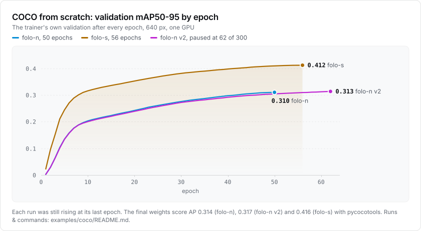

# COCO: folo-n and folo-s pretrained from scratch

folo-n trained **from scratch** on COCO train2017 at 640 px on one RTX 4080 SUPER for **50 epochs** (8.7 h of
epochs), evaluated on val2017 with FOLO's pycocotools-exact evaluator, and published as `folo-n-coco` (release `weights-v1`,
[Publish](#publish)): `folo weights pull folo-n-coco`.

**Result: AP 0.314 / AP50 0.455 on val2017** (f32; f16 the same to three decimals), cross-checked number for number
against pycocotools. Ultralytics' published nano models reach 0.395 (YOLO11n) and 0.409 (YOLO26n). YOLO26n was
pretrained for 150 epochs on Objects365, then fine-tuned for 245 epochs on COCO with evolved hyperparameters. This run
is **50 epochs on COCO alone, from random init**. Data, schedule, recipe and architecture all differ, so this is not a
like-for-like comparison, and how much of the gap each accounts for is not known ([Results](#results-val2017)).

**v2 (interim): AP 0.317 / AP50 0.458** after 62 epochs of a 300-epoch schedule that was paused there, published as
`folo-n-coco-v2` (release `weights-v2`). It is paused and can be resumed from its checkpoint
([v2](#v2-a-300-epoch-schedule-paused-at-epoch-62)).

**v3: AP 0.340 / AP50 0.487**: v2's weights annealed for 16 more epochs (78 in all; the learning rate decayed to
1%, mosaic off for the last 8), published as `folo-n-coco-v3` (release `weights-v4`):
`folo weights pull folo-n-coco-v3` ([v3](#v3-v2-annealed-for-16-epochs)).

**v4: AP 0.356 / AP50 0.509**, the best folo-n weights: a new 64-epoch run from random init (`auto` rule 5, MuSGD),
its second half (epochs 33–64) distilled from the frozen `folo-s-coco` below, published as `folo-n-coco-v4`
(release `weights-v5`): `folo weights pull folo-n-coco-v4`
([v4](#v4-64-epochs-the-second-half-distilled-from-folo-s)). It is a **distilled** model; the teacher was itself
trained from scratch on COCO train2017, so no data beyond COCO train2017 is anywhere in the chain.

**folo-s: AP 0.416 / AP50 0.580** after 56 epochs from scratch on one rented RTX PRO 4000 Blackwell (9.5 h of epochs,
about $5.60 for the pod), published as `folo-s-coco` (release `weights-v3`): `folo weights pull folo-s-coco`. That is 0.05–0.06 AP
behind the published YOLO11s (0.470) and YOLO26s (0.480), and the first full-scale run of `auto`'s MuSGD rule
([folo-s](#folo-s-56-epochs-on-a-rented-gpu)).

<p align="center">
  <picture>
    <source media="(prefers-color-scheme: dark)" srcset="../../docs/img/charts/coco-curves-dark.svg">
    
  </picture>
</p>

The curves are the trainer's own validation after each epoch (the Curve tables below); the AP figures above are
the pycocotools-exact evaluation of the final weights, which reads a little higher.

## Data

COCO 2017 from the official servers, into `datasets/coco` (about 20 GB of zips, 26 GB unpacked):

```sh
mkdir -p datasets/coco/zips && cd datasets/coco/zips
for f in annotations/annotations_trainval2017.zip zips/val2017.zip zips/train2017.zip; do
  curl -fL -C - --retry 5 -O "http://images.cocodataset.org/$f"     # -C -: resumable
done
md5sum *.zip
#   f4bbac642086de4f52a3fdda2de5fa2c  annotations_trainval2017.zip
#   442b8da7639aecaf257c1dceb8ba8c80  val2017.zip
#   cced6f7f71b7629ddf16f17bbcfab6b2  train2017.zip
cd .. && for z in zips/*.zip; do unzip -q "$z"; done                # annotations/, train2017/, val2017/
```

cocodataset.org publishes no checksums; the MD5s above are the widely cited ones (torchvision, TFDS) and all three
matched. `unzip` checks every member's CRC as well.

folo-data reads that folder as is (`annotations/instances_{train,val}2017.json` next to `train2017/` and `val2017/`),
no conversion:

```sh
cargo folo dataset stats datasets/coco
#   coco: 80 classes, 118,287 train / 5,000 val images, 886,282 boxes (849,947 / 36,335; crowd regions excluded)
```

Opening it reads every image header in parallel (about 50 s) and parses the 448 MB train JSON with a 1.2 GB peak
instead of 7 GB, since it reads only the fields it needs (docs/DATA.md). No pre-pass is needed: COCO images are already at most 640 px on the
long side, so a resized cache would change nothing, and the loader keeps up with the GPU (about 200 img/s with
mosaic, 16 workers, on a CPU shared with other jobs; the trainer's GPU peak for folo-n at B=16 is 219 img/s).

## Train

```sh
cargo folo train --data datasets/coco --model folo-n --imgsz 640 --batch 16 --epochs 50 --cos-lr \
  --patience 1000 --workers 16 --device gpu:0 --seed 0 --project runs-coco --name coco-folo-n
# after an interruption:
cargo folo train --resume runs-coco/coco-folo-n/weights/last.folo --workers 16 --device gpu:0
```

The MODEL.md §8 recipe: SGD (`auto` picks it: 92,450 optimizer steps > 10,000) at lr0 0.01, momentum 0.9, nominal
batch 64 (batch 16 × accumulate 4), 3 warmup epochs, weight decay 5e-4, EMA, mosaic + affine + HSV + flips, mosaic
closed for the last 10 epochs. No mixup, copy-paste, multi-scale or distillation. Two choices fit the budget: the
epoch count, and cosine decay (`--cos-lr`) so the schedule reaches `lr0 · lrf` exactly at the last epoch. A first
5-minute probe measured 195 img/s, about 10.5 min per epoch with validation, so 50 epochs ≈ 9 h was the budget.
`--patience 1000` keeps early stopping from cutting the schedule short.

### Run

2026-11-08, 09:11 to 20:44 local time on our test machine (RTX 4080 SUPER, i7-14700KF, Vulkan, 16 loader workers, a
CPU shared with other jobs). The 50 epochs took **8.7 h** (518–850 s each; one slow epoch of 1765 s while other jobs
held the machine), about **11.5 h** of wall clock in all. The rest was lost to three interruptions, each resumed from
`last.folo` at the epoch boundary with the stored optimizer, schedule and EMA: a console Ctrl+C meant for another
process after epoch 9, and two crashes without an error message after epochs 29 and 41 (an unstable CPU under long
all-core load). Work since the last checkpoint was redone, and the machine sat idle for about 2 h before the
epoch-29 resume.

No non-finite batch. 7393 batches (1849 optimizer steps) per epoch, 219 img/s peak and about 200 img/s typical: the
loader and the GPU are close to balanced.

### Curve (internal val: network-input boxes, no crowd regions, `best.folo` fitness)

| epoch | box | cls | dfl | val P | val R | val mAP50 | val mAP50-95 | epoch time |
|---:|---:|---:|---:|---:|---:|---:|---:|---:|
| 1 | 3.064 | 5.016 | 3.488 | 0.008 | 0.033 | 0.005 | 0.002 | 724 s |
| 3 (end of warmup) | 1.772 | 3.109 | 1.891 | 0.182 | 0.164 | 0.112 | 0.064 | 736 s |
| 5 | 1.594 | 2.535 | 1.676 | 0.294 | 0.249 | 0.215 | 0.134 | 547 s |
| 10 | 1.457 | 2.115 | 1.510 | 0.395 | 0.324 | 0.309 | 0.203 | 586 s |
| 20 | 1.366 | 1.856 | 1.405 | 0.473 | 0.348 | 0.359 | 0.242 | 612 s |
| 30 | 1.306 | 1.703 | 1.347 | 0.510 | 0.385 | 0.403 | 0.275 | 581 s |
| 40 | 1.259 | 1.582 | 1.307 | 0.526 | 0.411 | 0.432 | 0.298 | 581 s |
| 41 (mosaic off) | 1.248 | 1.479 | 1.294 | 0.531 | 0.413 | 0.433 | 0.299 | 707 s |
| 45 | 1.222 | 1.417 | 1.276 | 0.551 | 0.416 | 0.442 | 0.306 | 530 s |
| **50** (best) | 1.212 | 1.392 | 1.267 | 0.535 | 0.429 | 0.449 | **0.310** | 574 s |

Every epoch improved on the one before, so the best epoch is the last. The gains shrink as the cosine LR decays:
about 0.0022 mAP50-95 per epoch from epoch 30 to 40, 0.0009 per epoch from 45 to 50 (0.3055 → 0.3100), and 0.0005
for the last epoch. The run ends at its schedule's floor, not at a measured plateau. A longer schedule would
probably gain more, but how much has not been measured.

## Evaluate

```sh
cargo folo val --model runs-coco/coco-folo-n/weights/best.folo --data datasets/coco \
  --coco --save-json runs-coco/eval/val2017-dets-f32.json --device gpu:0 --workers 16
cargo folo val --model runs-coco/coco-folo-n/weights/best.folo --data datasets/coco \
  --coco --half --save-json runs-coco/eval/val2017-dets-f16.json --device gpu:0 --workers 16
# cross-check with pycocotools on exactly the same detections (a Python with `pip install pycocotools`):
python -I -c "from pycocotools.coco import COCO; from pycocotools.cocoeval import COCOeval; \
  g = COCO('datasets/coco/annotations/instances_val2017.json'); d = g.loadRes('runs-coco/eval/val2017-dets-f32.json'); \
  e = COCOeval(g, d, 'bbox'); e.evaluate(); e.accumulate(); e.summarize()"
```

Each `val` takes about 18 s for the 5000 images (plus about 15 s to open the dataset) and writes about 910,000
detections (`conf > 0.001`, up to 300 per image; COCOeval keeps 100).

### Results (val2017)

`best.folo` (EMA, epoch 50), 640 px, rect letterbox, the MODEL.md §9.3 validation settings, 5000 images, 36,335 boxes
plus 446 crowd regions:

| | AP | AP50 | AP75 | AP_S | AP_M | AP_L | AR1 | AR10 | AR100 | AR_S | AR_M | AR_L |
|---|---:|---:|---:|---:|---:|---:|---:|---:|---:|---:|---:|---:|
| **f32** | **0.314** | **0.455** | 0.339 | 0.144 | 0.335 | 0.458 | 0.284 | 0.486 | 0.544 | 0.311 | 0.598 | 0.745 |
| f16 (`--half`) | 0.314 | 0.455 | 0.339 | 0.144 | 0.335 | 0.458 | 0.284 | 0.486 | 0.544 | 0.310 | 0.597 | 0.745 |

**pycocotools agrees on all 12 numbers.** Its `COCOeval` on the `--save-json` file gives the same stats as FOLO's
`coco` object to within 3.3e-16 (f32: AP 0.313810, AP50 0.455412, AP75 0.339179) and 5.6e-16 (f16: AP 0.313924).
f16 differs from f32 by at most 0.0004 (AP_L), well inside the 0.002 bound in docs/BENCHMARKS.md. The internal
val that picks `best.folo` (network-input boxes, crowd regions dropped) reads 0.310 / 0.449. The official numbers
are slightly higher, partly because crowd regions absorb some false positives.

**Against the incumbent.** Ultralytics publishes AP 0.395 for YOLO11n (2.6 M params) and 0.409 for YOLO26n (2.4 M;
0.401 with its end-to-end head), with the same evaluation (val2017, 640, single scale). folo-n is 2.6 M params. The
released YOLO26n was pretrained for 150 epochs on Objects365-v1, then fine-tuned for 245 epochs on COCO at batch 128
with size-specific hyperparameters from evolutionary search ([the YOLO26 paper](https://arxiv.org/abs/2606.03748), §4.1 and supplementary S3).
YOLO11n's recipe is not given on its model page. **This run is 50 epochs on COCO alone, from random init**, with the
plain MODEL.md §8 recipe. The data, the schedule, the recipe and the architectures all differ, so 0.314 against
0.395–0.409 cannot be split into those causes. The shorter schedule and the missing Objects365 pretraining are
plausible large contributors, but neither has been isolated. The result does not show that FOLO matches YOLO11n, and
it does not show that FOLO falls short at equal budget. That needs an equal-budget run (a much longer FOLO schedule,
or Ultralytics for 50 epochs from scratch on COCO on the same machine), and neither has been done.

Per class (AP / AP50, f32): large, distinctive objects do well; small, thin or ambiguous ones do not.

| best | AP | AP50 | | worst | AP | AP50 |
|---|---:|---:|---|---|---:|---:|
| giraffe | 0.635 | 0.848 | | hair drier (11 boxes) | 0.002 | 0.005 |
| bear | 0.632 | 0.773 | | spoon | 0.036 | 0.070 |
| zebra | 0.625 | 0.863 | | toothbrush | 0.053 | 0.104 |
| train | 0.621 | 0.802 | | handbag | 0.055 | 0.100 |
| elephant | 0.597 | 0.814 | | knife | 0.056 | 0.098 |
| airplane | 0.594 | 0.786 | | backpack | 0.070 | 0.131 |
| cat | 0.590 | 0.787 | | apple | 0.092 | 0.136 |
| fire hydrant | 0.589 | 0.745 | | book | 0.097 | 0.219 |

`person`, the most common class (10,777 boxes), gets AP 0.484 / AP50 0.732; `car` 0.316 / 0.519, `traffic light`
0.164 / 0.321. Small objects are the weak spot (AP_S 0.144 vs AP_L 0.458), as for every nano model at 640.

## Publish

```sh
cargo folo export --model runs-coco/coco-folo-n/weights/best.folo --format weights \
  --output out/folo-n-coco.folo                                     # EMA, unfused, f32, no optimizer state
cargo folo export --model out/folo-n-coco.folo --format folo-f16 --output out/folo-n-coco-f16.folo
cd out && sha256sum folo-n-coco.folo folo-n-coco-f16.folo > SHA256SUMS
gh release create weights-v1 --draft --repo himent12/folo --title "FOLO pretrained weights v1" \
  --notes-file notes.md folo-n-coco.folo folo-n-coco-f16.folo SHA256SUMS
```

| asset | what | bytes | SHA-256 |
|---|---|---:|---|
| `folo-n-coco.folo` | folo-n, 80 classes, EMA weights, unfused f32: fine-tune or predict | 10,601,456 | `5d5429ae2eb6050363a7f2253449cbe99a1dd2a36e3cd988b2011e2bc6bd5b01` |
| `folo-n-coco-f16.folo` | the same, BatchNorm fused, f16: inference only | 5,251,088 | `de863020b3542f0c16b94d0c2e9a03b8d5956e339eedaa875db65521de2d5c47` |

The release `weights-v1` was created as a draft and published on 2026-11-11 (UTC). `folo weights pull` downloads its
files over HTTPS and verifies them; the `folo` binary is all it takes (a logged-in `gh` also works, and
`FOLO_WEIGHTS_BASE_URL` points it at a mirror):

```sh
folo weights pull folo-n-coco          # → ~/.folo/weights/folo-n-coco.folo, sha256 verified
folo weights pull folo-n-coco-f16
folo train --data <your dataset> --weights folo-n-coco ...
folo predict --model folo-n-coco-f16 --half <images>
```

Pulled and passed by name, the files give the val2017 numbers above. `folo val --model folo-n-coco --data
datasets/coco --coco` is identical to `best.folo` in f32 (all 12 stats). `folo val --model folo-n-coco-f16 --data
datasets/coco --half --coco` matches the f16 row to four decimals.

Without `folo`: `gh release download weights-v1 --repo himent12/folo --pattern 'folo-n-coco*' --pattern SHA256SUMS`
(or the release's download URLs), then `sha256sum -c --ignore-missing SHA256SUMS`. A
new weights release is created with `--latest=false`, so `releases/latest` stays FOLO's binary release
([RELEASE.md, Weights releases](../../docs/RELEASE.md#weights-releases)).

## v2: a 300-epoch schedule, paused at epoch 62

The 50-epoch run above ended at its schedule's floor, still gaining every epoch. v2 trains the same folo-n from
scratch, with the same recipe, on a **300-epoch** schedule, to measure how much of the gap to the published nano
models the schedule alone closes. **The run was paused after epoch 62 of 300** (stopped cleanly at the epoch
boundary on 2026-11-09). Its checkpoint can be resumed ([Resume](#resume-v2)). The
weights at the pause are published as the interim `folo-n-coco-v2`: **val2017 AP 0.317**, 0.003 above v1, with
the learning rate still at 90% of `lr0` and mosaic still on.

```sh
folo train --data datasets/coco --model folo-n --imgsz 640 --batch 16 --epochs 300 --cos-lr --amp \
  --patience 1000 --workers 16 --device gpu:0 --seed 0 --project runs-coco --name coco-folo-n-long
```

**Recipe.** MODEL.md §8 as in v1 (SGD lr0 0.01, momentum 0.9, nominal batch 64, 3 warmup epochs, weight decay
5e-4, EMA, mosaic + affine + HSV + flips, mosaic closed for the last 10 epochs, cosine decay to `lr0 · lrf`). Two
things change: the epoch count, and mixed precision (`--amp`, MODEL.md §8.8), which is a speed change, checked
against f32 below. No augmentation or optimizer setting changed: there is no evidence on this data that another one
helps, and each would need its own ablation.

**Budget.** Short timing probes (2026-11-09, same binary, the first epoch's batches after the dataset is open, the
machine shared with other jobs): f32 222 img/s, AMP 248 img/s with 16 loader workers and 237 with 24.
The loader, not the GPU, sets the pace (CPU at 100%, GPU at 44–79%), so AMP buys about 10% here rather than the
24% of the bare training step, and more workers do not help. On a quieter machine the first AMP epochs ran at
260–280 img/s, **440–482 s per epoch** with validation. At about 470 s per epoch, 300 epochs are about 39 h; at the
v1 run's busier 600 s, 50 h. 300 epochs sits inside the 36–48 h budget at the expected rate, so that is the count.

**AMP against f32.** The first five epochs of the AMP run against an f32 twin with identical settings (same seed, so
the same batches and augmentations; stopped after epoch 5) and against the v1 f32 run (a 50-epoch cosine schedule,
whose learning rate is at most 2.5% lower over these epochs):

| epoch | f32 twin: loss box / cls / dfl | val mAP50 | mAP50-95 | **AMP**: loss box / cls / dfl | val mAP50 | mAP50-95 | v1 f32: mAP50-95 |
|---:|---|---:|---:|---|---:|---:|---:|
| 1 | 3.097 / 5.061 / 3.537 | 0.005 | 0.0019 | 3.135 / 5.080 / 3.565 | 0.006 | 0.0023 | 0.0023 |
| 2 | 1.992 / 3.691 / 2.179 | 0.052 | 0.0272 | 2.004 / 3.689 / 2.173 | 0.056 | 0.0289 | 0.0285 |
| 3 | 1.772 / 3.113 / 1.895 | 0.109 | 0.0628 | 1.769 / 3.089 / 1.884 | 0.110 | 0.0633 | 0.0642 |
| 4 | 1.665 / 2.761 / 1.757 | 0.168 | 0.1014 | 1.662 / 2.742 / 1.755 | 0.167 | 0.1012 | 0.1032 |
| 5 | 1.595 / 2.544 / 1.673 | 0.210 | 0.1308 | 1.592 / 2.526 / 1.671 | 0.214 | **0.1337** | 0.1343 |
| epoch time | 638 / 602 / 553 / 537 / 508 s | | | **482 / 454 / 466 / 440 / 462 s** | | | |

The two f32 runs differ by 0.0035 mAP50-95 at epoch 5, the AMP run lies between them, and the losses agree to 1%
after the first epoch. The scaler skipped 4 optimizer steps for overflow, all in the first 24 batches, while the
scale backed off from 2^16 to 2^12; it grew back to 2^16 by epoch 5 without another overflow. AMP keeps f32
accuracy here, as it did on the shapes gate (docs/BENCHMARKS.md), FOLO's convergence test: a synthetic shapes dataset
that a correct trainer must learn to a fixed mAP bar.

### Run (epochs 1–62)

2026-11-09, 03:21 to 11:23 local time, one process, no crash or resume: **8.0 h of epochs**, median 442 s per epoch
(400–614 s; one epoch of 1241 s while another program used the GPU), 250–310 img/s with mosaic. The trainer was
then stopped with `folo stop` right after epoch 62's checkpoint, so `last.folo` and `best.folo` both hold epoch 62. The
loss
scaler skipped 48 of 114,638 optimizer steps for gradient overflow over the run (the scale doubles every 2000 finite
steps and backs off on each overflow), and no batch was non-finite.

| epoch | box | cls | dfl | val P | val R | val mAP50 | val mAP50-95 | v1 at the same epoch | epoch time |
|---:|---:|---:|---:|---:|---:|---:|---:|---:|---:|
| 1 | 3.135 | 5.080 | 3.565 | 0.011 | 0.017 | 0.006 | 0.002 | 0.002 | 482 s |
| 5 | 1.592 | 2.526 | 1.671 | 0.307 | 0.246 | 0.214 | 0.134 | 0.134 | 462 s |
| 10 | 1.459 | 2.122 | 1.513 | 0.415 | 0.307 | 0.305 | 0.200 | 0.203 | 434 s |
| 20 | 1.383 | 1.898 | 1.415 | 0.447 | 0.355 | 0.354 | 0.239 | 0.242 | 435 s |
| 30 | 1.350 | 1.810 | 1.376 | 0.511 | 0.374 | 0.398 | 0.272 | 0.276 | 448 s |
| 40 | 1.334 | 1.760 | 1.350 | 0.550 | 0.393 | 0.424 | 0.292 | 0.298 | 412 s |
| 50 | 1.321 | 1.722 | 1.333 | 0.555 | 0.408 | 0.442 | 0.304 | 0.310 (v1's last) | 442 s |
| 60 | 1.310 | 1.697 | 1.322 | 0.554 | 0.424 | 0.451 | 0.312 | | 478 s |
| **62** (paused, best) | 1.310 | 1.692 | 1.321 | 0.536 | 0.435 | 0.452 | **0.313** | | 504 s |

Every epoch improved on the one before. Up to epoch 50, v1 is slightly ahead at the same epoch: its cosine schedule
decays six times faster, and it closed mosaic for its last 10 epochs, which lowers the training loss and lifts
validation (v1's cls loss falls from 1.58 to 1.39 between epochs 40 and 50; v2's from 1.76 to 1.72). v2 passes v1's
final number at epoch 58 with the learning rate still at `0.90 · lr0` (cosine at 62 of 300 epochs) and mosaic on.
It was gaining about 0.0008 mAP50-95 per epoch at the pause (epochs 52 to 62), and the decay and close-mosaic phases
are still ahead; how much they will add has not been measured.

### Evaluate (v2)

```sh
folo val --model runs-coco/coco-folo-n-long/weights/best.folo --data datasets/coco \
  --coco --save-json runs-coco/eval-long/val2017-dets-f32.json --device gpu:0 --workers 16
folo val --model runs-coco/coco-folo-n-long/weights/best.folo --data datasets/coco \
  --coco --half --save-json runs-coco/eval-long/val2017-dets-f16.json --device gpu:0 --workers 16
# pycocotools on the same detections, as for v1
```

`best.folo` (EMA, epoch 62), 640 px, the MODEL.md §9.3 validation settings, 5000 images:

| | AP | AP50 | AP75 | AP_S | AP_M | AP_L | AR1 | AR10 | AR100 | AR_S | AR_M | AR_L |
|---|---:|---:|---:|---:|---:|---:|---:|---:|---:|---:|---:|---:|
| **v2 f32** (epoch 62 of 300) | **0.317** | **0.458** | 0.343 | 0.153 | 0.344 | 0.453 | 0.287 | 0.492 | 0.550 | 0.317 | 0.604 | 0.742 |
| v2 f16 (`--half`) | 0.317 | 0.458 | 0.343 | 0.153 | 0.344 | 0.453 | 0.287 | 0.492 | 0.550 | 0.317 | 0.604 | 0.741 |
| v1 f32 (50 of 50 epochs) | 0.314 | 0.455 | 0.339 | 0.144 | 0.335 | 0.458 | 0.284 | 0.486 | 0.544 | 0.311 | 0.598 | 0.745 |

**pycocotools agrees on all 12 numbers** (f32: AP 0.316821, AP50 0.457804, AP75 0.342836; largest difference
2.2e-16 for f32 and 2.8e-16 for f16). f16 is within 0.0015 of f32 on every stat (AR_L), inside the 0.002 bound.
Against v1: +0.003 AP, +0.009 on small and medium objects, −0.005 on large ones. The gain is small and comes from
12 more epochs at a higher learning rate; it is not yet a measure of what the 300-epoch schedule can reach. The gap
to YOLO11n (0.395) and YOLO26n (0.409) is still 0.08–0.09 AP.

### Publish (v2)

```sh
mkdir -p out/weights-v2
folo export --model runs-coco/coco-folo-n-long/weights/best.folo --format weights \
  --output out/weights-v2/folo-n-coco-v2.folo
folo export --model out/weights-v2/folo-n-coco-v2.folo --format folo-f16 \
  --output out/weights-v2/folo-n-coco-v2-f16.folo
cd out/weights-v2 && sha256sum folo-n-coco-v2.folo folo-n-coco-v2-f16.folo > SHA256SUMS
gh release create weights-v2 --draft --repo himent12/folo --title "FOLO pretrained weights v2 (interim)" \
  --notes-file notes.md folo-n-coco-v2.folo folo-n-coco-v2-f16.folo SHA256SUMS
```

| asset | what | bytes | SHA-256 |
|---|---|---:|---|
| `folo-n-coco-v2.folo` | folo-n, 80 classes, EMA weights of epoch 62, unfused f32: fine-tune or predict | 10,601,456 | `98d27ef83cc9f24e7007aead94018ceb4a38b99bad8a16dc924c74c90f4ae760` |
| `folo-n-coco-v2-f16.folo` | the same, BatchNorm fused, f16: inference only | 5,251,088 | `95412714ab27afe129a4ef393f852f77209d15e28fa697a9633a697a6cc92af2` |

`weights-v2` was published with `weights-v1` (2026-11-11, UTC), and its notes say "interim: 62 of 300 epochs, run
paused". `folo weights pull folo-n-coco-v2` (and `-f16`) pulls and verifies as v1 does.
The exported files reproduce the `best.folo` numbers above exactly (all 12 stats, f32 and f16).

### Resume (v2)

The checkpoint holds the optimizer, the schedule, the EMA and the loss scaler, so the run continues bit-exactly at
epoch 63:

```sh
folo train --resume runs-coco/coco-folo-n-long/weights/last.folo --data datasets/coco --workers 16 --device gpu:0
```

Checked on a copy of the run folder: it resumes "after epoch 62 (optimizer step 114590)" with mixed precision and the
stored loss scale (16384). At the measured 442 s per epoch, the remaining 238 epochs take about 29 h. Run it in its
own process group, and not next to a `folo serve` that holds GPU memory. When it finishes, re-run the evaluation and
publish the final folo-n weights in a new release (`weights-v3` is folo-s's, `weights-v4` is v3's).

**It is paused** (2026-11-11). The checkpoint is kept and resumes as above. v3 below does not resume it: it starts
a new, short schedule from the v2 weights.

## v3: v2 annealed for 16 epochs

v2 stopped mid-schedule, with the learning rate at 90% of `lr0` and mosaic on. v3 gives those weights the ending a
schedule has: 16 epochs from `folo-n-coco-v2` with the learning rate decaying linearly to 1% and mosaic off for the
last 8 (hill-climb 3, lane fusion; its notebook is
[docs/notes/hill/r3-fusion.md](../../docs/notes/hill/r3-fusion.md), Part 0). It reaches **val2017 AP 0.340 / AP50
0.487**, 0.023 above v2, and is published as `folo-n-coco-v3` (release `weights-v4`).

```sh
folo train --weights folo-n-coco-v2 --data datasets/coco --project runs-coco --name land-n-v2 \
  --epochs 16 --batch 16 --imgsz 640 --device gpu:0 --workers 16 --optimizer sgd \
  --lr0 0.005 --lrf 0.01 --amp --warmup-epochs 0 --set warmup_bias_lr=0 --set momentum=0.9 \
  --close-mosaic 8 --seed 0 --patience 1000
```

**What the run resolved to** (its `config.json`): `--weights`, not `--resume`: all 417 tensors transferred from
`folo-n-coco-v2`, the EMA starts fresh from them, and the optimizer state, step count and loss scale start new. SGD
at lr0 0.005, linear decay to `lr0 · lrf` (0.00005; no `--cos-lr`), momentum 0.9 (the resolved momentum of the
original run; `--optimizer sgd` alone gives 0.937), weight decay 5e-4, no warmup, batch 16 × accumulate 4 (nominal
64), 1849 optimizer steps per epoch, EMA, mosaic 1.0 closed for the last 8 epochs, the default augmentation, AMP,
seed 0. Weights from 62 epochs of v2 plus 16 here: 78 epochs of training in all, from random init on COCO alone.

**Run.** 2026-11-13, one process on the RTX 4080 SUPER shared with other jobs: 16 epochs in 5704 s (1.58 h),
233–532 s per epoch. The loss scaler skipped 14 of 29,584 optimizer steps for gradient overflow; no batch was
non-finite.

| epoch | box | cls | dfl | val P | val R | val mAP50 | val mAP50-95 | epoch time |
|---:|---:|---:|---:|---:|---:|---:|---:|---:|
| 1 | 1.262 | 1.581 | 1.291 | 0.538 | 0.407 | 0.429 | 0.293 | 277 s |
| 4 | 1.252 | 1.555 | 1.282 | 0.548 | 0.435 | 0.457 | 0.314 | 426 s |
| 8 (last with mosaic) | 1.234 | 1.512 | 1.268 | 0.587 | 0.439 | 0.473 | 0.327 | 532 s |
| 9 (mosaic off) | 1.228 | 1.422 | 1.257 | 0.551 | 0.451 | 0.475 | 0.329 | 360 s |
| 12 | 1.204 | 1.360 | 1.241 | 0.565 | 0.451 | 0.478 | 0.332 | 324 s |
| **16** (last, best) | 1.173 | 1.290 | 1.220 | 0.585 | 0.448 | 0.481 | **0.335** | 233 s |

Epochs 1–3 sit below v2's 0.313 because the EMA restarts from the transferred weights and lags them at first; it
is past v2 at epoch 4 and rises in every epoch to the last (+0.0004 in epoch 16), so a longer ending would likely add
a little more. `best.folo` and `last.folo` are the same epoch-16 checkpoint.

### Evaluate (v3)

```sh
folo val --model folo-n-coco-v3 --data datasets/coco --coco --device gpu:0
folo val --model folo-n-coco-v3-f16 --data datasets/coco --coco --half --device gpu:0
```

The published files, 640 px, the MODEL.md §9.3 validation settings, 5000 images:

| | AP | AP50 | AP75 | AP_S | AP_M | AP_L | AR1 | AR10 | AR100 | AR_S | AR_M | AR_L |
|---|---:|---:|---:|---:|---:|---:|---:|---:|---:|---:|---:|---:|
| **v3 f32** (`folo-n-coco-v3`) | **0.340** | **0.487** | 0.367 | 0.163 | 0.368 | 0.494 | 0.301 | 0.507 | 0.565 | 0.331 | 0.618 | 0.762 |
| v3 f16 (`--half`, `folo-n-coco-v3-f16`) | 0.339 | 0.487 | 0.367 | 0.163 | 0.367 | 0.494 | 0.301 | 0.507 | 0.565 | 0.332 | 0.618 | 0.762 |
| v2 f32 | 0.317 | 0.458 | 0.343 | 0.153 | 0.344 | 0.453 | 0.287 | 0.492 | 0.550 | 0.317 | 0.604 | 0.742 |

**pycocotools agrees on all 12 numbers**: its own `COCOeval` on the same detections (`--save-json`, 969,059 in f32
and 969,561 in f16 at `conf > 0.001`) gives f32 AP 0.339555, AP50 0.487367, AP75 0.367109, with a largest difference
of 2.2e-16 for f32 and 3.3e-16 for f16. f16 is within 0.0005 of f32 on every stat (AR_S), inside MODEL.md §9.1's
0.002 bound. The f16 file without `--half` (f16 weights, f32 arithmetic) gives AP 0.340. These are the numbers of
the run's `best.folo` (lane fusion's evaluation) to the printed digits.

Against v2: +0.023 AP, +0.029 AP50, +0.041 on large objects, +0.010 on small ones. The gap to YOLO11n (0.395) and
YOLO26n (0.409) is now 0.055–0.069 AP; as above, data, schedule, recipe and architecture all differ.
With DFL evidence fusion (docs/MODEL.md §9.4, `--fusion dfl --iou 0.65 --max-det 1000`) the same file gives AP 0.343 (0.3434);
that is a different post-process, not the §9.3 protocol of the table.

### Publish (v3)

```sh
mkdir -p out/weights-v4
folo export --model runs-coco/land-n-v2/weights/best.folo --format weights \
  --output out/weights-v4/folo-n-coco-v3.folo
folo export --model out/weights-v4/folo-n-coco-v3.folo --format folo-f16 \
  --output out/weights-v4/folo-n-coco-v3-f16.folo
cd out/weights-v4 && sha256sum folo-n-coco-v3.folo folo-n-coco-v3-f16.folo > SHA256SUMS
gh release create weights-v4 --latest=false --target main --repo himent12/folo \
  --title "FOLO pretrained weights v4 (folo-n v3)" --notes-file notes.md \
  folo-n-coco-v3.folo folo-n-coco-v3-f16.folo SHA256SUMS
```

| asset | what | bytes | SHA-256 |
|---|---|---:|---|
| `folo-n-coco-v3.folo` | folo-n, 80 classes, EMA weights of the landing run's epoch 16, unfused f32: fine-tune or predict | 10,601,456 | `f366a2fd5d8df535c910cd87e6a258e8c89487f145592a14112f79a3b69ddf43` |
| `folo-n-coco-v3-f16.folo` | the same, BatchNorm fused, f16: inference only | 5,251,088 | `4419dd7b8991fbf2c6921f4f3099c5820147161bceea505c3c9ba81c25eae86b` |

`weights-v4` was published on 2026-11-14 (UTC) with `--latest=false`, like the other weights releases
([RELEASE.md, Weights releases](../../docs/RELEASE.md#weights-releases)). It pulls and verifies as v1 does:

```sh
folo weights pull folo-n-coco-v3          # → ~/.folo/weights/folo-n-coco-v3.folo, sha256 verified
folo weights pull folo-n-coco-v3-f16
folo train --data <your dataset> --weights folo-n-coco-v3 ...
folo predict --model folo-n-coco-v3-f16 --half <images>
```

Without `folo`: `gh release download weights-v4 --repo himent12/folo --pattern 'folo-n-coco-v3*' --pattern
SHA256SUMS`, then `sha256sum -c --ignore-missing SHA256SUMS`.

## v4: 64 epochs, the second half distilled from folo-s

Hill-climb 4 (lane coco; notebook [docs/notes/hill/r4-distill.md](../../docs/notes/hill/r4-distill.md), "Full
scale") trained two folo-n models on full COCO with today's defaults, one seed each, and kept the better:

- **Control**: folo-n from random init on COCO train2017, 64 epochs, 640 px, `auto` (rule 5: MuSGD), AMP, seed 0.
  val2017 AP 0.351 (0.3507). Not published.
- **Fork**: the control's epoch-32 checkpoint continued to epoch 64 with the frozen `folo-s-coco` as teacher (dense
  output distillation, `folo train --teacher`, [docs/MODEL.md](../../docs/MODEL.md) §8.9: class gain 0.5, DFL gain
  1.5, temperature 4). Same weights, optimizer, EMA, schedule and batches as the control at epoch 32. val2017
  **AP 0.356 (0.3559)**, published as `folo-n-coco-v4` (release `weights-v5`).

```sh
# control: 64 epochs from random init
folo train --data datasets/coco --format coco --model folo-n --imgsz 640 --batch 16 --epochs 64 --amp \
  --patience 1000 --workers 16 --device gpu:0 --seed 0 --project runs-coco --name n-r5-ctl
# fork: a copy of the control's run folder taken when weights/last.folo is the epoch-32 checkpoint, resumed with
# the teacher (folo weights pull folo-s-coco first)
folo train --resume runs-coco/n-r5-kd-e32/weights/last.folo --teacher folo-s-coco \
  --data datasets/coco --format coco --workers 16 --device gpu:0
```

**What the runs resolved to** (`config.json`): MuSGD (muon 0.2, sgd 1.0, class-head lr × 3), lr0 0.01 decaying
linearly to `lr0 · lrf` (lrf 0.01), momentum 0.937, weight decay 5e-4, 3 warmup epochs, batch 16 × accumulate 4
(nominal 64), 1849 optimizer steps per epoch, EMA, mosaic 1.0 closed for the last 10 epochs, the default
augmentation, AMP, seed 0. The fork's `distill` block: teacher `folo-s-coco`, class gain 0.5, DFL gain 1.5,
temperature 4. Both ran on one RTX 4080 SUPER shared with other jobs, so their epoch times are not a cost number;
the teacher's forward pass makes a distilled epoch dearer (about 2.7× per epoch in the notebook's proxy, under load).

The trainer's own validation (mAP50-95, EMA weights) after each epoch, from the runs' `metrics.jsonl`:

| epoch | control | fork | fork − control |
|---:|---:|---:|---:|
| 32 | 0.3141 | 0.3141 | 0 (same checkpoint) |
| 40 | 0.3250 | 0.3275 | +0.0025 |
| 48 | 0.3334 | 0.3371 | +0.0036 |
| 56 | 0.3409 | 0.3454 | +0.0045 |
| **64** (last, best) | 0.3470 | **0.3523** | +0.0053 |

### Evaluate (v4)

```sh
folo val --model folo-n-coco-v4 --data datasets/coco --coco --device gpu:0
folo val --model folo-n-coco-v4-f16 --data datasets/coco --coco --half --device gpu:0
```

The published files, 640 px, the MODEL.md §9.3 validation settings, 5000 images:

| | AP | AP50 | AP75 | AP_S | AP_M | AP_L | AR1 | AR10 | AR100 | AR_S | AR_M | AR_L |
|---|---:|---:|---:|---:|---:|---:|---:|---:|---:|---:|---:|---:|
| **v4 f32** (`folo-n-coco-v4`) | **0.356** | **0.509** | 0.384 | 0.171 | 0.388 | 0.513 | 0.307 | 0.510 | 0.566 | 0.330 | 0.624 | 0.761 |
| v4 f16 (`--half`, `folo-n-coco-v4-f16`) | 0.356 | 0.509 | 0.384 | 0.171 | 0.388 | 0.513 | 0.307 | 0.510 | 0.566 | 0.331 | 0.623 | 0.761 |
| control (not published) | 0.351 | 0.500 | 0.376 | 0.167 | 0.382 | 0.504 | | | 0.567 | | | |
| v3 f32 (`folo-n-coco-v3`) | 0.340 | 0.487 | 0.367 | 0.163 | 0.368 | 0.494 | 0.301 | 0.507 | 0.565 | 0.331 | 0.618 | 0.762 |

pycocotools' own `COCOeval` on the same detections (`--save-json`) gives f32 AP 0.355943, AP50 0.508672, AP75
0.384170: all 12 numbers agree with FOLO's, with a largest difference of 2.8e-16 for f32 (844,894 detections at
`conf > 0.001`, lane coco's count) and 4.4e-16 for f16 (844,854). f16 is within 0.001 of f32 on every stat, inside MODEL.md §9.1's 0.002 bound.

A paired bootstrap over the 5000 images (`bench/fusion/bootstrap.py`, 1000 resamples): v4 − v3 **+0.0164 AP**
[+0.0129, +0.0197], v4 − control +0.0052 [+0.0032, +0.0075] (the teacher's share). It covers the sampling of the
evaluation images, not the training seed: each side is one run, and the seed-to-seed spread at full scale is not
measured. With DFL evidence fusion (docs/MODEL.md §9.4, `--fusion dfl --iou 0.65 --max-det 1000`) the f32 file gives
AP 0.359 (0.3594); that is a different post-process, not the §9.3 protocol of the table. The gap to YOLO11n (0.395)
and YOLO26n (0.409) is now 0.039–0.053 AP; data, schedule, recipe and architecture still differ.

Not measured: a run with the teacher from epoch 1; another teacher or distillation setting at full scale; a second
seed. The teacher was trained on train2017, the student's training set; val2017 is unseen by both.

### Publish (v4)

```sh
mkdir -p out/weights-v5
folo export --model runs-coco/n-r5-kd-e32/weights/last.folo --format weights \
  --output out/weights-v5/folo-n-coco-v4.folo
folo export --model out/weights-v5/folo-n-coco-v4.folo --format folo-f16 \
  --output out/weights-v5/folo-n-coco-v4-f16.folo
cd out/weights-v5 && sha256sum folo-n-coco-v4.folo folo-n-coco-v4-f16.folo > SHA256SUMS
gh release create weights-v5 --latest=false --target main --repo himent12/folo \
  --title "FOLO pretrained weights v5 (folo-n v4)" --notes-file notes.md \
  folo-n-coco-v4.folo folo-n-coco-v4-f16.folo SHA256SUMS
```

| asset | what | bytes | SHA-256 |
|---|---|---:|---|
| `folo-n-coco-v4.folo` | folo-n, 80 classes, EMA weights of the fork's epoch 64, unfused f32: fine-tune or predict | 10,601,456 | `d3896e3ced0c739a3c8167c18bf5efdac1f96d8de69e8962341e2596e8f0b229` |
| `folo-n-coco-v4-f16.folo` | the same, BatchNorm fused, f16: inference only | 5,251,088 | `8090ccabc8b997b14035d24419de958e4e1a8df646b2f56582e0279a5b7dd28c` |

`weights-v5` was published on 2026-11-16 (UTC) with `--latest=false`, like the other weights releases. It pulls and
verifies as the others do:

```sh
folo weights pull folo-n-coco-v4          # → ~/.folo/weights/folo-n-coco-v4.folo, sha256 verified
folo weights pull folo-n-coco-v4-f16
folo train --data <your dataset> --weights folo-n-coco-v4 ...
folo predict --model folo-n-coco-v4-f16 --half <images>
```

**Fine-tuning from v4.** A distilled model had not been fine-tuned before, so v4 was checked as a starting point
against v3 with hill-climb 2's protocol (bench/finetune/README.md: folo-n, 640 px, batch 16, 100 epochs, f32,
defaults; `folo val --save-json` of `best.folo` on each set's evaluation split, scored by pycocotools), seeds 0 and 1,
`main` 069935d6:

| dataset | v3 s0 | v3 s1 | v3 mean | v4 s0 | v4 s1 | v4 mean | v4 − v3 |
|---|---:|---:|---:|---:|---:|---:|---:|
| BCCD | 0.6012 | 0.6209 | 0.6110 | 0.6390 | 0.6267 | 0.6329 | +0.0218 |
| signature | 0.9894 | 0.9871 | 0.9883 | 0.9880 | 0.9908 | 0.9894 | +0.0012 |
| medical pills | 0.8064 | 0.8050 | 0.8057 | 0.8066 | 0.8055 | 0.8061 | +0.0003 |

The bar was that v4's mean is not more than 0.010 AP below v3's on any of the three; it is not below on any, so v4 is
the recommended start for fine-tuning. Two seeds on three small test sets cannot show a gain, and none is claimed.

## folo-s: 56 epochs on a rented GPU

folo-s (9,458,736 parameters, 21.59 GFLOPs at 640; docs/MODEL.md) trained **from scratch** on COCO train2017 at
640 px for **56 epochs**, evaluated on val2017 with the same pycocotools-exact evaluator, and published as
`folo-s-coco` (release `weights-v3`): **val2017 AP 0.416 / AP50 0.580**.

```sh
folo train --data /data/coco --model folo-s --imgsz 640 --batch 32 --epochs 56 --amp \
  --patience 1000 --workers 12 --device gpu:0 --seed 0 --project /data/runs --name coco-folo-s
```

**What the recipe resolved to** (the run's `config.json`): `optimizer: auto` → **MuSGD** (`auto_rule` 3: 103,544
optimizer steps > 10,000) at lr0 0.01, momentum 0.9, warmup_bias_lr 0, weight decay 5e-4, linear decay to `lr0 ·
lrf` (lrf 0.01; no `--cos-lr`), batch 32 × accumulate 2 (nominal batch 64), 1849 optimizer steps per epoch (3697
batches), 5547 warmup steps (3 epochs), EMA, mosaic 1.0 closed for the last 10 epochs, the default augmentation, AMP
(f16 activations on tensor cores, loss scale 65536 at the start). This is the first run in which `auto` resolved to
MuSGD at full scale (docs/MODEL.md §8.2).

**Hardware.** One rented **NVIDIA RTX PRO 4000 Blackwell** (24 GB, a 140 W card; RunPod Secure Cloud, $0.57/h,
12 vCPUs of an AMD EPYC 7352, NVIDIA driver 595.91.07, Vulkan through the driver's EGL library), running the Linux
build of commit `ee846c88` (FOLO 0.1.0). The pod was set up by hand (`ubuntu:22.04` + sshd) rather than as a FOLO
cloud run, because a cloud run uploads the dataset from the machine that starts it (docs/CLOUD.md, Limits), 20 GB
over a home connection.
On the pod, COCO came straight from cocodataset.org: 3 minutes for the 20 GB with `aria2c -x 8`, MD5s checked as in
[Data](#data), 7.5 minutes until unpacked.

**Speed and cost.** A probe before the run measured about 165 img/s at batch 16 and 177.5 img/s at batch 64,
GPU-bound (GPU at 95–100%, the loader under 4 of the 12 vCPUs); batch 32 was chosen because batch 64's 17.3 GB of
24 was judged too close. The run took **607–628 s per epoch** with validation (607–610 s after the first): 56 epochs
in 34,156 s = **9.49 h**. For scale, the RTX 4080 SUPER's AMP training step for folo-s was 273 img/s at the time
(SGD, the step alone; 299 img/s in the 2026-11-12 measurement, docs/BENCHMARKS.md). The pod ran 9.85 h in all (setup, two 200 s probes, the run, evaluation and export), about **$5.60**.

### Curve (folo-s; internal val: network-input boxes, no crowd regions)

| epoch | box | cls | dfl | val P | val R | val mAP50 | val mAP50-95 | epoch time |
|---:|---:|---:|---:|---:|---:|---:|---:|---:|
| 1 | 2.903 | 4.611 | 3.314 | 0.098 | 0.093 | 0.045 | 0.023 | 628 s |
| 3 (end of warmup) | 1.605 | 2.450 | 1.682 | 0.374 | 0.260 | 0.245 | 0.152 | 608 s |
| 5 | 1.422 | 1.998 | 1.481 | 0.499 | 0.346 | 0.368 | 0.244 | 610 s |
| 10 | 1.285 | 1.653 | 1.339 | 0.521 | 0.442 | 0.457 | 0.316 | 609 s |
| 20 | 1.203 | 1.442 | 1.257 | 0.576 | 0.472 | 0.501 | 0.352 | 610 s |
| 30 | 1.156 | 1.329 | 1.219 | 0.606 | 0.503 | 0.535 | 0.381 | 610 s |
| 40 | 1.118 | 1.237 | 1.189 | 0.642 | 0.511 | 0.555 | 0.397 | 609 s |
| 46 (last with mosaic) | 1.094 | 1.175 | 1.171 | 0.625 | 0.535 | 0.565 | 0.406 | 609 s |
| 47 (mosaic off) | 1.075 | 1.086 | 1.150 | 0.647 | 0.524 | 0.566 | 0.407 | 609 s |
| 50 | 1.051 | 1.031 | 1.132 | 0.633 | 0.537 | 0.570 | 0.409 | 609 s |
| **56** (best) | 1.013 | 0.940 | 1.108 | 0.670 | 0.524 | 0.573 | **0.412** | 607 s |

mAP50-95 rose in every one of the 56 epochs, so the best epoch is the last. The last six gains were 0.0007, 0.0007,
0.0004, 0.0005, 0.0002 and 0.0001: that is the schedule reaching its learning-rate floor, not a plateau at a healthy
learning rate, so 0.416 is what this epoch budget reached, not what folo-s can reach. No batch was non-finite; the
loss scaler skipped 44 of 103,544 optimizer steps for gradient overflow (the scale ended at 32768). For comparison,
folo-n v1 (SGD, 50 epochs) had 0.064 at epoch 3, 0.203 at epoch 10 and 0.310 at epoch 50; that is another model
size and another optimizer, so it isolates neither.

### Results (folo-s, val2017)

`best.folo` and `last.folo` are identical epoch-56 checkpoints, and the published `folo-s-coco.folo` holds their
exported EMA weights (all three evaluate to the same numbers); `folo val --coco` on the pod's GPU, 640 px, the MODEL.md §9.3 validation settings, 5000 images, 36,335 boxes plus 446 crowd regions:

| | AP | AP50 | AP75 | AP_S | AP_M | AP_L | AR1 | AR10 | AR100 | AR_S | AR_M | AR_L |
|---|---:|---:|---:|---:|---:|---:|---:|---:|---:|---:|---:|---:|
| **f32** | **0.4162** | **0.5798** | 0.4519 | 0.2289 | 0.4594 | 0.5845 | 0.3385 | 0.5600 | 0.6164 | 0.4118 | 0.6777 | 0.7850 |
| f16 (`--half`, the fused f16 file) | 0.4162 | 0.5799 | 0.4520 | 0.2288 | 0.4595 | 0.5844 | 0.3386 | 0.5601 | 0.6164 | 0.4118 | 0.6776 | 0.7847 |

**pycocotools agrees**: its own `COCOeval` on the same detections (`--save-json`, 631,524 detections in f32 at
`conf > 0.001`) gives all 12 stats equal to four decimals, f32 and f16. `--half --tensor-cores` gives the f16 numbers
exactly. `folo val` took 25 s for the 5000 images on the pod in f32 and f16, 17 s with tensor cores.

**Against the incumbent.** Ultralytics publishes AP 0.470 for YOLO11s (its recipe is not given on its model page)
and 0.480 for YOLO26s (YOLO26: Objects365 pretraining, a long COCO schedule, evolved hyperparameters;
[the YOLO26 paper](https://arxiv.org/abs/2606.03748)).
folo-s at 56 epochs from random init on COCO alone is **0.05–0.06 AP behind them**, and above the published nano
models (YOLO11n 0.395, YOLO26n 0.409). As for folo-n, data, schedule, recipe and architecture all differ, so the gap
cannot be split into those causes.

### Publish (folo-s)

```sh
# on the pod
folo export --model /data/runs/coco-folo-s/weights/best.folo --format weights \
  --output /data/out/folo-s-coco.folo                               # EMA, unfused, f32, no optimizer state
folo export --model /data/out/folo-s-coco.folo --format folo-f16 --output /data/out/folo-s-coco-f16.folo
cd /data/out && sha256sum folo-s-coco.folo folo-s-coco-f16.folo > SHA256SUMS
# locally, with the three files copied back
gh release create weights-v3 --latest=false --target main --repo himent12/folo --title "FOLO pretrained weights v3 (folo-s)" \
  --notes-file notes.md folo-s-coco.folo folo-s-coco-f16.folo SHA256SUMS
```

| asset | what | bytes | SHA-256 |
|---|---|---:|---|
| `folo-s-coco.folo` | folo-s, 80 classes, EMA weights of epoch 56, unfused f32: fine-tune or predict | 37,998,320 | `a9d7f588aadd62acadb629f50c86038cc7abc07cdb41612a5d90668b32a57e60` |
| `folo-s-coco-f16.folo` | the same, BatchNorm fused, f16: inference only | 18,906,424 | `0bb9620e3ca75520f1ed10f582b85960bf5eae214e0c538b0941391ee2c52e99` |

`weights-v3` was published on 2026-11-11 (UTC) with `--latest=false`, like the other weights releases
([RELEASE.md, Weights releases](../../docs/RELEASE.md#weights-releases)). It pulls and verifies as v1 does:

```sh
folo weights pull folo-s-coco          # → ~/.folo/weights/folo-s-coco.folo, sha256 verified
folo weights pull folo-s-coco-f16
folo train --data <your dataset> --weights folo-s-coco ...    # takes the weights' architecture (folo-s)
folo predict --model folo-s-coco-f16 --half <images>
```

Without `folo`: `gh release download weights-v3 --repo himent12/folo --pattern 'folo-s-coco*' --pattern SHA256SUMS`,
then `sha256sum -c --ignore-missing SHA256SUMS`.
