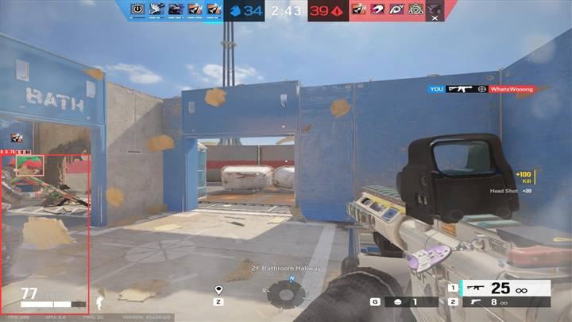
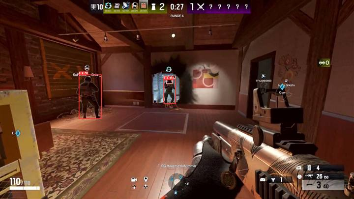
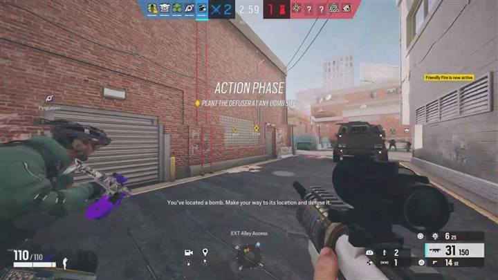

# R6: folo-n and folo-s from scratch on Rainbow Six Siege footage

A real-data run on the GPU trainer: folo-n (and folo-s, [below](#folo-s)) trained **from scratch** (no pretraining) at 640 px on the user's
`r6-clean` dataset (YOLO format, classes `0 body`, `1 Head`; 2030 train / 203 val / 93 test frames of 1080p gameplay,
of which only about 756 train frames are unique), evaluated on its test split and on the held-out `r6-fresh` set
(291 frames from 10 YouTube channels that appear nowhere in the training pool; **test only, never trained on**).
[Fine-tuning from COCO](#fine-tuning-from-coco) starts folo-n from the COCO-pretrained `folo-n-coco` instead and
reaches 0.441 on r6-clean test and 0.201 on r6-fresh in 100 epochs.

The datasets live outside the repo (`C:\Users\himent\Documents\r6yolo\data`, read-only); the run used copies on
`D:/folo-data/r6/` (with the absolute `path:` line removed from the copy of `r6-fresh/data.yaml`).

## Commands

```sh
# Train (MODEL.md §8 recipe: 500 epochs is long enough that `auto` picks SGD at lr0 0.01, momentum 0.9,
# 100 warmup steps; patience 100; mosaic + affine + HSV + flips).
cargo folo train --data D:/folo-data/r6/r6-clean --arch folo-n --imgsz 640 --epochs 500 --batch 16 --seed 0 \
  --device gpu:0 --workers 16 --project D:/folo-data/runs-r6 --name r6-folo-n

# Evaluate the best (EMA) weights on the test splits.
cargo folo val --model D:/folo-data/runs-r6/r6-folo-n/weights/best.folo --data D:/folo-data/r6/r6-clean --split test
cargo folo val --model D:/folo-data/runs-r6/r6-folo-n/weights/best.folo --data D:/folo-data/r6/r6-fresh --split test

# Annotated predictions (conf 0.25, rect letterbox at 640).
cargo folo predict --model D:/folo-data/runs-r6/r6-folo-n/weights/best.folo <images> --save <dir>
```

## Run

2026-11-08, branch `train/gpu`, RTX 4080 SUPER (Vulkan), 16 loader workers. The run **stopped early after 410 of
500 epochs** (no fitness gain for 100 epochs; best epoch 310) in **104 min** of wall clock (12–21 s per epoch with
validation). The machine was shared with other agents' builds the whole time, which left the GPU at 40–70% load: on
1080p JPEGs with mosaic the loader, not the GPU, set the pace. No non-finite batch.

Because it stopped at epoch 410, the linear LR decay (planned to reach `lr0 · lrf` at epoch 500) and the last-10-epochs
mosaic close never happened; a run sized to stop on time (or `--patience` above 100) would get both.

| epoch | box | cls | dfl | val P | val R | val mAP50 | val mAP50-95 |
|---:|---:|---:|---:|---:|---:|---:|---:|
| 1 | 4.542 | 7.752 | 4.212 | 0.000 | 0.009 | 0.000 | 0.000 |
| 10 | 2.200 | 1.830 | 1.665 | 0.582 | 0.321 | 0.348 | 0.142 |
| 25 | 1.698 | 1.183 | 1.289 | 0.704 | 0.495 | 0.544 | 0.291 |
| 50 | 1.420 | 0.892 | 1.123 | 0.854 | 0.562 | 0.621 | 0.346 |
| 100 | 1.156 | 0.679 | 1.008 | 0.825 | 0.619 | 0.662 | 0.374 |
| 150 | 1.033 | 0.573 | 0.942 | 0.919 | 0.617 | 0.689 | 0.399 |
| 200 | 0.941 | 0.526 | 0.909 | 0.876 | 0.641 | 0.703 | 0.399 |
| 250 | 0.867 | 0.487 | 0.895 | 0.891 | 0.639 | 0.702 | 0.401 |
| **310** (best) | 0.800 | 0.445 | 0.871 | 0.868 | 0.646 | 0.697 | **0.409** |
| 410 (stop) | 0.697 | 0.388 | 0.848 | 0.858 | 0.648 | 0.694 | 0.402 |

The training losses keep falling after epoch 150 while validation is flat: with ~756 unique frames the model starts to
memorise the training set.

## Results (best.folo, EMA, 640 px)

| split | images | mAP50 | mAP50-95 | P | R | body mAP50-95 | Head mAP50-95 |
|---|---:|---:|---:|---:|---:|---:|---:|
| r6-clean val (epoch 310) | 203 | 0.697 | 0.409 | 0.868 | 0.646 | 0.524 | 0.293 |
| r6-clean test | 93 | 0.710 | **0.397** | 0.817 | 0.679 | 0.497 | 0.297 |
| r6-fresh (held out) | 291 | 0.260 | **0.130** | 0.360 | 0.331 | 0.207 | 0.053 |

For context (r6yolo's README; not comparable one to one). Ultralytics YOLO26 models were COCO-pretrained, fine-tuned at
1280 px, and the newer ones distilled on up to 26,000 frames. On r6-clean test they reach 0.45 (`exp-7`) to 0.58
(26m) mAP50-95. On r6-fresh they reach 0.40 (`d26n_soup`, 26n) to 0.565 (round-4 26m on far more data).

FOLO trained from scratch at 640 on 2030 frames lands at 0.397 on r6-clean test, which is not far behind the original
pretrained `exp-7` (0.452). On r6-fresh it reaches 0.130. Bodies are found reasonably (0.21 mAP50-95, 45% recall at
the operating point), but the small and far Heads that dominate r6-fresh (58 of its 171 Heads are under 20 px at
1080p, i.e. under 12 px at 640) are mostly missed (0.05). The r6yolo README notes the same: "640 input destroys small
heads". The gap to the incumbent comes from data (no pretraining, about 3% of the frames), input size (640 vs 1280)
and the shorter schedule. It is not a sign of a training bug: the same trainer passes the shapes gate on the GPU with
the CPU's numbers (examples/shapes).

## folo-s

The same recipe with `--arch folo-s` (9.4 M parameters) for **300 epochs**. That is short enough that `auto` picks
AdamW at lr0 0.001667 (`iterations = 32 · 300 = 9600 ≤ 10000`). It did not stop early.

```sh
cargo folo train --data D:/folo-data/r6/r6-clean --arch folo-s --imgsz 640 --epochs 300 --batch 16 --seed 0 \
  --device gpu:0 --workers 16 --project D:/folo-data/runs-r6 --name r6-folo-s
# resumed twice with: cargo folo train --resume D:/folo-data/runs-r6/r6-folo-s/weights/last.folo \
#   --data D:/folo-data/r6/r6-clean --device gpu:0 --workers 16
```

It took about **141 min of training** (19–36 s per epoch with validation; loader-bound again, now on a busier machine).
The run was interrupted twice, and each time resumed from `last.folo` at the epoch boundary with the stored
optimizer, schedule and EMA:
- **Epoch 40:** the display driver reset the GPU (Windows TDR, nvlddmkm event 153) while other agents' processes
  were on it; the epochs just before had slowed from about 26 s to 130–220 s. wgpu then panicked in `Device::poll`.
  A lost device is now a training error that names the checkpoint to resume from (`GpuError::DeviceLost`, this PR).
- **Epoch 266:** the host ran out of memory. The machine (32 GB) was shared with several builds, and the trainer's
  commit charge was about 11 GB, stable over the run (no leak).

| epoch | box | cls | dfl | val P | val R | val mAP50 | val mAP50-95 |
|---:|---:|---:|---:|---:|---:|---:|---:|
| 1 | 4.322 | 7.130 | 4.075 | 0.000 | 0.017 | 0.000 | 0.000 |
| 10 | 2.065 | 1.603 | 1.514 | 0.621 | 0.365 | 0.412 | 0.192 |
| 25 | 1.547 | 1.005 | 1.190 | 0.845 | 0.548 | 0.612 | 0.325 |
| 50 | 1.237 | 0.739 | 1.033 | 0.882 | 0.571 | 0.653 | 0.354 |
| 100 | 0.962 | 0.555 | 0.930 | 0.836 | 0.619 | 0.667 | 0.393 |
| 150 | 0.841 | 0.467 | 0.879 | 0.859 | 0.660 | 0.701 | 0.414 |
| **206** (best) | 0.721 | 0.397 | 0.854 | 0.856 | 0.658 | 0.707 | **0.422** |
| 250 | 0.668 | 0.375 | 0.844 | 0.829 | 0.665 | 0.694 | 0.417 |
| 300 | 0.565 | 0.312 | 0.813 | 0.853 | 0.658 | 0.700 | 0.413 |

| split (best.folo, EMA, 640 px) | mAP50 | mAP50-95 | P | R | body mAP50-95 | Head mAP50-95 | folo-n mAP50-95 |
|---|---:|---:|---:|---:|---:|---:|---:|
| r6-clean val (epoch 206) | 0.707 | 0.422 | 0.856 | 0.658 | 0.522 | 0.323 | 0.409 |
| r6-clean test | 0.729 | **0.395** | 0.907 | 0.673 | 0.501 | 0.289 | 0.397 |
| r6-fresh (held out) | 0.297 | **0.148** | 0.535 | 0.285 | 0.217 | 0.079 | 0.130 |

On 756 unique frames the larger model barely moves the r6-clean numbers: test mAP50-95 is a tie. It does generalise
somewhat better to the new footage: r6-fresh rises from 0.130 to 0.148, with Heads from 0.053 to 0.079, and precision
at the operating point improves from 0.36 to 0.54. As with folo-n, the ceiling here is the data and the 640 input, not
the model size. The pretrained YOLO26s fine-tuned at 1280 reaches 0.547 on r6-clean test.

## Fine-tuning from COCO

The same folo-n, started from the COCO-pretrained `folo-n-coco` (examples/coco: 50 epochs from scratch on COCO,
val2017 AP 0.314) instead of random weights. The control trains from scratch with the same flags, seed and budget:
**100 epochs each**.

```sh
folo weights pull folo-n-coco                     # draft release weights-v1 (examples/coco, Publish)
cargo folo train --data D:/folo-data/r6/r6-clean --weights folo-n-coco --imgsz 640 --epochs 100 --batch 16 --seed 0 \
  --device gpu:0 --workers 12 --project D:/folo-data/runs-r6-coco --name r6-coco-ft-100
cargo folo train --data D:/folo-data/r6/r6-clean --model folo-n --imgsz 640 --epochs 100 --batch 16 --seed 0 \
  --device gpu:0 --workers 12 --project D:/folo-data/runs-r6-coco --name r6-scratch-100
# evaluated like the runs above: folo val --model <run>/weights/best.folo --data D:/folo-data/r6/<r6-clean|r6-fresh> --split test
```

100 epochs is short enough that `auto` picks AdamW at lr0 0.001667 for both (3200 optimizer steps ≤ 10,000), with
100 warmup steps and mosaic closed for the last 10 epochs. `--weights folo-n-coco` resolves the name to the pulled
file in `~/.folo/weights/` and logs `transferred 366 of 417 tensors`. The backbone, neck and box branch come from
COCO, and so does the class branch's first depthwise conv (`dw0`, which only depends on the input channels). The rest
of the class branch starts fresh, not just its last layer. Its width is `max(C_P3, min(nc, 100))` (docs/MODEL.md), 80
for COCO and 64 for R6's two classes, so `pw0`, `dw1`, `pw1` (each a conv and its BatchNorm) and `out` change shape:
17 tensors per level, all 51 skipped tensors. Ultralytics' Detect head has the same width rule, so its shape-matched
transfer skips the corresponding layers.

2026-11-08 on the RTX 4080 SUPER, about 44 min of epochs each (13–37 s per epoch, loader-bound on a shared CPU). The
two started side by side, but together they filled the card's memory (15.7 of 16 GB) and slowed to 100–230 s per
epoch. The
fine-tune was stopped after epoch 7 (`folo stop`), resumed bit-exactly from `last.folo` after the control had finished,
and ran alone from then on. Neither run is affected in its results, only in its wall clock.

| epoch | from scratch: val mAP50 | val mAP50-95 | from folo-n-coco: val mAP50 | val mAP50-95 |
|---:|---:|---:|---:|---:|
| 1 | 0.000 | 0.000 | 0.498 | 0.266 |
| 5 | 0.191 | 0.080 | 0.633 | 0.361 |
| 10 | 0.345 | 0.165 | 0.673 | 0.394 |
| 25 | 0.552 | 0.300 | 0.697 | 0.401 |
| 50 | 0.631 | 0.367 | 0.728 | 0.434 |
| 75 | 0.646 | 0.374 | 0.743 | 0.446 |
| 83 | 0.644 | 0.367 | **0.755** | **0.453** (best) |
| 89 | **0.659** | **0.380** (best) | 0.759 | 0.443 |
| 100 | 0.644 | 0.373 | 0.754 | 0.446 |

The fine-tune reaches val mAP50-95 0.35 at epoch 5; the from-scratch run gets there at epoch 45. After one epoch it is
already where the from-scratch run is at epoch 18.

| best.folo (EMA, 640 px) | r6-clean test mAP50 | mAP50-95 | body | Head | r6-fresh (held out) mAP50 | mAP50-95 | body | Head | fresh P / R |
|---|---:|---:|---:|---:|---:|---:|---:|---:|---|
| from scratch, 100 epochs | 0.657 | 0.350 | 0.458 | 0.241 | 0.265 | 0.118 | 0.189 | 0.047 | 0.411 / 0.299 |
| from scratch, 410 epochs ([above](#results-bestfolo-ema-640-px)) | 0.710 | 0.397 | 0.497 | 0.297 | 0.260 | 0.130 | 0.207 | 0.053 | 0.360 / 0.331 |
| folo-s from scratch, 300 epochs ([above](#folo-s)) | 0.729 | 0.395 | 0.501 | 0.289 | 0.297 | 0.148 | 0.217 | 0.079 | 0.535 / 0.285 |
| **from folo-n-coco, 100 epochs** | **0.749** | **0.441** | **0.569** | **0.314** | **0.405** | **0.201** | **0.297** | **0.105** | **0.619 / 0.387** |

(The 410-epoch row was re-evaluated with the same binary and reproduces the numbers above exactly.)

Pretraining is the biggest single gain on this data so far:
- **r6-clean test:** +0.091 mAP50-95 over the same 100-epoch budget from scratch (0.350 → 0.441), and +0.044 over the
  410-epoch from-scratch run, in a quarter of the epochs. That is level with the r6yolo README's COCO-pretrained
  YOLO26 `exp-7` (0.452), which was fine-tuned at 1280 px.
- **r6-fresh, the held-out footage:** 0.118 → **0.201** (+70%). The 410-epoch run reached 0.130, and folo-s 0.148.
  Heads roughly double (0.047 → 0.105), and precision at the operating point rises from 0.41 to 0.62. Features
  learned on 118k varied COCO images transfer to new channels better than anything learned from ~756 unique R6 frames.
- It is still far from the incumbent on r6-fresh: 0.40–0.565 there, with pretraining and 1280 px input, distilled
  on up to 26,000 frames. The far, tiny Heads at 640 px remain the limit.

## Predictions (folo-n)

`folo predict` with the defaults (conf 0.25), downscaled to 720 px wide (red boxes `body`, green `Head`, the class and
score above each box).

| | |
|---|---|
|  | r6-clean test: an operator close up at the left edge, body 0.76 and Head 0.82. |
|  | r6-fresh (new channel): two operators across the room, both bodies (0.85, 0.48) and one Head (0.78) found. |
|  | r6-fresh: a miss. Six labelled targets: a near ally at the left edge, plus two far operators at the right whose Heads are about 6 × 6 px at 640. Nothing passes conf 0.25, which is the far-target weakness in the table above. |
